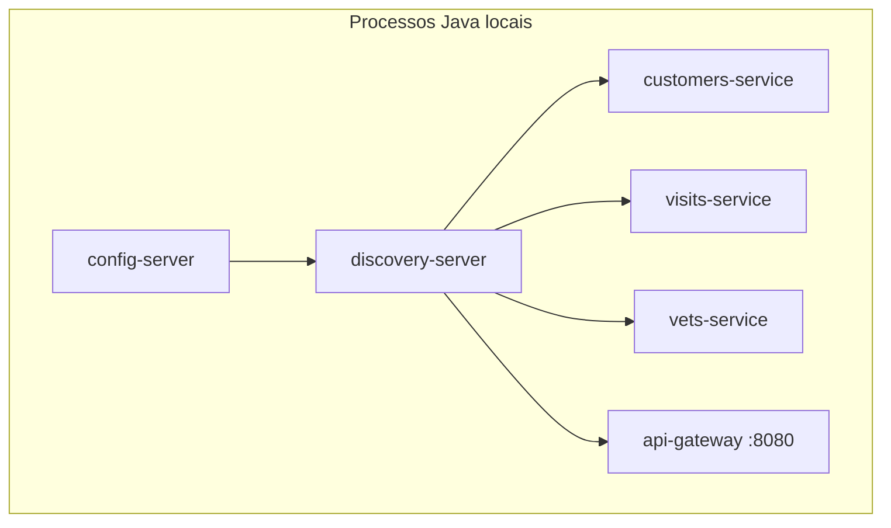

# Ambiente local via IDE / Maven
Cada microsserviço roda como processo Java independente (`../mvnw spring-boot:run` ou execução pela IDE), sem containers. `config-server` e `discovery-server` precisam subir antes dos demais. Tracing (Zipkin), Admin Server, Grafana e Prometheus são opcionais nesse modo. Usa banco HSQLDB embutido por padrão (ver `res-hsqldb-embedded`).

## Implantação

Portas de negócio não são fixadas em `application.yml` neste modo (nenhum `server.port` explícito nos serviços de negócio) — o README instrui checar a porta real pelo painel do Eureka. **Inferido**: a porta efetiva provavelmente vem de variável de ambiente `SERVER_PORT`, cuja origem (perfil, config externo) não está neste repositório.
