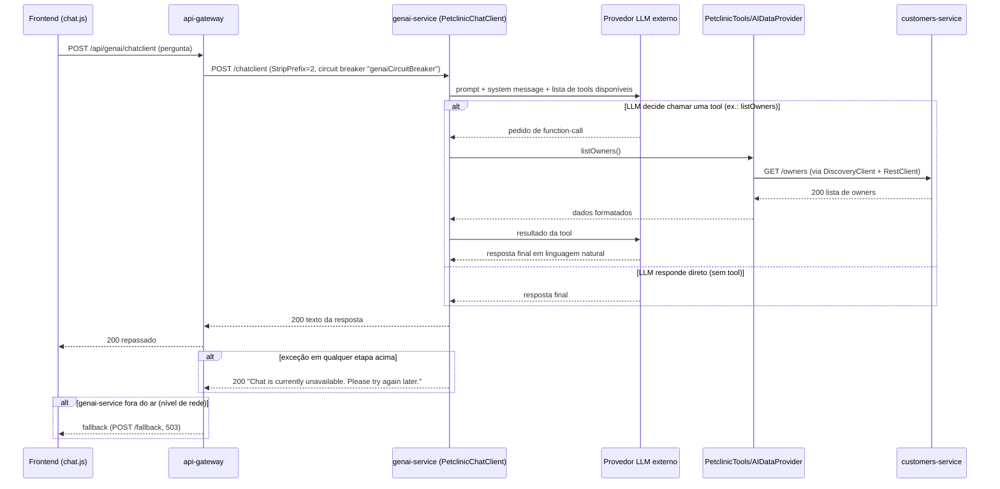
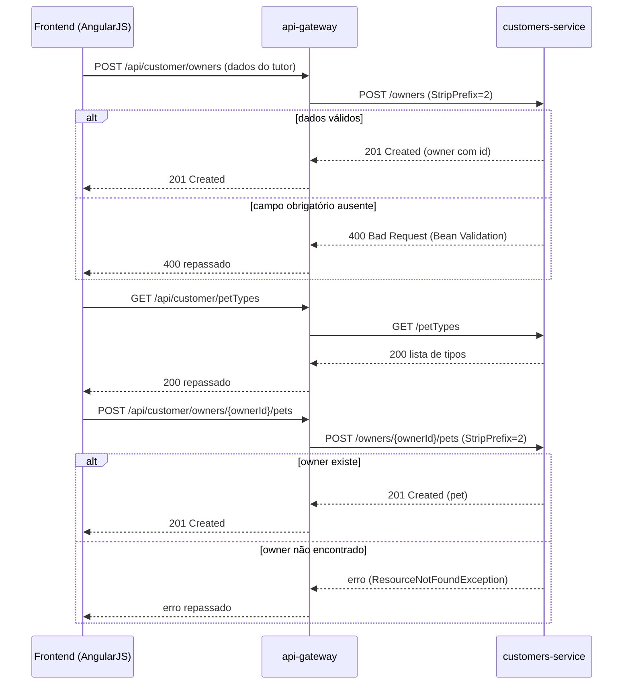
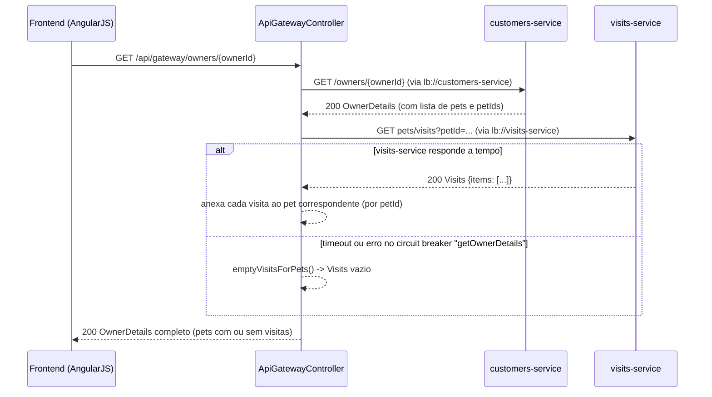
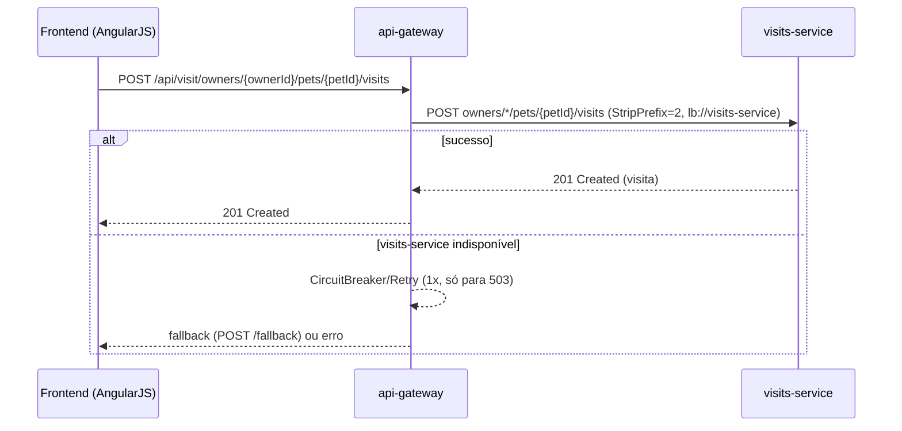

# Contexto do domínio Clínica Veterinária

Gerir o cadastro de tutores e pets, o corpo clínico de veterinários e o histórico de consultas de uma clínica veterinária, oferecendo atendimento tanto por uma tela web quanto por um assistente virtual com IA generativa. Documentação gerada

Legenda: `[id] título (tipo, origem) — resumo`. Origem: extraído = lido nas fontes; inferido = a confirmar.

## 2. Domínio
- [dom-clinica-veterinaria] Domínio Clínica Veterinária (domain, inferido) — Gerir o cadastro de tutores e pets, o corpo clínico de veterinários e o histórico de consultas de uma clínica veterinária, oferecendo atendimento tanto por uma tela web quanto por 

## 1. Negócio
- [cap-atendimento-inteligente] Atender por assistente virtual (IA generativa) (capability, inferido) — A clínica oferece um canal conversacional em que o usuário pergunta ou pede ações sobre tutores, pets e veterinários em linguagem natural, sem precisar navegar pelas telas tradicio | realiza dom-clinica-veterinaria
- [cap-atendimento-omnicanal] Atender o tutor num único canal digital (capability, inferido) — A clínica oferece uma única porta de entrada (tela web) onde o tutor ou a equipe encontram, numa mesma consulta, o cadastro, os pets e o histórico de visitas — sem precisar saber q | realiza dom-clinica-veterinaria
- [cap-cadastro-clientes-pets] Cadastrar e manter clientes e seus pets (capability, inferido) — A clínica consegue cadastrar tutores e seus pets, mantendo esse cadastro atualizado e disponível para todos os demais atendimentos. | realiza dom-clinica-veterinaria
- [cap-gestao-corpo-clinico] Divulgar o corpo clínico e suas especialidades (capability, inferido) — A clínica consegue apresentar, a tutores e à própria equipe, quais veterinários atendem e em quais especialidades — hoje como um catálogo de consulta, sem fluxo de cadastro/edição  | realiza dom-clinica-veterinaria
- [cap-registro-consultas] Registrar e consultar o histórico de consultas (capability, inferido) — A clínica consegue registrar cada consulta realizada em um pet e recuperar esse histórico depois, tanto pet a pet quanto agregado por tutor. | realiza dom-clinica-veterinaria
- [flow-atendimento-assistente-virtual] Atendimento via assistente virtual (flow, inferido) — Permitir que um usuário converse em linguagem natural com um assistente virtual para consultar tutores, pets e veterinários, ou até cadastrar um novo tutor/pet, sem navegar pelas t | realiza cap-atendimento-inteligente
- [flow-cadastro-tutor-pet] Cadastro de tutor e pet (flow, inferido) — Permitir que um novo tutor se cadastre na clínica e registre seus pets, para que a clínica possa atendê-lo e manter o histórico de consultas. | realiza cap-cadastro-clientes-pets
- [flow-consulta-historico-tutor] Consulta de histórico do tutor (flow, inferido) — Permitir que a clínica veja, numa única tela, o tutor, seus pets e o histórico de visitas de cada pet — sem precisar navegar por telas separadas para cada informação. | realiza cap-atendimento-omnicanal, cap-cadastro-clientes-pets
- [flow-registro-consulta] Registro de consulta veterinária (flow, inferido) — Permitir que a equipe da clínica registre a consulta realizada em um pet, formando o histórico clínico que poderá ser consultado depois pelo tutor ou pelo próprio veterinário. | realiza cap-registro-consultas

## 3. Subdomínio
- [flow-atendimento-assistente-virtual-sequencia] Atendimento via assistente virtual: sequência técnica (flow, extraído) — Realiza as etapas do [fluxo macro](./flow-atendimento-assistente-virtual.md). | realiza flow-atendimento-assistente-virtual
- [flow-cadastro-tutor-pet-sequencia] Cadastro de tutor e pet: sequência técnica (flow, extraído) — Realiza as etapas do [fluxo macro](./flow-cadastro-tutor-pet.md). | realiza flow-cadastro-tutor-pet
- [flow-consulta-historico-tutor-sequencia] Consulta de histórico do tutor: sequência técnica (flow, extraído) — Realiza as etapas do [fluxo macro](./flow-consulta-historico-tutor.md). Esta é a única sequência do domínio com um agregador de dados explícito no código (`ApiGatewayController`) e | realiza flow-consulta-historico-tutor
- [flow-registro-consulta-sequencia] Registro de consulta veterinária: sequência técnica (flow, extraído) — Realiza as etapas do [fluxo macro](./flow-registro-consulta.md). | realiza flow-registro-consulta
- [sub-atendimento-digital] Subdomínio Atendimento Digital (subdomain, extraído) — Concentra os canais pelos quais tutores e equipe da clínica interagem com o sistema: a tela web (via `api-gateway`) e o assistente virtual (via `genai-service`). Não guarda dado me | realiza dom-clinica-veterinaria
- [sub-cadastro] Subdomínio Cadastro de Clientes e Pets (subdomain, extraído) — Mantém o cadastro mestre de tutores e seus pets — é a fonte de verdade referenciada por todos os demais subdomínios (consultas referenciam `pet_id`; o assistente virtual lê e escre | realiza dom-clinica-veterinaria
- [sub-consultas] Subdomínio Consultas (subdomain, extraído) — Registra e consulta o histórico de visitas (consultas veterinárias) de cada pet. | realiza dom-clinica-veterinaria
- [sub-corpo-clinico] Subdomínio Corpo Clínico (subdomain, extraído) — Mantém o cadastro (somente leitura via API) de veterinários e suas especialidades. | realiza dom-clinica-veterinaria
- [sub-plataforma] Subdomínio Plataforma (subdomain, extraído) — Serviços de suporte técnico (configuração centralizada, service discovery, administração e observabilidade) que sustentam todos os demais subdomínios, mas não implementam nenhuma c | realiza dom-clinica-veterinaria

## 4. Sistema
- [sys-admin-server] admin-server (system, extraído) — Console de administração (Spring Boot Admin) para observar saúde, métricas e logs dos demais serviços. Não implementa capacidade de negócio. | realiza sub-plataforma
- [ctr-gateway-get-owner-details] GET /api/gateway/owners/{ownerId} (contract, extraído) — Agrega, numa única resposta, o tutor, seus pets e as visitas de cada pet. É o contrato central do fluxo [Consulta de histórico do tutor](../../../fluxos/flow-consulta-historico-tut | realiza cap-atendimento-omnicanal, cap-cadastro-clientes-pets
- [ctr-gateway-post-fallback] POST /fallback (contract, extraído) — Retorna sempre `503 Service Unavailable` com uma mensagem fixa. Usado principalmente quando o `genai-service` está indisponível ("Chat is currently unavailable..."). | realiza cap-atendimento-omnicanal
- [sys-api-gateway] api-gateway (system, extraído) — Porta de entrada única do domínio: serve o frontend AngularJS (tela de tutores, pets, veterinários, visitas e chat) e roteia/agrega chamadas para os serviços de negócio via Spring  | realiza sub-atendimento-digital, cap-atendimento-omnicanal
- [sys-config-server] config-server (system, extraído) — Servidor de configuração centralizada (Spring Cloud Config). Não implementa nenhuma capacidade de negócio da clínica veterinária — é infraestrutura de plataforma consumida por todo | realiza sub-plataforma
- [ctr-customers-get-owner] GET /owners/{ownerId} (contract, extraído) — Retorna um tutor pelo id, incluindo a lista de pets (`Owner.pets`, carregada `EAGER`). É a chamada base do fluxo [Consulta de histórico do tutor](../../../fluxos/flow-consulta-hist | realiza cap-cadastro-clientes-pets
- [ctr-customers-get-owners] GET /owners (contract, extraído) — Lista todos os tutores cadastrados, sem paginação nem filtro. | realiza cap-cadastro-clientes-pets
- [ctr-customers-get-pet] GET owners/*/pets/{petId} (contract, extraído) — Retorna os detalhes de um pet, incluindo o nome completo do tutor (`PetDetails` monta `owner.getFirstName() + " " + owner.getLastName()`). | realiza cap-cadastro-clientes-pets
- [ctr-customers-get-pettypes] GET /petTypes (contract, extraído) — Lista os tipos de pet cadastrados (dado de referência), usados para popular o formulário de cadastro de pet. | realiza cap-cadastro-clientes-pets
- [ctr-customers-post-owners] POST /owners (contract, extraído) — Cria um novo tutor. Retorna `201 Created` com o owner criado (incluindo `id` gerado). | realiza cap-cadastro-clientes-pets
- [ctr-customers-post-pet] POST /owners/{ownerId}/pets (contract, extraído) — Cria um novo pet associado a um tutor existente. IDs de tipo de pet válidos: 1=cat, 2=dog, 3=lizard, 4=snake, 5=bird, 6=hamster (conforme descrição da tool `addPetToOwner` do `gena | realiza cap-cadastro-clientes-pets
- [ctr-customers-put-owner] PUT /owners/{ownerId} (contract, extraído) — Atualiza os dados de um tutor existente. Retorna `204 No Content`. Lança `ResourceNotFoundException` (caminho de erro) se `ownerId` não existir. | realiza cap-cadastro-clientes-pets
- [ctr-customers-put-pet] PUT /owners/*/pets/{petId} (contract, extraído) — Atualiza nome, data de nascimento e tipo de um pet existente. O `ownerId` no path é ignorado (`*`) — o pet é localizado só por `petId`, presente também no corpo (`PetRequest.id`).  | realiza cap-cadastro-clientes-pets
- [sys-customers-service] customers-service (system, extraído) — Mantém o cadastro de tutores (owners) e de seus pets, incluindo os tipos de pet disponíveis (cat, dog, lizard, snake, bird, hamster). | realiza sub-cadastro, cap-cadastro-clientes-pets
- [sys-discovery-server] discovery-server (system, extraído) — Registro de serviços (Netflix Eureka). Não implementa capacidade de negócio — é infraestrutura de plataforma que permite aos demais sistemas se encontrarem por nome lógico (`lb://c | realiza sub-plataforma
- [ctr-genai-post-chatclient] POST /chatclient (contract, extraído) — Recebe uma pergunta em texto livre e devolve a resposta do assistente virtual, já com eventuais ações executadas (ex.: cadastro de owner/pet) via *tool calling*. | realiza cap-atendimento-inteligente
- [sys-genai-service] genai-service (system, extraído) — Assistente virtual (chatbot) baseado em LLM que responde perguntas e executa ações sobre owners, pets e vets em nome do usuário, usando Spring AI. | realiza sub-atendimento-digital, cap-atendimento-inteligente
- [ctr-vets-get-vets] GET /vets (contract, extraído) — Retorna a lista completa de veterinários com suas especialidades. Resposta cacheada em produção (`@Cacheable("vets")`). | realiza cap-gestao-corpo-clinico
- [sys-vets-service] vets-service (system, extraído) — Mantém o cadastro de veterinários e suas especialidades. É um serviço somente leitura do ponto de vista da API (não expõe criação/edição de veterinários). | realiza sub-corpo-clinico, cap-gestao-corpo-clinico
- [ctr-visits-get-visits-batch] GET pets/visits (contract, extraído) — Consulta em lote: recebe uma lista de `petId` na query string (`?petId=1&petId=2...`, unidos por vírgula pelo cliente) e retorna todas as visitas desses pets, agrupadas no envelope | realiza cap-registro-consultas
- [ctr-visits-get-visits-by-pet] GET owners/*/pets/{petId}/visits (contract, extraído) — Lista as visitas de um único pet. | realiza cap-registro-consultas
- [ctr-visits-post-visit] POST owners/*/pets/{petId}/visits (contract, extraído) — Registra uma nova visita para um pet. O `petId` do path sobrescreve o campo do corpo (`visit.setPetId(petId)`). Retorna `201 Created`. | realiza cap-registro-consultas
- [sys-visits-service] visits-service (system, extraído) — Registra e consulta as visitas (consultas veterinárias) de cada pet. | realiza sub-consultas, cap-registro-consultas

## 5. Componente
- [cmp-admin-server-app] SpringBootAdminApplication (component, extraído) —  | realiza sys-admin-server
- [cmp-gateway-controller] ApiGatewayController (component, extraído) — Endpoint de agregação (padrão *Backend for Frontend*) que junta owner + pets + visitas numa única resposta, evitando que o frontend faça 3 chamadas separadas. | realiza sys-api-gateway
- [cmp-gateway-routes] Rotas do Spring Cloud Gateway (component, extraído) — Proxy reverso declarativo que encaminha chamadas do frontend para os serviços de negócio, resolvendo o host via Eureka (`lb://`). | realiza sys-api-gateway
- [cmp-config-server-app] ConfigServerApplication (component, extraído) —  | realiza sys-config-server
- [cmp-customers-owner-api] OwnerResource (component, extraído) — Endpoint REST para criar, consultar e atualizar tutores (owners). | realiza sys-customers-service
- [cmp-customers-pet-api] PetResource (component, extraído) — Endpoint REST para tipos de pet e para criar/consultar/atualizar pets de um tutor. | realiza sys-customers-service
- [cmp-discovery-server-app] DiscoveryServerApplication (component, extraído) —  | realiza sys-discovery-server
- [cmp-genai-chat-api] PetclinicChatClient (component, extraído) — Endpoint que recebe a pergunta do usuário em texto livre e a repassa ao LLM configurado, com um prompt de sistema fixo e ferramentas (`PetclinicTools`) que o modelo pode invocar. | realiza sys-genai-service
- [cmp-genai-tools] PetclinicTools / AIDataProvider (component, extraído) — Conjunto de "ferramentas" (`@Tool`) que o LLM pode chamar durante a conversa, e o provedor que de fato executa essas chamadas contra os serviços de negócio. | realiza sys-genai-service
- [cmp-genai-vectorstore-loader] VectorStoreController (component, extraído) — Carrega os dados dos veterinários no vector store em memória, para permitir busca semântica pela tool `listVets`. | realiza sys-genai-service
- [cmp-vets-vet-api] VetResource (component, extraído) — Endpoint REST único que lista veterinários com suas especialidades. | realiza sys-vets-service
- [cmp-visits-visit-api] VisitResource (component, extraído) — Endpoint REST para criar e consultar visitas (consultas veterinárias) de um pet. | realiza sys-visits-service

## 6. Infraestrutura
- [env-local-docker] Ambiente local via Docker Compose (environment, extraído) — Sobe toda a stack (serviços de negócio + plataforma + observabilidade) em containers na mesma máquina, para desenvolvimento e demonstração. Não há evidência neste repositório de um
- [env-local-ide] Ambiente local via IDE / Maven (environment, extraído) — Cada microsserviço roda como processo Java independente (`../mvnw spring-boot:run` ou execução pela IDE), sem containers. `config-server` e `discovery-server` precisam subir antes 
- [res-grafana-prometheus] Grafana + Prometheus (métricas) (resource, extraído) — Todos os serviços Spring Boot do domínio expõem métricas via `micrometer-registry-prometheus` (dependência presente nos `pom.xml`), consumidas pelo Prometheus e visualizadas no Gra | realiza sub-plataforma
- [res-hsqldb-embedded] Banco HSQLDB embutido (dev/teste) (resource, extraído) — Cada serviço de dados (`customers-service`, `vets-service`, `visits-service`) inicializa seu próprio banco HSQLDB em memória ao subir, populado com dados de exemplo (`data.sql`). N | realiza sys-customers-service, sys-vets-service, sys-visits-service
- [res-mysql-customers] Banco MySQL — customers-service (resource, extraído) — O schema e a massa de dados MySQL existem no código (driver `mysql-connector-j` no `pom.xml`), mas **nenhum arquivo deste repositório define host, credenciais ou string de conexão* | realiza sys-customers-service
- [res-mysql-vets] Banco MySQL — vets-service (resource, extraído) —  | realiza sys-vets-service
- [res-mysql-visits] Banco MySQL — visits-service (resource, extraído) — A tabela `visits` declara `FOREIGN KEY (pet_id) REFERENCES pets(id)`, mas `pets` vive no banco do `customers-service`. Em uma topologia de um banco MySQL por serviço, essa FK não p | realiza sys-visits-service
- [res-tracing-server] Servidor de tracing distribuído (Zipkin) (resource, extraído) —  | realiza sub-plataforma

## Transversal
- [term-pet] Pet (term, extraído) — Animal de estimação vinculado a um tutor, com nome, data de nascimento e um tipo (`PetType`). É o sujeito das visitas/consultas registradas em `visits-service`.
- [term-tutor-owner] Tutor (Owner) (term, extraído) — Pessoa responsável por um ou mais pets cadastrados na clínica. No código é chamado de `Owner` (nome, sobrenome, endereço, cidade, telefone e a lista de pets).
- [term-veterinario-especialidade] Veterinário / Especialidade (term, extraído) — Veterinário (`Vet`): profissional da clínica, com nome e uma ou mais especialidades. Especialidade (`Specialty`): área de atuação do veterinário (ex.: radiologia — visto em dado de
- [term-visita-consulta] Visita / Consulta (term, extraído) — Registro de um atendimento veterinário prestado a um pet, com data e descrição textual (até 8192 caracteres). No código é chamado de `Visit`. Usamos "visita" e "consulta" como sinô
- [pad-metricas-timed] Controllers anotados com @Timed("petclinic.<recurso>") (standard, extraído) — Cada controller REST de negócio é anotado com `@Timed` do Micrometer, usando o padrão de nome `petclinic.<recurso>` (`petclinic.owner`, `petclinic.pet`, `petclinic.visit`), exporta
- [pad-service-discovery-lb] Chamadas entre serviços sempre via nome lógico + Eureka (standard, extraído) — Nenhum sistema deste domínio chama outro por host/IP fixo. Todas as chamadas HTTP entre sistemas usam o nome lógico do serviço (`http://customers-service/...`, `http://vets-service
- [reg-degradacao-visitas] A tela do tutor nunca falha por causa do histórico de visitas (rule, extraído) — Se a busca do histórico de visitas (`visits-service`) falhar ou ficar lenta, o `api-gateway` exibe o tutor e seus pets normalmente, apenas com a lista de visitas vazia — em vez de 
- [reg-limite-descricao-visita] Descrição da visita limitada a 8192 caracteres (rule, extraído) — A descrição de uma visita (`Visit.description`) é validada com `@Size(max = 8192)` e a coluna do banco é `VARCHAR(8192)`.
- [reg-memoria-conversa] O assistente virtual lembra até 10 mensagens anteriores (rule, extraído) — O `MessageChatMemoryAdvisor` é configurado com `.order(10)` — o contexto de conversa considerado pelo LLM cobre até as últimas 10 mensagens. Implementação de armazenamento da memór
- [reg-telefone-formato] Telefone do tutor deve ter até 12 dígitos, sem formatação (rule, extraído) — O telefone do tutor é validado com `@Digits(fraction = 0, integer = 12)` — só dígitos, sem parte fracionária, no máximo 12 caracteres numéricos. O campo também é obrigatório (`@Not
- [reg-tipos-de-pet] Um pet só pode ter um dos tipos cadastrados (rule, extraído) — Todo pet deve ter um `typeId` que exista na tabela `types`/entidade `PetType`. Os valores observados (via `data.sql` e a descrição da tool `addPetToOwner` do `genai-service`) são: 

## Sequências (passo a passo técnico)
### Atendimento via assistente virtual: sequência técnica [flow-atendimento-assistente-virtual-sequencia]

### Cadastro de tutor e pet: sequência técnica [flow-cadastro-tutor-pet-sequencia]

### Consulta de histórico do tutor: sequência técnica [flow-consulta-historico-tutor-sequencia]

### Registro de consulta veterinária: sequência técnica [flow-registro-consulta-sequencia]

