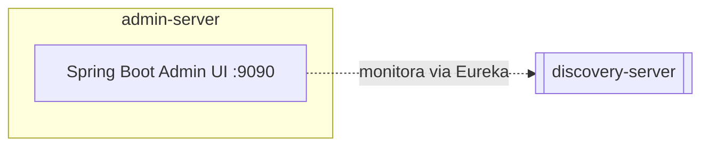

# admin-server
Console de administração (Spring Boot Admin) para observar saúde, métricas e logs dos demais serviços. Não implementa capacidade de negócio.

| Campo | Valor |
|---|---|
| Subdomínio | [Plataforma](../../subdominios/sub-plataforma.md) |
| Dono | não informado — a confirmar |
| Stack | Java 17+, Spring Boot 4.0.1, Spring Boot Admin Server |
| Repositório | `spring-petclinic-admin-server/` |
| Criticidade | baixa (opcional — README indica que sua subida é opcional) |

## Contêineres

## Expõe
| Contrato | Tipo | Detalhe |
|---|---|---|
| UI de administração (`/`) | interface web | não documentado neste repositório |

## Dados
Não possui banco; consulta os endpoints Actuator dos demais serviços em tempo real.
