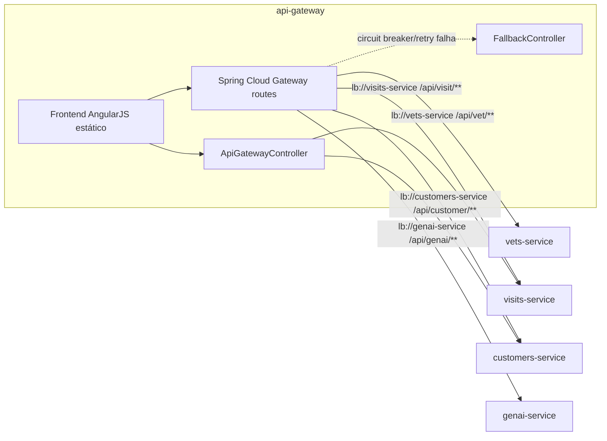

# api-gateway
Porta de entrada única do domínio: serve o frontend AngularJS (tela de tutores, pets, veterinários, visitas e chat) e roteia/agrega chamadas para os serviços de negócio via Spring Cloud Gateway.

| Campo | Valor |
|---|---|
| Subdomínio | [Atendimento Digital](../../subdominios/sub-atendimento-digital.md) |
| Dono | não informado — a confirmar |
| Stack | Java 17+, Spring Boot 4.0.1, Spring Cloud Gateway (WebFlux), Spring Cloud Circuit Breaker (Resilience4j), AngularJS 1.x (frontend estático embutido) |
| Repositório | `spring-petclinic-api-gateway/` |
| Criticidade | alta (inferido — é o único ponto de entrada externo do domínio; se cair, nenhum canal funciona) |

## Contêineres

## Expõe
| Contrato | Tipo | Detalhe |
|---|---|---|
| `GET /api/gateway/owners/{ownerId}` | API REST (agregação) | [ctr-gateway-get-owner-details](contratos/ctr-gateway-get-owner-details.md) |
| `POST /fallback` | API REST (fallback de circuit breaker) | [ctr-gateway-post-fallback](contratos/ctr-gateway-post-fallback.md) |
| `/api/vet/**`, `/api/visit/**`, `/api/customer/**`, `/api/genai/**` | Roteamento (proxy reverso via Eureka `lb://`) | encaminha, com `StripPrefix=2`, para os contratos próprios de cada serviço (ver fichas de `vets-service`, `visits-service`, `customers-service`, `genai-service`) |

Não há OpenAPI neste serviço; contratos extraídos de `application.yml` (rotas) e dos controllers Java.

## Consome
| Sistema | Contrato | Tipo |
|---|---|---|
| `customers-service` | [ctr-customers-get-owner](../customers-service/contratos/ctr-customers-get-owner.md) e demais endpoints `/owners/**`, `/petTypes` | API REST síncrona, via `lb://customers-service` |
| `visits-service` | [ctr-visits-get-visits-batch](../visits-service/contratos/ctr-visits-get-visits-batch.md) e demais endpoints `/api/visit/**` | API REST síncrona, via `lb://visits-service` |
| `vets-service` | [ctr-vets-get-vets](../vets-service/contratos/ctr-vets-get-vets.md) | API REST síncrona, via `lb://vets-service` |
| `genai-service` | `POST /api/genai/chatclient` (roteado) | API REST síncrona, via `lb://genai-service` |
| discovery-server | registro/descoberta Eureka | infraestrutura |
| config-server | propriedades externas | infraestrutura |

## Dados
Este sistema não possui banco próprio nem entidades persistentes — trabalha apenas com DTOs de agregação em memória (`OwnerDetails`, `PetDetails`, `VisitDetails`, `Visits`, todos em `org.springframework.samples.petclinic.api.dto`), espelhando as entidades dos serviços de origem.

## Qualidade
- `CircuitBreaker` (Resilience4j) aplicado a todas as rotas por padrão (`default-filters`), com `fallbackUri: forward:/fallback`; a rota `/api/genai/**` tem um circuit breaker nomeado adicional (`genaiCircuitBreaker`).
- `Retry` padrão: 1 retentativa, só para respostas `SERVICE_UNAVAILABLE` em métodos `POST`.
- No endpoint de agregação `GET /api/gateway/owners/{ownerId}`, se a chamada a `visits-service` falhar, o circuit breaker devolve uma lista de visitas vazia (`emptyVisitsForPets`) em vez de propagar o erro — o tutor e os pets ainda aparecem, sem visitas.
