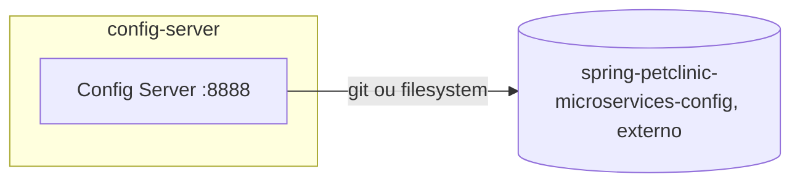

# config-server
Servidor de configuração centralizada (Spring Cloud Config). Não implementa nenhuma capacidade de negócio da clínica veterinária — é infraestrutura de plataforma consumida por todos os outros sistemas.

| Campo | Valor |
|---|---|
| Subdomínio | [Plataforma](../../subdominios/sub-plataforma.md) |
| Dono | não informado — a confirmar |
| Stack | Java 17+, Spring Boot 4.0.1, Spring Cloud Config Server |
| Repositório | `spring-petclinic-config-server/` |
| Criticidade | crítica (inferido — todos os demais serviços dependem dele para subir: `depends_on: condition: service_healthy` no `docker-compose.yml`) |

## Contêineres

## Expõe
| Contrato | Tipo | Detalhe |
|---|---|---|
| API do Spring Cloud Config (`/{application}/{profile}`) | API REST (padrão do framework) | não documentado neste repositório; consumida via `spring.config.import: configserver:...` pelos demais serviços |

## Consome
- Repositório Git externo `https://github.com/spring-petclinic/spring-petclinic-microservices-config` (branch `main`), ou um diretório local via perfil `native` + variável `GIT_REPO`. **Este repositório de configuração não faz parte do escopo lido nesta documentação** — é a provável fonte real das credenciais de banco, URLs de produção e segredos (ver RELATORIO.md).

## Dados
Não possui banco próprio; serve arquivos de configuração de um repositório Git/filesystem externo.

## Qualidade
- Porta fixa `8888` (único serviço com `server.port` explícito neste repositório).
- Health check via `curl -I http://config-server:8888` no `docker-compose.yml`, com 10 tentativas a cada 5s.
