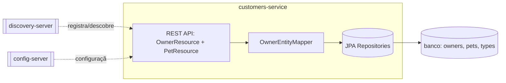
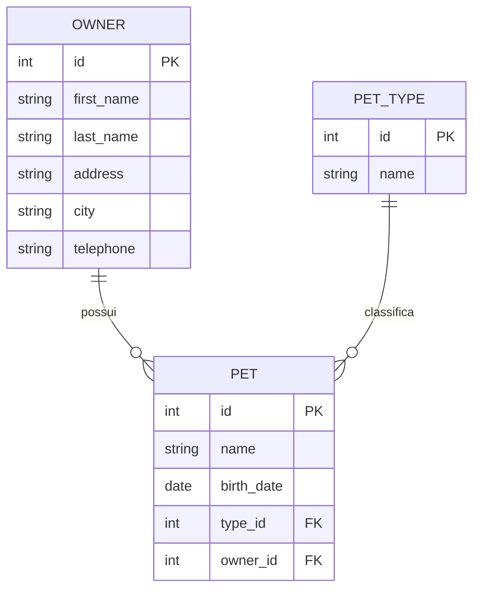

# customers-service
Mantém o cadastro de tutores (owners) e de seus pets, incluindo os tipos de pet disponíveis (cat, dog, lizard, snake, bird, hamster).

| Campo | Valor |
|---|---|
| Subdomínio | [Cadastro de Clientes e Pets](../../subdominios/sub-cadastro.md) |
| Dono | não informado (sem `CODEOWNERS` no repositório) — a confirmar |
| Stack | Java 17+, Spring Boot 4.0.1, Spring Cloud (Eureka Client, Config Client), Spring Data JPA |
| Repositório | `spring-petclinic-customers-service/` (módulo Maven deste monorepo) |
| Criticidade | alta (inferido — é a fonte de verdade de owners/pets, usada pelo `api-gateway`, `visits-service` (referência de `pet_id`) e `genai-service`); valor de SLA não confirmado |

## Contêineres

## Expõe
| Contrato | Tipo | Detalhe |
|---|---|---|
| `POST /owners` | API REST | [ctr-customers-post-owners](contratos/ctr-customers-post-owners.md) |
| `GET /owners/{ownerId}` | API REST | [ctr-customers-get-owner](contratos/ctr-customers-get-owner.md) |
| `GET /owners` | API REST | [ctr-customers-get-owners](contratos/ctr-customers-get-owners.md) |
| `PUT /owners/{ownerId}` | API REST | [ctr-customers-put-owner](contratos/ctr-customers-put-owner.md) |
| `GET /petTypes` | API REST | [ctr-customers-get-pettypes](contratos/ctr-customers-get-pettypes.md) |
| `POST /owners/{ownerId}/pets` | API REST | [ctr-customers-post-pet](contratos/ctr-customers-post-pet.md) |
| `PUT /owners/*/pets/{petId}` | API REST | [ctr-customers-put-pet](contratos/ctr-customers-put-pet.md) |
| `GET /owners/*/pets/{petId}` | API REST | [ctr-customers-get-pet](contratos/ctr-customers-get-pet.md) |

Não há OpenAPI/Swagger neste repositório para este serviço — os contratos abaixo foram extraídos diretamente dos controllers (`extracted`).

## Consome
| Sistema | Contrato | Tipo |
|---|---|---|
| discovery-server | registro/descoberta Eureka | infraestrutura |
| config-server | propriedades externas (`optional:configserver:...`) | infraestrutura |

Este serviço não chama nenhum outro sistema de negócio — é uma folha na topologia de chamadas síncronas.

## Dados

Fonte: `src/main/resources/db/mysql/schema.sql` (tabelas `owners`, `pets`, `types`) e entidades JPA `Owner`, `Pet`, `PetType`. `pets.owner_id` e `pets.type_id` têm `FOREIGN KEY` no MySQL. Tipos de pet são dados de referência carregados por `data.sql` (ex.: cat, dog, lizard, snake, bird, hamster — confirmado também pela descrição da tool `addPetToOwner` do `genai-service`).

## Qualidade
- Validação de entrada: `@NotBlank` em nome/endereço/cidade/telefone do owner; `@Digits(fraction=0, integer=12)` no telefone (até 12 dígitos, sem fração); `@Min(1)` em ids de path; `@Size(min=1)` no nome do pet.
- `ResourceNotFoundException` (não mostrado aqui em detalhe) é lançada quando owner ou pet não existem — mapeada presumivelmente para HTTP 404 (`inferred`, o handler de exceção não foi localizado nas fontes lidas).
- Métricas: todos os endpoints são anotados com `@Timed("petclinic.owner")` / `@Timed("petclinic.pet")` (Micrometer).
- Sem timeout, retry ou circuit breaker configurado neste serviço (ele é sempre o lado "servidor" das chamadas síncronas do domínio).
