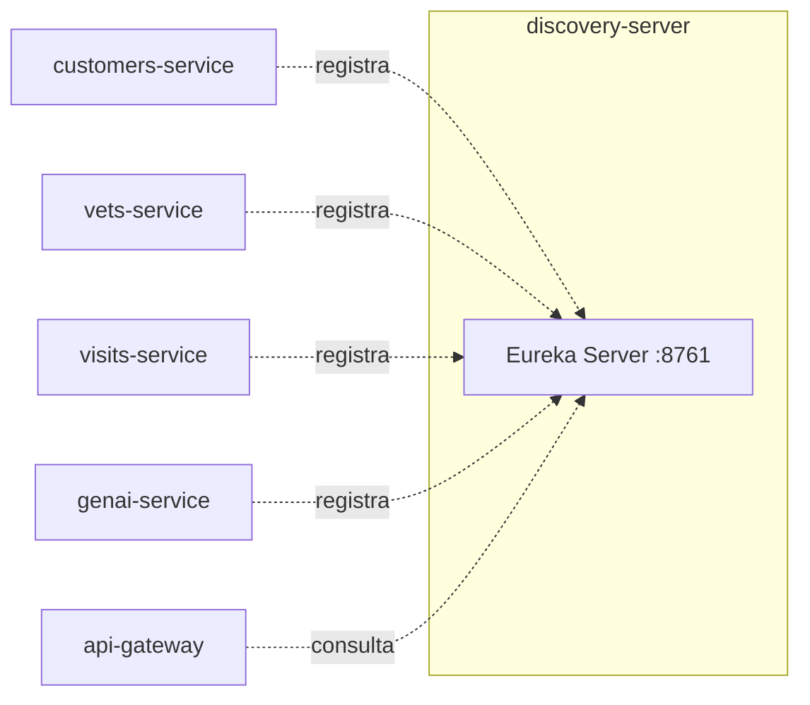

# discovery-server
Registro de serviços (Netflix Eureka). Não implementa capacidade de negócio — é infraestrutura de plataforma que permite aos demais sistemas se encontrarem por nome lógico (`lb://customers-service`, etc.).

| Campo | Valor |
|---|---|
| Subdomínio | [Plataforma](../../subdominios/sub-plataforma.md) |
| Dono | não informado — a confirmar |
| Stack | Java 17+, Spring Boot 4.0.1, Spring Cloud Netflix Eureka Server |
| Repositório | `spring-petclinic-discovery-server/` |
| Criticidade | crítica (inferido — sem ele, `api-gateway` e `genai-service` não conseguem resolver os demais serviços por nome) |

## Contêineres

## Expõe
| Contrato | Tipo | Detalhe |
|---|---|---|
| Dashboard/API Eureka (`/eureka/**`) | API REST (padrão do framework) | não documentado neste repositório |

## Dados
Não possui banco; mantém em memória o registro de instâncias vivas.

## Qualidade
- Health check via `curl -f http://discovery-server:8761`, depende de `config-server` saudável antes de subir.
