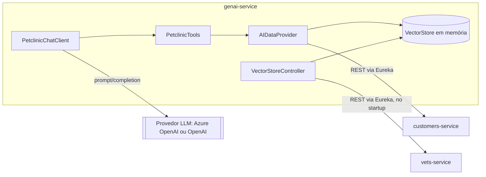

# genai-service
Assistente virtual (chatbot) baseado em LLM que responde perguntas e executa ações sobre owners, pets e vets em nome do usuário, usando Spring AI.

| Campo | Valor |
|---|---|
| Subdomínio | [Atendimento Digital](../../subdominios/sub-atendimento-digital.md) |
| Dono | não informado — a confirmar |
| Stack | Java 17+, Spring Boot 4.0.1 (reativo), Spring AI (`ChatClient`, `VectorStore`), Spring Cloud (Eureka Client, Config Client, LoadBalancer) |
| Repositório | `spring-petclinic-genai-service/` |
| Criticidade | baixa/média (inferido — funcionalidade adicional de atendimento; sua indisponibilidade tem fallback dedicado no `api-gateway`) |

## Contêineres

## Expõe
| Contrato | Tipo | Detalhe |
|---|---|---|
| `POST /chatclient` | API REST | [ctr-genai-post-chatclient](contratos/ctr-genai-post-chatclient.md) |

## Consome
| Sistema | Contrato | Tipo |
|---|---|---|
| `customers-service` | `GET /owners`, `POST /owners`, `POST /owners/{ownerId}/pets` | API REST síncrona, via `DiscoveryClient` + `RestClient` |
| `vets-service` | `GET /vets` | API REST síncrona, via `WebClient`, apenas no `ApplicationStartedEvent` (carga do vector store) |
| provedor de LLM externo (Azure OpenAI ou OpenAI) | Chat Completions | API REST externa |
| discovery-server | registro/descoberta Eureka | infraestrutura |
| config-server | propriedades externas | infraestrutura |

## Dados
Não possui banco próprio. Mantém em memória:
- **Vector store** (`SimpleVectorStore`, biblioteca Spring AI): embeddings dos veterinários, usados para busca semântica pela tool `listVets`. Pré-carregado de `src/main/resources/vectorstore.json` quando o arquivo existe (evita custo de reprocessar embeddings); caso contrário, é reconstruído a partir de `GET /vets` no `vets-service` a cada subida (`VectorStoreController`).
- **Memória de conversa** (`ChatMemory`, injetada em `PetclinicChatClient`) — mantém contexto de até as últimas 10 mensagens (`.order(10)` no `MessageChatMemoryAdvisor`); implementação e persistência não detalhadas nas fontes lidas (**inferido**: provavelmente em memória, perdida a cada restart).

## Qualidade
- Segredos: `AZURE_OPENAI_KEY`, `OPENAI_API_KEY` são lidos de variáveis de ambiente (`application.yml`) — **não copiados aqui**, ver RELATORIO.md.
- Erros do `ChatClient` (chamada ao LLM) são capturados em `PetclinicChatClient.exchange` e retornam a mensagem "Chat is currently unavailable. Please try again later." em vez de propagar exceção.
- Rota do `api-gateway` para este serviço (`/api/genai/**`) tem um circuit breaker nomeado (`genaiCircuitBreaker`) além do padrão, sinalizando maior expectativa de falha/latência deste serviço (chamada a LLM externo).
- Modelo padrão: `gpt-4o` (Azure) ou `gpt-4o-mini` (OpenAI), `temperature: 0.7`.
