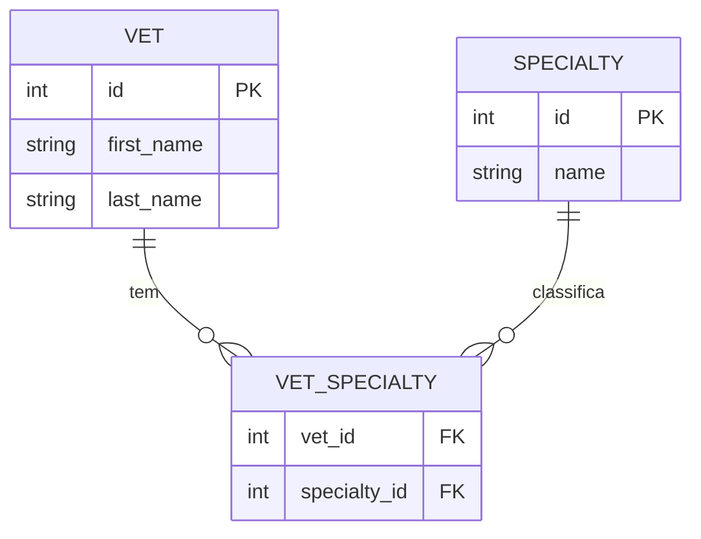

# vets-service
Mantém o cadastro de veterinários e suas especialidades. É um serviço somente leitura do ponto de vista da API (não expõe criação/edição de veterinários).

| Campo | Valor |
|---|---|
| Subdomínio | [Corpo Clínico](../../subdominios/sub-corpo-clinico.md) |
| Dono | não informado — a confirmar |
| Stack | Java 17+, Spring Boot 4.0.1, Spring Cloud (Eureka Client, Config Client), Spring Data JPA, Spring Cache |
| Repositório | `spring-petclinic-vets-service/` |
| Criticidade | média (inferido — consultado pelo `api-gateway`/frontend e pelo `genai-service`, mas os dados são estáticos e cacheados) |

## Contêineres
```mermaid
flowchart LR
  subgraph vets-service
    API[REST API: VetResource] --> CACHE[[cache "vets"]]
    CACHE --> REPO[(VetRepository)]
  end
  REPO --> DB[(banco: vets, specialties, vet_specialties)]
```

## Expõe
| Contrato | Tipo | Detalhe |
|---|---|---|
| `GET /vets` | API REST | [ctr-vets-get-vets](contratos/ctr-vets-get-vets.md) |

## Consome
| Sistema | Contrato | Tipo |
|---|---|---|
| discovery-server | registro/descoberta Eureka | infraestrutura |
| config-server | propriedades externas | infraestrutura |

## Dados

Fonte: `db/mysql/schema.sql` (tabelas `vets`, `specialties`, `vet_specialties` — tabela de junção many-to-many com `UNIQUE(vet_id, specialty_id)`) e entidades `Vet`, `Specialty`.

## Qualidade
- `GET /vets` é anotado `@Cacheable("vets")`; o cache só é habilitado no perfil `production` (`CacheConfig`, `@Profile("production")`) e é definido em `application.yml` (`spring.cache.cache-names: vets`) — em testes o cache fica desabilitado.
- Sem timeout/retry configurado neste serviço (é sempre o lado servidor).
- Sem paginação nem filtro no endpoint — retorna sempre a lista completa.
