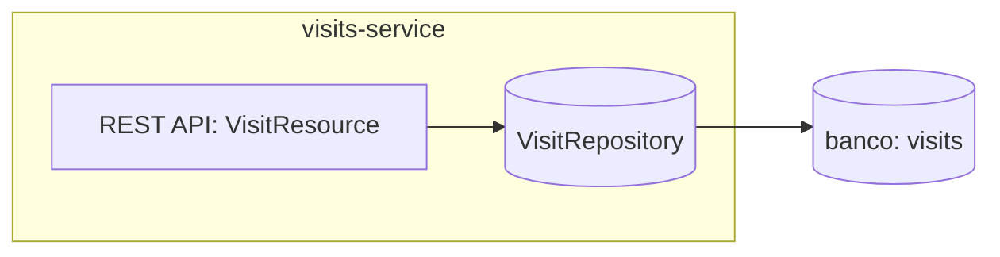
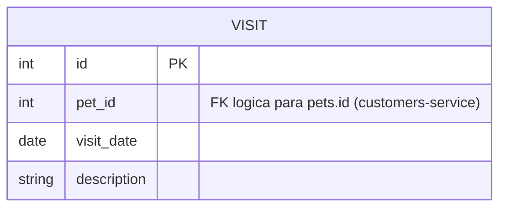

# visits-service
Registra e consulta as visitas (consultas veterinárias) de cada pet.

| Campo | Valor |
|---|---|
| Subdomínio | [Consultas](../../subdominios/sub-consultas.md) |
| Dono | não informado — a confirmar |
| Stack | Java 17+, Spring Boot 4.0.1, Spring Cloud (Eureka Client, Config Client), Spring Data JPA |
| Repositório | `spring-petclinic-visits-service/` |
| Criticidade | alta (inferido — é a fonte de verdade do histórico clínico) |

## Contêineres

## Expõe
| Contrato | Tipo | Detalhe |
|---|---|---|
| `POST owners/*/pets/{petId}/visits` | API REST | [ctr-visits-post-visit](contratos/ctr-visits-post-visit.md) |
| `GET owners/*/pets/{petId}/visits` | API REST | [ctr-visits-get-visits-by-pet](contratos/ctr-visits-get-visits-by-pet.md) |
| `GET pets/visits` | API REST | [ctr-visits-get-visits-batch](contratos/ctr-visits-get-visits-batch.md) |

## Consome
| Sistema | Contrato | Tipo |
|---|---|---|
| discovery-server | registro/descoberta Eureka | infraestrutura |
| config-server | propriedades externas | infraestrutura |

`visits-service` **não chama** `customers-service` para validar se o `petId` recebido existe de fato — grava o `pet_id` sem verificação cruzada (`inferred` a partir da ausência de qualquer `WebClient`/`RestClient` no código deste serviço). A consistência entre pet e visita é responsabilidade de quem chama (o `api-gateway`, indiretamente).

## Dados

Fonte: `db/mysql/schema.sql` (tabela `visits`, com `FOREIGN KEY (pet_id) REFERENCES pets(id)` — mas `pets` vive fisicamente no banco do `customers-service`; ver nota em `res-mysql-visits`). `description` é limitado a 8192 caracteres (`@Size(max = 8192)`).

## Qualidade
- `@Min(1)` no `petId` de path.
- `@Size(max = 8192)` na descrição da visita.
- Métricas: `@Timed("petclinic.visit")`.
- Sem timeout/retry configurado neste serviço (lado servidor).
