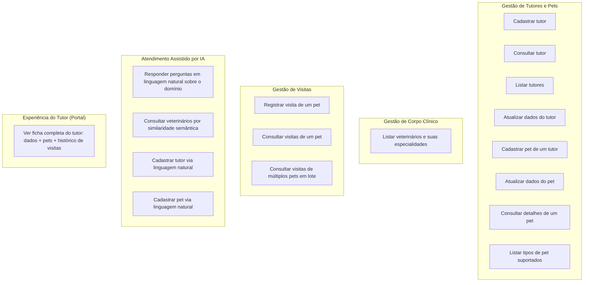

# Capacidades de Negócio — Domínio Clínica Veterinária

> Levantado a partir dos controllers REST, modelos JPA e regras de validação encontrados no código de cada serviço. Cada capacidade lista o serviço "dono" dos dados/regra e a evidência no código.

## Mapa de capacidades

## 1. Gestão de Tutores e Pets (`customers-service`)

Serviço dono do cadastro mestre de **Owners** (tutores) e **Pets**.

| Capacidade | Descrição de negócio | Evidência (código) |
|---|---|---|
| Cadastrar tutor | Cria um novo tutor com nome, endereço, cidade e telefone | `OwnerResource.createOwner` (`POST /owners`) |
| Consultar tutor | Busca um tutor por ID, incluindo a lista de seus pets | `OwnerResource.findOwner` (`GET /owners/{ownerId}`) |
| Listar tutores | Lista todos os tutores cadastrados | `OwnerResource.findAll` (`GET /owners`) |
| Atualizar dados do tutor | Atualiza nome, endereço, cidade e telefone de um tutor existente | `OwnerResource.updateOwner` (`PUT /owners/{ownerId}`) |
| Cadastrar pet de um tutor | Associa um novo pet (nome, data de nascimento, tipo) a um tutor existente | `PetResource.processCreationForm` (`POST /owners/{ownerId}/pets`) |
| Atualizar dados do pet | Atualiza nome, data de nascimento e tipo de um pet | `PetResource.processUpdateForm` (`PUT /owners/*/pets/{petId}`) |
| Consultar detalhes de um pet | Retorna nome, tutor, data de nascimento e tipo de um pet específico | `PetResource.findPet` (`GET owners/*/pets/{petId}`) |
| Listar tipos de pet suportados | Retorna o catálogo de espécies (cachorro, gato, etc.) usado para classificar pets | `PetResource.getPetTypes` (`GET /petTypes`) |

**Regras de negócio observadas:**
- Nome, sobrenome, endereço, cidade e telefone do tutor são obrigatórios (`@NotBlank`).
- Telefone deve ser numérico, com até 12 dígitos (`@Digits(fraction=0, integer=12)`).
- Um tutor pode ter múltiplos pets (`@OneToMany` `Owner → Pet`), carregados sempre junto (`FetchType.EAGER`) e ordenados por nome.
- Cada pet pertence a exatamente um tutor e a exatamente um tipo (`PetType`).
- IDs de tutor e pet devem ser >= 1 (`@Min(1)`) nos endpoints que recebem `ownerId`/`petId` via URL.
- Buscar um tutor ou pet inexistente resulta em erro de negócio explícito (`ResourceNotFoundException`).

## 2. Gestão de Corpo Clínico (`vets-service`)

Serviço dono do cadastro de **Veterinários** e suas **Especialidades**.

| Capacidade | Descrição de negócio | Evidência (código) |
|---|---|---|
| Listar veterinários e suas especialidades | Retorna todos os veterinários cadastrados, cada um com a lista ordenada de especialidades (ex.: radiologia, cirurgia, dentística) | `VetResource.showResourcesVetList` (`GET /vets`) |

**Regras de negócio observadas:**
- Nome e sobrenome do veterinário são obrigatórios (`@NotBlank`).
- Um veterinário pode ter zero, uma ou várias especialidades (`@ManyToMany` via tabela `vet_specialties`), retornadas ordenadas por nome.
- A lista de veterinários é cacheada (`@Cacheable("vets")`, cache habilitado apenas no perfil `production`) — é tratada como dado de leitura pesada e de baixa volatilidade, adequado para consulta de IA (RAG) e telas de listagem.
- Não há endpoint de escrita (criação/edição de veterinário) exposto neste serviço — o cadastro de veterinários é somente leitura pela API pública atual.

## 3. Gestão de Visitas (`visits-service`)

Serviço dono do histórico de **Visitas/Consultas** de cada pet.

| Capacidade | Descrição de negócio | Evidência (código) |
|---|---|---|
| Registrar visita de um pet | Cria uma nova visita associada a um pet, com data e descrição do atendimento | `VisitResource.create` (`POST owners/*/pets/{petId}/visits`) |
| Consultar visitas de um pet | Lista o histórico de visitas de um pet específico | `VisitResource.read` (`GET owners/*/pets/{petId}/visits`) |
| Consultar visitas de múltiplos pets em lote | Retorna as visitas de vários pets de uma vez, dado um conjunto de `petId` — usado para montar a ficha agregada do tutor | `VisitResource.read` (`GET pets/visits?petId=...`) |

**Regras de negócio observadas:**
- Uma visita sempre pertence a um pet (`pet_id` obrigatório), mas o vínculo é lógico — não há chave estrangeira de banco entre o schema de `visits-service` e o de `customers-service` (são bases de dados separadas por serviço).
- Data da visita tem valor padrão "agora" se não informada (`Date date = new Date()`), mas é normalmente enviada pelo cliente.
- Descrição da visita é limitada a 8192 caracteres.
- `petId` na URL deve ser >= 1 (`@Min(1)`).

## 4. Atendimento Assistido por IA (`genai-service`)

Capacidade transversal de negócio: um assistente conversacional que **usa** as capacidades acima como ferramentas (function calling), sem ser dono de dados próprios de owners/pets/vets (exceto o índice vetorial de veterinários usado para busca semântica).

| Capacidade | Descrição de negócio | Evidência (código) |
|---|---|---|
| Responder perguntas em linguagem natural sobre o domínio | Ponto único de entrada de chat (`/chatclient`) que interpreta a pergunta do usuário e decide quais ferramentas acionar | `PetclinicChatClient.exchange` |
| Consultar veterinários por similaridade semântica | Busca vetorial (RAG) sobre um índice de veterinários pré-carregado, com top-K configurável (20 resultados por padrão, 50 se a pergunta não tiver critério) | `PetclinicTools.listVets` + `AIDataProvider.getVets` |
| Listar tutores via IA | Delega para `customers-service` (`GET /owners`) para responder "quem são os tutores da clínica" | `PetclinicTools.listOwners` + `AIDataProvider.getAllOwners` |
| Cadastrar tutor via linguagem natural | Delega para `customers-service` (`POST /owners`) a criação de um tutor a partir de um pedido em linguagem natural | `PetclinicTools.addOwnerToPetclinic` |
| Cadastrar pet via linguagem natural | Delega para `customers-service` (`POST /owners/{id}/pets`) a criação de um pet, validando o `petTypeId` contra uma lista fixa (1=gato, 2=cachorro, 3=lagarto, 4=cobra, 5=pássaro, 6=hamster) descrita no prompt da ferramenta | `PetclinicTools.addPetToOwner` |

**Regras de negócio observadas:**
- O agente é instruído (system prompt) a ser honesto sobre incerteza, manter tom profissional e, para perguntas sobre "quantos veterinários existem no total", pedir mais critérios em vez de tentar enumerar todos (proteção contra respostas incompletas de uma busca top-K limitada).
- O histórico de conversa é mantido para até as últimas mensagens via `ChatMemory` (memória de curto prazo por sessão de chat).
- O serviço descobre o `customers-service` dinamicamente via Eureka (`DiscoveryClient`), e não por URL fixa — acopla-se à mesma malha de service discovery dos demais serviços de negócio.
- O índice vetorial de veterinários é carregado uma única vez: na primeira subida, se não existir `vectorstore.json` em classpath, o serviço busca todos os vetos em `vets-service` (`GET /vets`) e gera embeddings; caso exista o arquivo, ele é reaproveitado (economia de custo com o provedor de IA), o que implica que alterações no cadastro de veterinários não se refletem automaticamente na busca por IA sem reindexação manual.

## 5. Experiência do Tutor / Portal (`api-gateway`)

Não é dono de regra de negócio própria, mas materializa a capacidade de **visão 360° do tutor** combinando dois serviços de negócio.

| Capacidade | Descrição de negócio | Evidência (código) |
|---|---|---|
| Ver ficha completa do tutor (dados + pets + histórico de visitas) | Agrega `Owner`+`Pets` (via customers-service) com as `Visits` de cada pet (via visits-service) em uma única resposta para a UI | `ApiGatewayController.getOwnerDetails` (`GET /api/gateway/owners/{ownerId}`) |

**Regra de resiliência de negócio:** se `visits-service` estiver indisponível ou lento, a ficha do tutor ainda é retornada, porém com a lista de visitas vazia para cada pet (circuit breaker com fallback), priorizando disponibilidade do cadastro sobre completude do histórico.

## 6. Capacidades explicitamente fora do escopo atual (lacunas observadas)

- Não há capacidade de **agendamento futuro** de consultas (o domínio registra visitas já ocorridas/descrições de atendimento, não uma agenda com horários e confirmação).
- Não há **cadastro/edição de veterinários ou especialidades** via API (somente leitura).
- Não há **exclusão (delete)** de tutor, pet ou visita em nenhum dos serviços.
- Não há autenticação/autorização (controle de acesso) nos controllers analisados.
- Não há integração com pagamento, faturamento ou prontuário clínico detalhado (exames, prescrições) — a "visita" é limitada a data + descrição textual.
