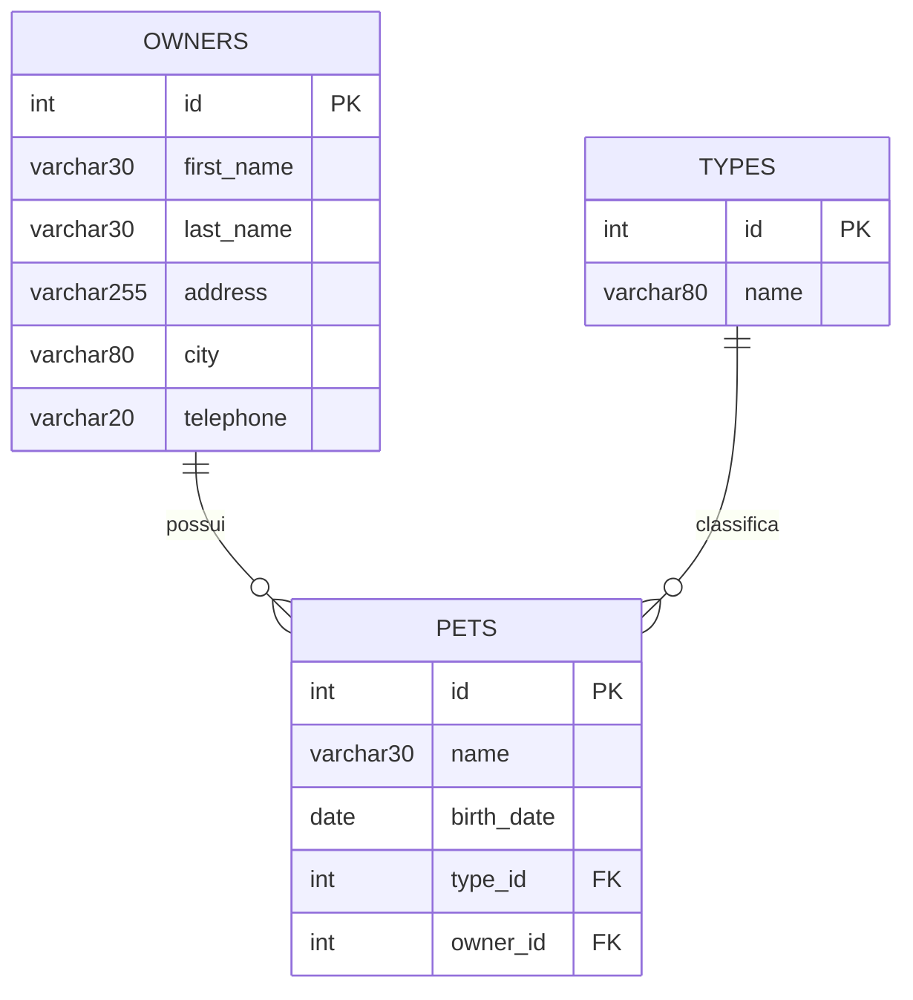

# Modelo de Dados — customers-service

- Banco: MySQL em produção (`db/mysql/schema.sql`) ou HSQLDB embarcado em testes/dev (`db/hsqldb/schema.sql`) — schemas equivalentes.
- Mapeamento ORM: Jakarta Persistence (JPA) / Hibernate, entidades em `org.springframework.samples.petclinic.customers.model`.
- Banco lógico: `petclinic` (schema próprio deste serviço; cada microsserviço tem seu próprio banco — sem tabelas compartilhadas entre serviços).

## Diagrama Entidade-Relacionamento

## Tabelas

### `owners`
| Coluna | Tipo | Constraint | Observação |
|---|---|---|---|
| `id` | `INT(4) UNSIGNED` | PK, auto increment | |
| `first_name` | `VARCHAR(30)` | | obrigatório na camada de aplicação (`@NotBlank`) |
| `last_name` | `VARCHAR(30)` | índice (`INDEX(last_name)`) | obrigatório na aplicação |
| `address` | `VARCHAR(255)` | | obrigatório na aplicação |
| `city` | `VARCHAR(80)` | | obrigatório na aplicação |
| `telephone` | `VARCHAR(20)` | | obrigatório na aplicação; validado como numérico até 12 dígitos |

### `pets`
| Coluna | Tipo | Constraint | Observação |
|---|---|---|---|
| `id` | `INT(4) UNSIGNED` | PK, auto increment | |
| `name` | `VARCHAR(30)` | índice (`INDEX(name)`) | |
| `birth_date` | `DATE` | | |
| `type_id` | `INT(4) UNSIGNED` | NOT NULL, FK → `types(id)` | |
| `owner_id` | `INT(4) UNSIGNED` | NOT NULL, FK → `owners(id)` | |

### `types`
| Coluna | Tipo | Constraint | Observação |
|---|---|---|---|
| `id` | `INT(4) UNSIGNED` | PK, auto increment | |
| `name` | `VARCHAR(80)` | índice (`INDEX(name)`) | catálogo fixo (ex.: cat, dog, lizard, snake, bird, hamster — conforme `data.sql` e prompt do genai-service) |

## Relacionamentos e regras de integridade

- `pets.owner_id → owners.id`: obrigatório (`NOT NULL`), FK física — um pet sempre pertence a um tutor.
- `pets.type_id → types.id`: obrigatório (`NOT NULL`), FK física — um pet sempre tem um tipo.
- `owners (1) — (N) pets`: no ORM, `@OneToMany(cascade = ALL, fetch = EAGER, mappedBy = "owner")` — apagar/persistir um `Owner` propaga para seus `Pet`s (cascade), e os pets são sempre carregados junto com o tutor.
- Não há relação física de `pets` com o serviço `visits-service` (o vínculo pet↔visita existe apenas do lado de `visits-service`, como referência lógica ao `pet_id`).

## Observações de modelagem

- Chaves primárias são inteiras autoincrementais (`IDENTITY`), sem UUID.
- Não há colunas de auditoria (`created_at`/`updated_at`) nem soft-delete — o modelo reflete o desenho original do Spring PetClinic monolítico, adaptado para múltiplos serviços.
- Engine `InnoDB` (suporta FKs e transações) em MySQL.
