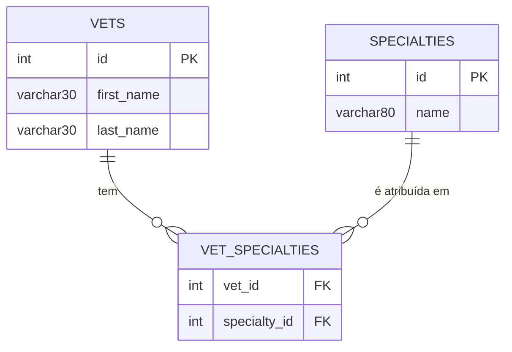

# Modelo de Dados — vets-service

- Banco: MySQL em produção (`db/mysql/schema.sql`) ou HSQLDB embarcado em testes/dev (`db/hsqldb/schema.sql`).
- Mapeamento ORM: JPA/Hibernate, entidades em `org.springframework.samples.petclinic.vets.model`.
- Banco lógico: `petclinic` (schema próprio deste serviço, independente do banco de `customers-service`, embora tenha o mesmo nome lógico).

## Diagrama Entidade-Relacionamento

## Tabelas

### `vets`
| Coluna | Tipo | Constraint | Observação |
|---|---|---|---|
| `id` | `INT(4) UNSIGNED` | PK, auto increment | |
| `first_name` | `VARCHAR(30)` | | obrigatório na aplicação (`@NotBlank`) |
| `last_name` | `VARCHAR(30)` | índice (`INDEX(last_name)`) | obrigatório na aplicação |

### `specialties`
| Coluna | Tipo | Constraint | Observação |
|---|---|---|---|
| `id` | `INT(4) UNSIGNED` | PK, auto increment | |
| `name` | `VARCHAR(80)` | índice (`INDEX(name)`) | ex.: radiology, surgery, dentistry (conforme `data.sql`) |

### `vet_specialties` (tabela associativa N:N)
| Coluna | Tipo | Constraint | Observação |
|---|---|---|---|
| `vet_id` | `INT(4) UNSIGNED` | FK → `vets(id)` | |
| `specialty_id` | `INT(4) UNSIGNED` | FK → `specialties(id)` | |
| — | — | `UNIQUE(vet_id, specialty_id)` | impede duplicidade da mesma especialidade para o mesmo veterinário |

## Relacionamentos e regras de integridade

- `vets (N) — (N) specialties` via `vet_specialties`, mapeado no ORM como `@ManyToMany(fetch = EAGER)` no lado `Vet` — especialidades são sempre carregadas junto com o veterinário e retornadas ordenadas por nome.
- Um veterinário pode não ter nenhuma especialidade (relação opcional do lado `specialties`).

## Observações de modelagem

- Não há coluna para dados de contato do veterinário (telefone, e-mail), agenda/disponibilidade, nem status (ativo/inativo) — o modelo é propositalmente mínimo (nome + especialidades).
- Sem colunas de auditoria ou soft-delete.
- Resultado de `GET /vets` é cacheado em memória (`@Cacheable("vets")`, perfil `production`) — mudanças diretas no banco não aparecerão na API até expiração/invalidação do cache do processo.
