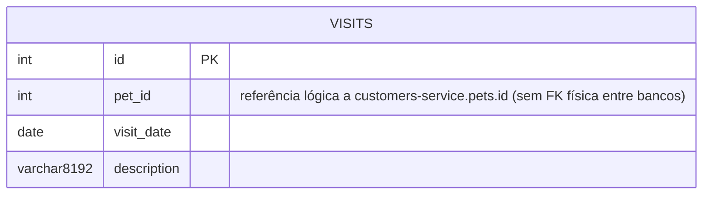

# Modelo de Dados — visits-service

- Banco: MySQL em produção (`db/mysql/schema.sql`) ou HSQLDB embarcado em testes/dev (`db/hsqldb/schema.sql`).
- Mapeamento ORM: JPA/Hibernate, entidade em `org.springframework.samples.petclinic.visits.model.Visit`.
- Banco lógico: `petclinic` (schema próprio deste serviço, base de dados fisicamente separada da de `customers-service`).

## Diagrama Entidade-Relacionamento

## Tabela

### `visits`
| Coluna | Tipo | Constraint | Observação |
|---|---|---|---|
| `id` | `INT(4) UNSIGNED` | PK, auto increment | |
| `pet_id` | `INT(4) UNSIGNED` | NOT NULL, `FOREIGN KEY (pet_id) REFERENCES pets(id)` **no script SQL** | ver nota abaixo |
| `visit_date` | `DATE` | | mapeado no Java como `@Temporal(TIMESTAMP)`, mas a coluna SQL é `DATE` |
| `description` | `VARCHAR(8192)` | | validado na aplicação com `@Size(max = 8192)` |

## Nota importante sobre a FK `pet_id → pets(id)`

O script `schema.sql` deste serviço declara `FOREIGN KEY (pet_id) REFERENCES pets(id)`, mas a tabela `pets` **não existe no banco deste serviço** — ela pertence ao schema de `customers-service`, em outro banco/processo. Isso só é sintaticamente válido porque cada serviço roda sobre seu próprio schema `petclinic` isolado (ou o script foi herdado do monólito original e a FK é, na prática, inofensiva/ignorada dependendo do motor). Em termos de arquitetura de dados:
- Não existe integridade referencial garantida pelo banco entre `visits.pet_id` e o `pets.id` real de `customers-service`.
- A consistência é responsabilidade da aplicação (ninguém valida, no `visits-service`, que o `petId` recebido de fato existe em `customers-service` antes de gravar uma visita).

## Observações de modelagem

- Não há referência a `owner_id` — o vínculo com o tutor é sempre indireto, via `pet_id`.
- Não há colunas de auditoria ou soft-delete.
- Suporta consulta por pet único (`findByPetId`) e por lote de pets (`findByPetIdIn`), refletindo o padrão de uso do `api-gateway` para montar a ficha agregada do tutor.
