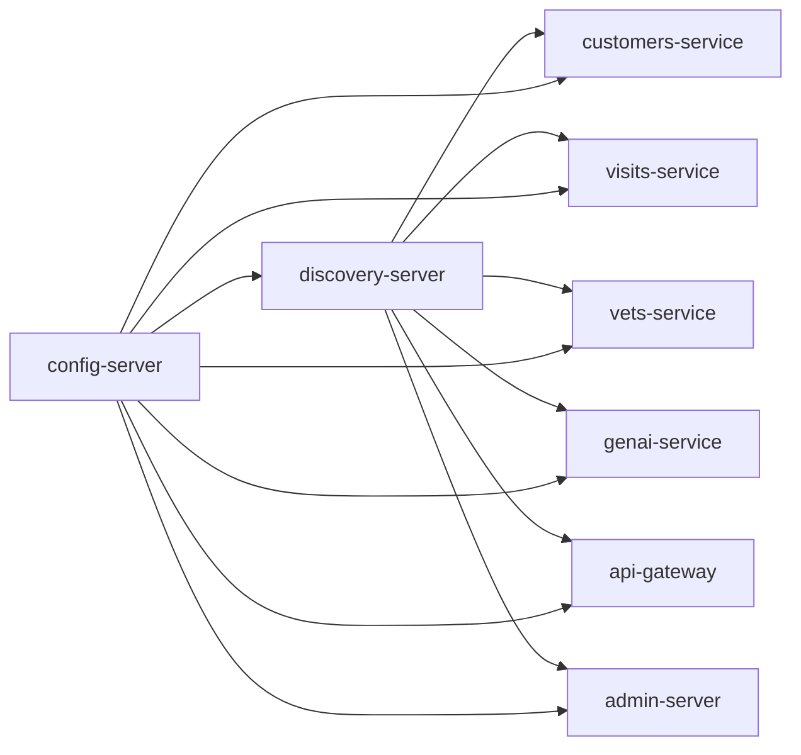

# Serviços de Infraestrutura de Suporte

Estes serviços não implementam capacidades de negócio da clínica veterinária, mas são pré-requisitos operacionais para os serviços de negócio funcionarem. Documentados aqui para completude do "repo do domínio", sem contratos de API de negócio.

## discovery-server (Eureka)
- Porta: `8761`.
- Papel: Service Registry — todos os demais serviços se registram nele e o utilizam para resolver `lb://<nome-do-serviço>` (usado pelo gateway) ou `DiscoveryClient.getInstances("customers-service")` (usado pelo genai-service).
- Deve subir antes dos serviços de negócio (README: "Config and Discovery Server must be started before any other application").

## config-server (Spring Cloud Config)
- Porta: `8888`.
- Papel: fonte centralizada de configuração para todos os serviços (`spring.config.import: optional:configserver:...` em cada `application.yml`).
- Fonte da configuração: repositório Git (`spring-petclinic-microservices-config`) por padrão, ou sistema de arquivos local via perfil `native` + variável `GIT_REPO`.
- Cada serviço de negócio importa sua config de `http://localhost:8888` localmente, ou `http://config-server:8888` no perfil `docker`.

## admin-server (Spring Boot Admin)
- Porta: `9090`.
- Papel: painel de observabilidade/administração dos demais serviços registrados no Eureka (health, métricas, logs, env).

## api-gateway (também documentado como serviço de negócio em `02-contrato-api-gateway.md`)
- Porta: `8080`.
- Além do roteamento, serve a UI AngularJS estática do domínio.

## Observabilidade (fora do código Java, definidos em `docker-compose.yml`/`docker/`)
- **Zipkin** (tracing distribuído): porta `9411`.
- **Prometheus** (métricas): porta `9091` (mapeada), config em `docker/prometheus/prometheus.yml`.
- **Grafana** (dashboards): porta `3030` (mapeada), dashboard pré-carregado em `docker/grafana/dashboards/grafana-petclinic-dashboard.json`.

## Ordem de dependência (docker-compose `depends_on` + healthcheck)

Todos os serviços de negócio dependem de `config-server` e `discovery-server` estarem saudáveis (`service_healthy`) antes de subir.
