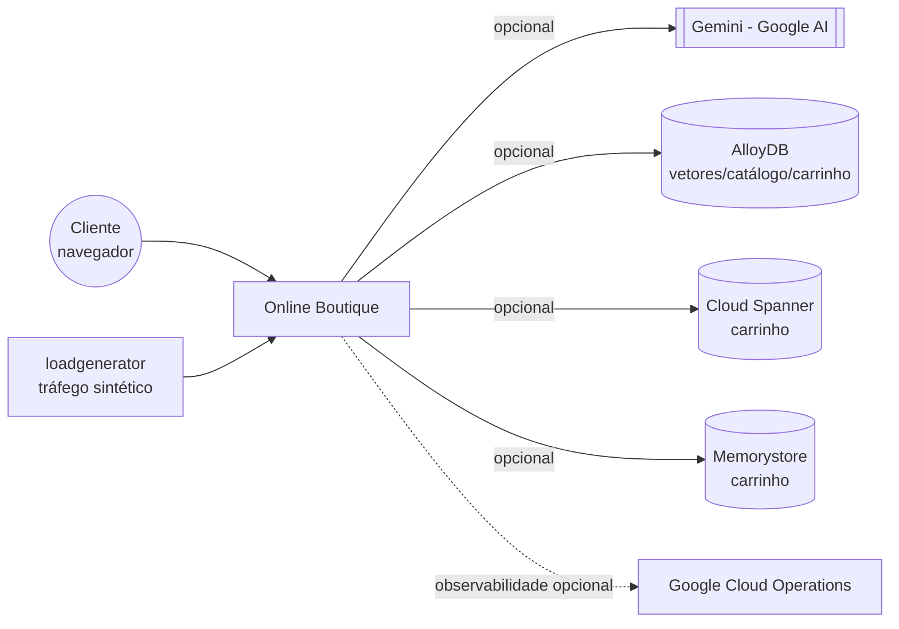
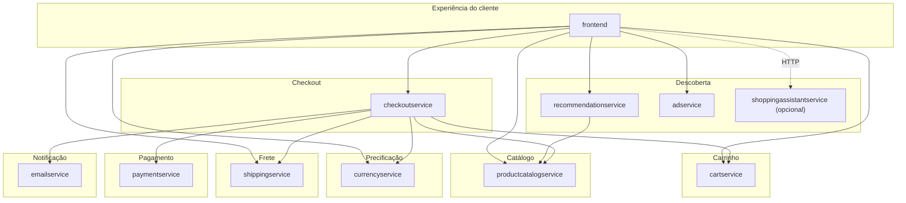

# Arquitetura: Online Boutique

> **Em resumo:** 11 microsserviços poliglotas (Go, Java, Node.js, Python, C#) que conversam quase
> exclusivamente por gRPC síncrono, definidos em um único contrato compartilhado
> (`protos/demo.proto`). Não há barramento de eventos nem fila — a única "orquestração" é o
> `checkoutservice`, que chama os demais em sequência dentro de uma requisição. O `frontend` é o
> único ponto de entrada externo; tudo mais é interno ao cluster.

## Nesta página
| Seção | Em uma linha |
|---|---|
| [Contexto](#contexto) | O domínio como caixa: quem entra e com quem fala fora dele |
| [Subdomínios](#subdomínios) | Como os serviços se agrupam por responsabilidade |
| [Mapa dos serviços](#mapa-dos-serviços) | Quem chama quem |
| [Estilo de integração](#estilo-de-integração) | Só gRPC síncrono; um único ponto de orquestração |
| [Decisões que moldam](#decisões-que-moldam) | Por que o desenho é assim |
| [Riscos técnicos](#riscos-técnicos) | O que quebra junto |

## Contexto

Não há sistema de pagamento, transportadora ou provedor de email reais — `paymentservice`,
`shippingservice` e `emailservice` são mocks internos ao domínio (ver `3-servicos.md`).

## Subdomínios

| Subdomínio | Responsabilidade | Serviços |
|---|---|---|
| Experiência do cliente | Servir o site, agregar dados dos demais subdomínios | `frontend` |
| Carrinho | Guardar os itens escolhidos por sessão | `cartservice` |
| Catálogo | Listar, buscar e detalhar produtos | `productcatalogservice` |
| Precificação | Converter valores entre moedas | `currencyservice` |
| Frete | Cotar e "despachar" o pedido | `shippingservice` |
| Checkout | Orquestrar a compra ponta a ponta | `checkoutservice` |
| Pagamento | Validar e "cobrar" o cartão | `paymentservice` |
| Notificação | Confirmar o pedido por email | `emailservice` |
| Descoberta | Sugerir produtos/anúncios ao cliente | `recommendationservice`, `adservice`, `shoppingassistantservice` (opcional) |
| Suporte (fora do negócio) | Gerar tráfego de teste | `loadgenerator` |

## Mapa dos serviços

`checkoutservice` é o único serviço "do meio": todos os outros são folhas (não chamam ninguém do
domínio, exceto `recommendationservice`, que chama `productcatalogservice`).

## Estilo de integração

- **Síncrono, sempre.** Todo o domínio fala gRPC (contrato único em `protos/demo.proto`), com uma
  exceção: `frontend` → `shoppingassistantservice` é HTTP simples (POST JSON), não gRPC.
- **Sem eventos, sem filas.** Não há producer/consumer de mensageria em nenhum serviço — cada
  chamada espera resposta antes de seguir.
- **Orquestração centralizada em um serviço, não em um motor de processo.** O `checkoutservice`
  concentra toda a lógica da saga da compra em código Go dentro de `PlaceOrder` — não há Step
  Functions, Camunda, Temporal nem qualquer BOAT. Todo o resto é coreografia trivial: o `frontend`
  chama cada serviço que precisa, sem compor um fluxo maior.
- **Timeouts pontuais.** Só `adservice` tem timeout explícito no chamador (100 ms, no `frontend`).
  Os demais não mostraram timeout/retry configurado nos trechos lidos *(a confirmar)*.

## Decisões que moldam

| Decisão | Efeito |
|---|---|
| Um único `.proto` compartilhado para todos os serviços ([`6-referencia.md`](6-referencia.md#decisões)) | Contratos nunca divergem entre serviços, mas acopla o build de todos a um gerador comum |
| Nenhum serviço mock (pagamento, frete, email) chama sistema externo real | Domínio é 100% autocontido — ótimo para demo, mas não reflete uma loja real em produção |
| `checkoutservice` orquestra por código, sem persistir o pedido | Compra é "fire and forget": não há como consultar um pedido depois de feito |
| Infra gerenciada (Spanner/AlloyDB/Memorystore/Istio) é sempre opt-in via Kustomize | Reduz a complexidade e o custo do caminho padrão (`docs/product-requirements.md`), mas quem quer produção real precisa montar isso à mão |

## Riscos técnicos

- **Cobrança sem estorno:** se `ShipOrder` falhar depois de `Charge` ter sido aprovado, o cliente é
  cobrado e o pedido não se completa — não existe compensação (ver `4-jornadas.md` →
  "Comprar um produto").
- **Carrinho sem persistência por padrão:** `redis-cart` usa `emptyDir`; um restart do pod apaga
  todos os carrinhos em andamento (ver `5-infraestrutura.md`).
- **Sem estoque nem limite de quantidade:** nada no código impede adicionar mais itens do que
  "existe" — não há conceito de estoque no domínio *(a confirmar)*.
- **Taxas de câmbio desatualizadas:** `currencyservice` usa uma tabela fixa embutida na imagem, não
  busca cotações reais apesar do que o `README.md` do repositório sugere (ver `6-referencia.md` →
  Dúvidas e perguntas).
- **Acoplamento síncrono em cadeia:** como tudo é gRPC bloqueante, uma lentidão em qualquer serviço
  do checkout (ex.: `paymentservice`) atrasa a resposta inteira ao cliente; não há circuit breaker
  visível no código lido.

**Fontes:** `protos/demo.proto`, `src/checkoutservice/main.go`, `src/frontend/rpc.go` e
`handlers.go`, `docs/product-requirements.md`, `docs/purpose.md`, `README.md` do repositório,
`kustomize/components/*` (para as integrações opcionais). Donos por subdomínio e SLA/timeouts não
documentados explicitamente ficam *(a confirmar)*.
