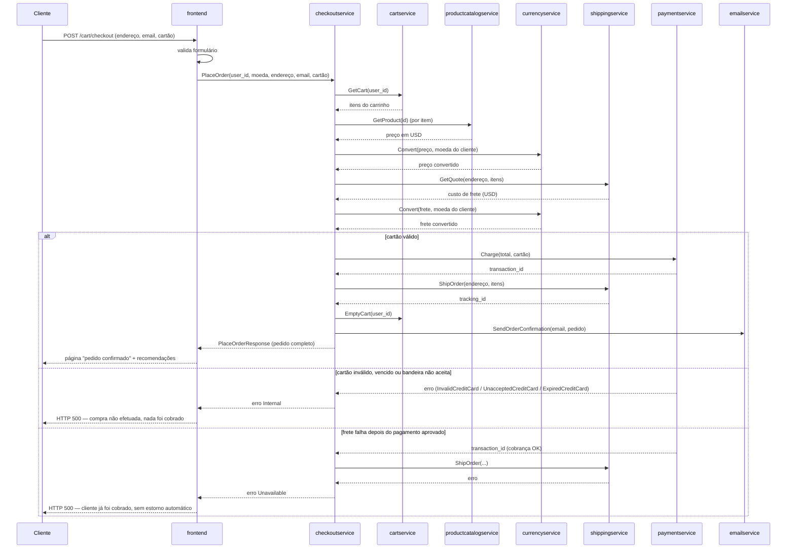
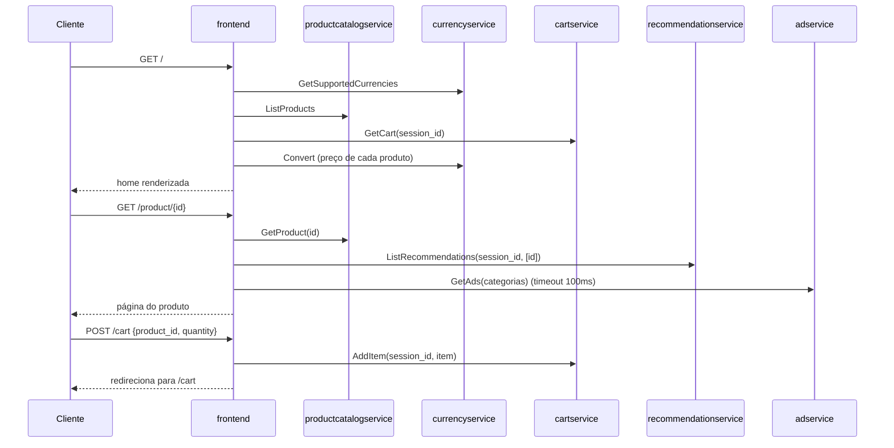
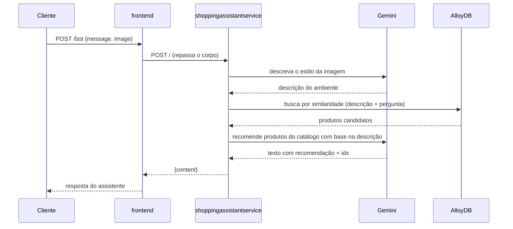

# Jornadas: Online Boutique

> **Em resumo:** a jornada central é a compra: o cliente navega sem login, monta um carrinho e
> fecha o pedido em uma única chamada síncrona orquestrada pelo `checkoutservice` (cobra, envia e
> notifica em sequência, sem fila). Há também a navegação/descoberta (home, busca, recomendação,
> anúncio) e, opcionalmente, um assistente de compras com IA. Nenhuma jornada usa um motor de
> processo — o que existe é coreografia simples via HTTP/gRPC dentro de uma única requisição.

## Nesta página
| Jornada | Em uma linha | Quem orquestra |
|---|---|---|
| [Comprar um produto](#comprar-um-produto) | Do clique em "comprar" ao email de confirmação | `checkoutservice` (orquestrador síncrono) |
| [Navegar e montar o carrinho](#navegar-e-montar-o-carrinho) | Ver produtos, buscar, adicionar ao carrinho | Sem orquestrador — cada tela chama os serviços que precisa |
| [Pedir ajuda ao assistente de compras](#pedir-ajuda-ao-assistente-de-compras-opcional) | Enviar foto de um ambiente e receber sugestão de produtos | `shoppingassistantservice` (opcional) |

---

## Comprar um produto
> **Em resumo:** o cliente preenche endereço e cartão na tela de checkout; uma única chamada
> gRPC ao `checkoutservice` busca o carrinho, precifica em moeda local, cobra o cartão, despacha o
> frete, esvazia o carrinho e dispara o email — tudo antes de responder ao navegador.

### Em linguagem de negócio
| # | 🟨 Quem | 🟦 Faz | 🟧 Acontece | 🟪 Regra ou reação |
|---|---|---|---|---|
| 1 | Cliente | Preenche endereço, email e cartão e confirma a compra | Pedido solicitado | Formulário validado no frontend antes de seguir |
| 2 | Loja | Busca o carrinho do cliente e converte os preços para a moeda escolhida | Preço do pedido calculado | Inclui o frete já convertido |
| 3 | Loja | Cobra o valor total no cartão informado | Pagamento aprovado *ou* recusado | Só aceita Visa/Mastercard com validade futura |
| 4 | Loja | Despacha o pedido para o endereço informado | Pedido enviado (rastreio gerado) | Só ocorre se o pagamento foi aprovado |
| 5 | Loja | Esvazia o carrinho e envia o email de confirmação | Pedido confirmado ao cliente | Falha aqui não desfaz a compra |

🟥 **Dúvidas:** não há evento de "pedido cancelado" nem de estorno — se o envio falhar depois do
pagamento aprovado, não existe reação de negócio para isso no código (ver Regras e dúvidas abaixo).

### Quem orquestra
`checkoutservice.PlaceOrder` chama, em sequência e de forma síncrona (dentro da mesma requisição
gRPC recebida do `frontend`): `cartservice`, `productcatalogservice`, `currencyservice`,
`shippingservice`, `paymentservice`, `cartservice` de novo (esvaziar) e `emailservice`. É uma saga
orquestrada por código, não por um motor de processo nem por eventos.

### Passo a passo técnico

Após a resposta, o `frontend` ainda busca recomendações (`getRecommendations`) para mostrar na tela
de pedido confirmado — isso é best-effort e não bloqueia a exibição do pedido.

### Regras e dúvidas
| Regra | Valor atual |
|---|---|
| Bandeiras aceitas | Visa e Mastercard apenas |
| Validação de vencimento | Mês/ano do cartão deve ser posterior ao mês/ano atual |
| Custo de frete | Fixo: US$ 8.99 se o carrinho tiver itens, senão US$ 0 |
| Falha ao esvaziar carrinho ou enviar email | Não bloqueia o pedido (apenas logada) |

🟥 **Dúvidas:**
- Se `ShipOrder` falhar depois de `Charge` ter sido bem-sucedido, o cliente é cobrado mas o pedido
  não é confirmado nem estornado — não há compensação no código lido (`src/checkoutservice/main.go`).
- O pedido não é persistido em nenhum banco: uma vez respondido, o `PlaceOrderResponse` não existe
  mais em lugar nenhum do sistema *(a confirmar se isso é aceitável para uma demo ou se falta um
  serviço de "orders" ainda não escrito)*.

**Fontes:** `src/checkoutservice/main.go` (função `PlaceOrder` e auxiliares),
`src/frontend/handlers.go` (`placeOrderHandler`), `src/paymentservice/charge.js`,
`src/shippingservice/quote.go`, `protos/demo.proto`.

---

## Navegar e montar o carrinho
> **Em resumo:** da home ao carrinho, cada tela busca só o que precisa em paralelo lógico — sem
> orquestrador, sem estado de sessão no servidor além do cookie `shop_session-id`.

### Em linguagem de negócio
| # | 🟨 Quem | 🟦 Faz | 🟧 Acontece | 🟪 Regra ou reação |
|---|---|---|---|---|
| 1 | Cliente | Abre a loja | Sessão iniciada (cookie gerado) | Sem cadastro nem login |
| 2 | Cliente | Vê produtos, busca ou entra no detalhe de um item | Produto visualizado | Anúncio e recomendações exibidos como complemento |
| 3 | Cliente | Adiciona item(s) ao carrinho | Item adicionado ao carrinho | Carrinho é por sessão (`user_id` = id da sessão) |
| 4 | Cliente | Troca a moeda de exibição | Preços recalculados | Não altera o carrinho, só a exibição |

### Quem orquestra
Ninguém — o `frontend` chama cada serviço dependente diretamente por handler HTTP, sem uma saga.

### Passo a passo técnico

### Regras e dúvidas
Sem regras de negócio explícitas (limite de quantidade, estoque) encontradas no código — qualquer
quantidade positiva é aceita *(a confirmar)*.

**Fontes:** `src/frontend/handlers.go` (`homeHandler`, `productHandler`, `addToCartHandler`),
`src/frontend/rpc.go`.

---

## Pedir ajuda ao assistente de compras (opcional)
> **Em resumo:** só existe quando o componente Kustomize `shopping-assistant` está habilitado.
> Cliente envia uma foto do ambiente; o assistente descreve o estilo com Gemini, busca produtos
> parecidos por similaridade vetorial e devolve uma recomendação em texto.

### Em linguagem de negócio
| # | 🟨 Quem | 🟦 Faz | 🟧 Acontece | 🟪 Regra ou reação |
|---|---|---|---|---|
| 1 | Cliente | Envia foto do ambiente + pergunta | Pedido de sugestão recebido | Só disponível se `ENABLE_ASSISTANT=true` |
| 2 | Loja | Descreve o estilo da foto e busca produtos parecidos | Produtos candidatos encontrados | Busca por similaridade, não por regra fixa |
| 3 | Loja | Monta uma recomendação em texto com até 3 produtos | Sugestão entregue ao cliente | — |

### Quem orquestra
`shoppingassistantservice` — chama o Gemini duas vezes (descrever imagem, gerar recomendação) e o
AlloyDB uma vez (busca vetorial), sem outro serviço do domínio envolvido.

### Passo a passo técnico

### Regras e dúvidas
🟥 **Dúvidas:** não há tratamento de erro visível em `shoppingassistantservice.py` para falhas do
Gemini ou do AlloyDB *(a confirmar o comportamento nesses casos)*; a chave `GOOGLE_API_KEY` vem
como placeholder no manifesto do componente Kustomize, precisa ser preenchida manualmente antes do
deploy (ver `6-referencia.md`).

**Fontes:** `src/shoppingassistantservice/shoppingassistantservice.py`,
`src/frontend/handlers.go` (`chatBotHandler`),
`kustomize/components/shopping-assistant/README.md`.
