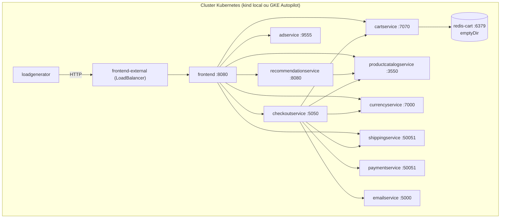
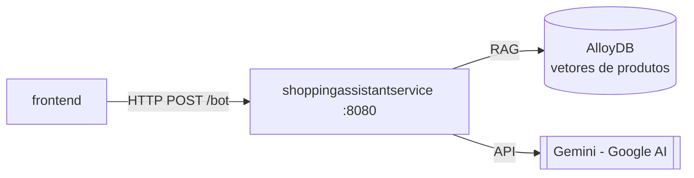

# Infraestrutura: Online Boutique

> **Em resumo:** roda em qualquer cluster Kubernetes (o "golden path" é um `kind` local ou GKE
> Autopilot via Terraform). Cada serviço é um `Deployment` + `Service` ClusterIP simples, sem
> banco gerenciado por padrão: carrinho fica em um Redis dentro do próprio cluster (`emptyDir`,
> sem persistência) e catálogo é um arquivo JSON embutido na imagem. Variações (Spanner, AlloyDB,
> Memorystore, Istio, políticas de rede) existem como componentes opcionais do Kustomize, nunca
> ligados por padrão — é uma regra de produto do repositório (ver `docs/product-requirements.md`).

## Nesta página
| Seção | Em uma linha |
|---|---|
| [Ambientes](#ambientes) | Local (kind/minikube), GKE via Terraform, variações via Kustomize |
| [Recursos](#recursos) | Um `Deployment`/`Service` por serviço, Redis in-cluster, sem banco externo por padrão |
| [Implantação](#implantação) | Diagrama do cluster padrão e como as variações se encaixam |

## Ambientes

| Ambiente | Como sobe | Diferença |
|---|---|---|
| Local (dev) | `skaffold dev` (`skaffold.yaml`) ou `kubectl apply -f release/kubernetes-manifests.yaml` em `kind`/minikube | Sem tracing/profiler; imagens buildadas localmente |
| GKE (quickstart oficial) | `gcloud container clusters create-auto` + `kubectl apply -f release/kubernetes-manifests.yaml` | Cluster Autopilot; manifests padrão do diretório `kubernetes-manifests/` |
| GKE via Terraform | `terraform/main.tf` cria o cluster Autopilot e aplica `kubectl apply -k <filepath_manifest>` | Provisiona cluster + habilita APIs do Google Cloud (`container`, `monitoring`, `cloudtrace`, `cloudprofiler`, `redis` se `memorystore=true`) |
| Variações (Kustomize) | `kustomize/components/*` combinados via `kustomize/kustomization.yaml` | Ver tabela de componentes abaixo |
| Cloud Build | `cloudbuild.yaml` | Build e push das imagens de cada serviço em CI *(a confirmar: qual gatilho aciona)* |

**Componentes Kustomize disponíveis** (opt-in, nunca no default): `alloydb`, `spanner`, `memorystore`
(bancos gerenciados para o `cartservice`/`productcatalogservice` no lugar do Redis/arquivo local),
`service-mesh-istio` (Istio/Cloud Service Mesh + `istio-manifests/`), `network-policies`
(`NetworkPolicy` por Deployment), `non-public-frontend` (remove o LoadBalancer público),
`single-shared-session`, `google-cloud-operations` (tracing/profiling), `shopping-assistant`
(adiciona o `shoppingassistantservice`, ver `4-jornadas.md`), `cymbal-branding`,
`custom-base-url`, `container-images-registry/tag/tag-suffix`, `without-loadgenerator`.

Há também um `helm-chart/` equivalente aos manifests base, para quem prefere Helm.

## Recursos

| Recurso | Tipo | Tecnologia | Quem usa | Definido em |
|---|---|---|---|---|
| `frontend` | Deployment + Service (ClusterIP) + Service `frontend-external` (LoadBalancer) | Go, container porta 8080 | Ponto de entrada do site | `kubernetes-manifests/frontend.yaml` |
| `cartservice` | Deployment + Service | C#/.NET, gRPC porta 7070 | Carrinho | `kubernetes-manifests/cartservice.yaml` |
| `redis-cart` | Deployment + Service | `redis:alpine`, porta 6379, volume `emptyDir` (efêmero) | `cartservice` | `kubernetes-manifests/cartservice.yaml` |
| `productcatalogservice` | Deployment + Service | Go, gRPC porta 3550 | Catálogo | `kubernetes-manifests/productcatalogservice.yaml` |
| `currencyservice` | Deployment + Service | Node.js, gRPC porta 7000 | Conversão de moeda | `kubernetes-manifests/currencyservice.yaml` |
| `paymentservice` | Deployment + Service | Node.js, gRPC porta 50051 | Cobrança (mock) | `kubernetes-manifests/paymentservice.yaml` |
| `shippingservice` | Deployment + Service | Go, gRPC porta 50051 | Frete (mock) | `kubernetes-manifests/shippingservice.yaml` |
| `emailservice` | Deployment + Service (porta serviço 5000 → container 8080) | Python, gRPC | Email de confirmação (mock) | `kubernetes-manifests/emailservice.yaml` |
| `checkoutservice` | Deployment + Service | Go, gRPC porta 5050 | Orquestra a compra | `kubernetes-manifests/checkoutservice.yaml` |
| `recommendationservice` | Deployment + Service | Python, gRPC porta 8080 | Recomendações | `kubernetes-manifests/recommendationservice.yaml` |
| `adservice` | Deployment + Service | Java, gRPC porta 9555 | Anúncios contextuais | `kubernetes-manifests/adservice.yaml` |
| `loadgenerator` | Deployment (sem Service) | Python/Locust | Gera tráfego sintético contra `frontend` | `kubernetes-manifests/loadgenerator.yaml` |
| `shoppingassistantservice` *(opcional)* | Deployment + Service, HTTP porta 8080 | Python/Flask + Gemini (`langchain_google_genai`) + AlloyDB (RAG) | `frontend` (rota `/bot`) quando `ENABLE_ASSISTANT=true` | `kustomize/components/shopping-assistant/shoppingassistantservice.yaml` |
| GKE Autopilot cluster | `google_container_cluster` | GKE | Todo o domínio | `terraform/main.tf` |
| APIs do Google Cloud | `module.enable_google_apis` | `container`, `monitoring`, `cloudtrace`, `cloudprofiler`, (+`redis` se Memorystore) | Observabilidade/infra | `terraform/main.tf` |

Todos os serviços rodam com `runAsNonRoot`, `readOnlyRootFilesystem` (exceto o
`shoppingassistantservice`) e sem `allowPrivilegeEscalation` — postura de segurança padrão do
repositório, não específica de um serviço.

Requests/limits de CPU e memória são pequenos (na casa de 100–300m CPU e 64–450Mi memória),
consistente com o objetivo de demo leve (`docs/purpose.md`), não com uma carga de produção real
*(a confirmar)*.

## Implantação

Variação com assistente de compras (componente `shopping-assistant`, requer AlloyDB + Gemini fora do cluster):

**Fontes:** `kubernetes-manifests/*.yaml` (Deployments/Services/env/probes/resources lidos
literalmente), `terraform/main.tf` e `terraform/variables.tf`, `kustomize/kustomization.yaml` e
`kustomize/components/*/README.md`, `docs/product-requirements.md`, `helm-chart/` (equivalente,
não detalhado por página própria), `skaffold.yaml` e `cloudbuild.yaml` (citados, não aprofundados).
O gatilho exato do Cloud Build e o dimensionamento para carga real de produção ficam *(a confirmar)*.
