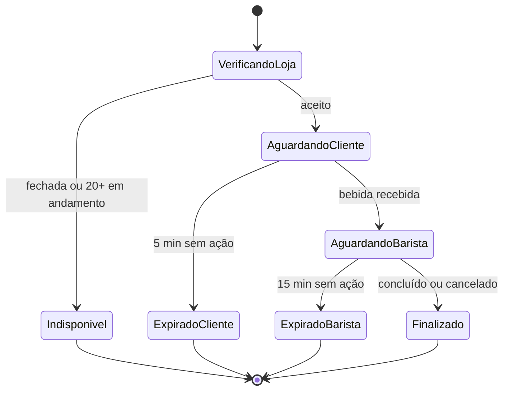
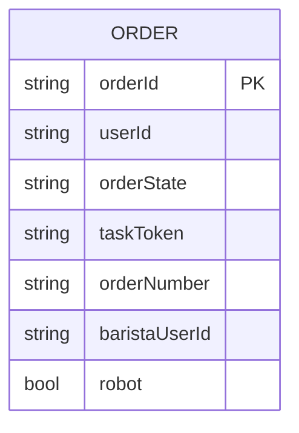

# Serviços: Serverlesspresso

> **Em resumo:** nove serviços na stack principal (mais quatro extensões opcionais), quase todos
> Lambda + EventBridge; dois deles são máquinas de estado do Step Functions que cooperam para
> tocar o pedido do início ao fim. Cada seção lista os lambdas daquele serviço um a um, o contrato
> que expõe e os eventos que produz/consome.

## Nesta página
| Serviço | Subdomínio | Em uma linha |
|---|---|---|
| [00-baseCore](#00-basecore) | Plataforma | Event bus, login por SMS e endpoint IoT usados por todos |
| [validator-service](#validator-service-backends9-validator) | Validação do pedido | Gera e valida o QR code que libera um pedido |
| [config-service](#config-service-backends2-config-service) | Configuração do evento | Guarda cardápio, limites e se a loja está aberta |
| [order-processor](#order-processor-backends4-order-processing) | Processamento do pedido | Orquestra o ciclo de vida do pedido (Step Functions) |
| [order-manager](#order-manager-backends5-order-manager) | Gestão do pedido | Recebe ações do cliente e do barista (Step Functions + API) |
| [publisher-service](#publisher-service-backends6-publisher-service) | Tempo real | Espelha eventos de negócio para os 3 frontends via IoT |
| [order-journey-service](#order-journey-service-backends8-order-journey) | Recibo do pedido | Grava a trilha de eventos e gera o recibo em HTML |
| [metrics-service](#metrics-service-backends7-metrics-service) | Métricas | Publica métricas customizadas no CloudWatch |
| [counting-service](#counting-service-backends1-counting-service-não-usado) | — | Código de geração de número de pedido, não implantado |
| [EventPlayer](#eventplayer-extensionseventplayer) | Extensões | Simula 15 min de eventos reais para testar extensões |
| [OrderRobotExtension](#orderrobotextension-extensionsorderrobotextension) | Extensões | Simula clientes e baristas em massa |
| [PersistOrderMetricsToDynamoDB](#persistordermetricstodynamodb-extensionspersistordermetricstodynamodb) | Extensões | Histórico de tempos de espera em DynamoDB via SQS |
| [WaitTimes](#waittimes-extensionswaittimes) | Extensões | Calcula tempo médio de espera por bebida |

---

## 00-baseCore
> **Em resumo:** stack fundacional: cria o event bus `Serverlesspresso`, o Cognito User Pool com
> login por SMS (sem senha) e o endpoint IoT usado para tempo real. Todo o resto depende dela.

| Subdomínio | Dono | Stack | Repositório |
|---|---|---|---|
| Plataforma | Não identificado *(a confirmar)* | SAM, Node.js 14.x | `00-baseCore/` |

### Expõe
| Contrato | Tipo | Para quê |
|---|---|---|
| `ServerlesspressoEventBus` | EventBridge custom bus | Barramento de eventos de todo o domínio |
| Cognito User Pool / Identity Pool | Auth | Login do cliente e do barista por número de telefone (OTP via SMS) |
| Endpoint IoT Core | MQTT | Canal de tempo real para os 3 frontends |

### Por dentro
| Componente | Gatilho | O que faz |
|---|---|---|
| `DefineAuthChallenge` | Cognito (custom auth flow) | Decide o próximo passo do desafio de login |
| `CreateAuthChallenge` | Cognito | Gera e envia o código por SMS (`sns`/`mobiletargeting`) |
| `VerifyAuthChallengeResponse` | Cognito | Confere o código digitado pelo usuário |
| `PreSignUp` | Cognito | Auto-confirma o cadastro no primeiro login |
| `GetIoTEndpointFunction` | Custom resource (deploy) | Descobre o endpoint IoT da conta e o expõe como output |

### Quando falha
Sem retry/DLQ explícitos nos gatilhos do Cognito; falha no desafio = login recusado pelo Cognito.
`LogsRule` grava todo evento do bus em CloudWatch Logs para depuração (`/aws/serverlesspresso-event-bus`).

### Infra que usa
EventBridge, Cognito, IoT Core — ver [5-infraestrutura.md](./5-infraestrutura.md#recursos-stack-00-basecore-00-basecoretemplateyaml).

---

## validator-service (`backends/9-validator`)
> **Em resumo:** é o portão de entrada do pedido: gera um QR code com token limitado por janela de
> 5 minutos e, quando o cliente escaneia, valida o token e dispara `Validator.NewOrder` — o evento
> que dá partida em tudo.

| Subdomínio | Dono | Stack | Repositório |
|---|---|---|---|
| Validação do pedido | Não identificado *(a confirmar)* | SAM, Node.js 14.x | `backends/9-validator/` |

### Expõe
| Contrato | Tipo | Para quê |
|---|---|---|
| `GET /qr-code` | API (Cognito auth) | Gera/retorna o código válido da janela de tempo atual |
| `POST /qr-code` | API (Cognito auth) | Valida o código escaneado e abre um novo pedido |

### Consome
| Serviço | Contrato | Tipo |
|---|---|---|
| config-service | `ConfigTable` (leitura direta) | Dado (DynamoDB) |

### Por dentro
| Componente | Gatilho | O que faz |
|---|---|---|
| `getCode.js` (`GetQRcodeFunction`) | API Gateway `GET /qr-code` | Só admin; cria (se não existir) um código de `CodeLength` chars por janela de 5 min, com `drinksPerBarcode` tokens disponíveis, lido do `config-{eventId}` |
| `verifyCode.js` (`VerifyQRcodeFunction`) | API Gateway `POST /qr-code` | Confere código + janela; se `availableTokens < 1` recusa; senão decrementa, gera `orderId` (`nanoid`) e publica `Validator.NewOrder` no bus |

### Dados
Tabela `serverlesspresso-validator` (`PK` = `{eventId}-{bucket de 5 min}`), com `last_code`,
`availableTokens`, `start_ts`/`end_ts` da janela.

### Quando falha
Sem parâmetro obrigatório → `400`/`422`. Código/token errado → `400 Invalid code`. Sem tokens na
janela → `200` com `{error: 'No tokens remaining'}` (o cliente vê que esgotou, não é um erro HTTP).

### Infra que usa
`ValidatorTable` (DynamoDB), `RESTApiValidatorService` (API Gateway), `ServerlesspressoEventBus` —
ver [5-infraestrutura.md](./5-infraestrutura.md#recursos-stack-01-appcore-01-appcoretemplateyaml--a-maior-parte-da-aplicação).

---

## config-service (`backends/2-config-service`)
> **Em resumo:** guarda a configuração de cada evento pop-up (loja aberta/fechada, cardápio,
> limites) numa única tabela e propaga qualquer mudança para o resto do domínio via EventBridge.

| Subdomínio | Dono | Stack | Repositório |
|---|---|---|---|
| Configuração do evento | Não identificado *(a confirmar)* | SAM, Node.js 14.x | `backends/2-config-service/` |

### Expõe
| Contrato | Tipo | Para quê |
|---|---|---|
| `GET /config` | API | Cardápio e limites do evento (público, sem auth) |
| `GET /admin-config` | API (Cognito auth) | Mesma config, para o painel admin |
| `PUT /store` | API (Cognito auth) | Abre/fecha a loja (`storeOpen`) |

### Por dentro
| Componente | Gatilho | O que faz |
|---|---|---|
| `configChanged.js` (`ConfigChangedFunction`) | DynamoDB Streams da `ConfigTable` | Publica `ConfigService.ConfigChanged` com a nova imagem do item toda vez que a config muda |

### Dados
`ConfigTable` (`PK` = `config-{eventId}`): `storeOpen` (bool), `menu` (lista de bebida + modificadores
+ disponibilidade), `drinksPerBarcode`, `maxOrdersInQueue`, `maxOrdersPerUser`, `start`/`end` do evento,
`language`. Semeada no deploy por `FillDatabasesCustomResource` (`01-appCore/initDB`).

### Quando falha
As integrações `PUT`/`GET` são diretas API Gateway → DynamoDB (sem lambda no meio); erro de
DynamoDB vira erro HTTP cru, sem tratamento customizado visível.

### Infra que usa
`ConfigTable`, `RESTApiConfigService` — ver [5-infraestrutura.md](./5-infraestrutura.md#recursos-stack-01-appcore-01-appcoretemplateyaml--a-maior-parte-da-aplicação).

---

## order-processor (`backends/4-order-processing`)
> **Em resumo:** a máquina de estado que carrega o pedido do início ao fim. Não tem lambda
> própria: fala direto com DynamoDB e EventBridge, e pausa duas vezes esperando uma ação humana
> (cliente escolher a bebida, barista concluir), usando o padrão *waitForTaskToken*.

| Subdomínio | Dono | Stack | Repositório |
|---|---|---|---|
| Processamento do pedido | Não identificado *(a confirmar)* | Step Functions (Standard) | `backends/4-order-processing/statemachine/op.asl.json` |

### Expõe
| Contrato | Tipo | Para quê |
|---|---|---|
| Execução iniciada por `Validator.NewOrder` | EventBridgeRule → StartExecution | Único jeito documentado de iniciar um pedido |

### Consome
| Serviço | Contrato | Tipo |
|---|---|---|
| config-service | `ConfigTable.GetItem` (`storeOpen`) | Dado (DynamoDB) |
| counting-service | `CountingTable.UpdateItem` (gera o número do pedido, lógica reimplementada inline no ASL — ver nota abaixo) | Dado (DynamoDB) |
| order-manager | `SendTaskSuccess` recebido | Assíncrono (token) |

### Por dentro (estados do ASL)
| Estado | O que faz |
|---|---|
| `DynamoDB Get Shop status` → `Shop Open?` | Lê `storeOpen` na config do evento |
| `ListExecutions` → `Is capacity available?` | Lista execuções `RUNNING` da própria máquina; se a 21ª existir (`[20]`), rejeita — **limite de 20 pedidos simultâneos, fixo no ASL** |
| `EventBridge PutEvents` (`OrderProcessor.ShopUnavailable`) | Loja fechada ou lotada → encerra o pedido |
| `Emit - Workflow Started TT` | Publica `OrderProcessor.WorkflowStarted` com `TaskToken`; espera até **5 min** (`HeartbeatSeconds: 300`) o cliente enviar a bebida |
| `Generate Order Number` | `UpdateItem` na `CountingTable` (`IDvalue += 1`) — gera o número exibido ao cliente |
| `Emit - Awaiting Completion TT` | Publica `OrderProcessor.WaitingCompletion` com novo `TaskToken`; espera até **15 min** (`HeartbeatSeconds: 900`) o barista concluir |
| `Emit - order finished` | Publica `OrderProcessor.orderFinished` — fecha o pedido com sucesso |
| `Customer timedout` / `Barista timedout` → `Emit - error timeout` | Em qualquer um dos dois esperas, se estourar o tempo publica `OrderProcessor.OrderTimeOut` |

### Estados do pedido (visão da máquina)

### Quando falha
Timeout do cliente ou do barista → `OrderProcessor.OrderTimeOut` (o pedido não fica preso para
sempre, mas também não distingue "cliente sumiu" de "barista cancelou" no evento). Sem `Retry`
nos `PutEvents`; se o `EventBridge PutEvents` falhar a execução simplesmente falha (sem DLQ visível).

### Infra que usa
`OrderProcessorStateMachine`, `OrderTable`(indireto via order-manager), `CountingTable`, `ConfigTable`,
`ServerlesspressoEventBus` — ver [5-infraestrutura.md](./5-infraestrutura.md).

🟥 *(a confirmar)* `backends/4-order-processing/functions/capacity/isCapacityAvailable.js` e
`functions/resumeWF/app.js` existem no repo mas não aparecem em nenhum `template.yaml`; parecem
uma versão anterior da checagem de capacidade, substituída pelo `ListExecutions` inline no ASL.
`backends/4-order-processing/api.yaml` (`POST /order`) também não é referenciado por nenhuma stack
implantada.

---

## order-manager (`backends/5-order-manager`)
> **Em resumo:** a segunda máquina de estado: recebe, via API Gateway, a bebida escolhida pelo
> cliente e as ações do barista (assumir, liberar, concluir, cancelar), grava tudo na tabela de
> pedidos e é quem efetivamente "acorda" o order-processor com `SendTaskSuccess`.

| Subdomínio | Dono | Stack | Repositório |
|---|---|---|---|
| Gestão do pedido | Não identificado *(a confirmar)* | Step Functions (Standard) + SAM | `backends/5-order-manager/` |

### Expõe
| Contrato | Tipo | Para quê |
|---|---|---|
| `PUT /orders/{id}?action=&eventId=` | API (Cognito auth) → inicia `OrderManagerStateMachine` | Cliente envia a bebida (sem `action`); barista envia `make`/`unmake`/`complete`/`cancel` |
| `GET /orders` | API (Cognito auth) → `Query` direto no DynamoDB | Fila de pedidos por estado (`ORDERSTATE`), para o app do barista |
| `GET /orders/{id}` | API (Cognito auth) → `GetItem` direto no DynamoDB | Detalhe de um pedido |
| `GET /myOrders` | API (Cognito auth) → `Query` por `USERID` | Pedidos do próprio cliente logado |

### Consome
| Serviço | Contrato | Tipo |
|---|---|---|
| order-processor | `TaskToken` gravado por evento, resumido via `SendTaskSuccess` | Assíncrono (token) |
| config-service | `ConfigTable.GetItem` (cardápio) | Dado (DynamoDB) |

### Por dentro
| Componente | Gatilho | O que faz |
|---|---|---|
| ASL: `Customer Put Order` → `get menu` → `Sanitize order` | `PUT /orders/{id}` sem `action` | Lê o cardápio do evento e valida a bebida |
| `sanitize/app.js` (`SanitizeOrderLambda`) | Invocado pelo ASL acima | Confere se a bebida e os modificadores existem no cardápio (`available`); devolve `true`/`false` |
| ASL: `Update order` → `Resume Order Processor - customer` | Pedido válido | Grava `drinkOrder`, lê o `TaskToken` salvo e chama `SendTaskSuccess` — resume o order-processor no primeiro *wait* |
| `workflowStarted/app.js` (`WorkFlowStarted`) | Evento `OrderProcessor.WorkflowStarted` | Cria a linha do pedido (`PK=orders`, `SK=orderId`, `ORDERSTATE={eventId}-CREATED`) com o 1º `TaskToken` |
| `waitingCompletion/app.js` (`WaitingCompletion`) | Evento `OrderProcessor.WaitingCompletion` | Grava o número do pedido e o 2º `TaskToken`; publica `OrderManager.WaitingCompletion` |
| `OrderTimedOut/app.js` (`OrderTimedOut`) | Evento `OrderProcessor.OrderTimeOut` | Marca `ORDERSTATE = {eventId}-CANCELLED` com o motivo (`cause`) |
| ASL: `Claim Order` → `Make OR Unmake?` → `EventBridge Emit Making Order` | `PUT /orders/{id}?action=make\|unmake` | Grava `baristaUserId` (ou limpa, no `unmake`); publica `OrderManager.MakeOrder` |
| ASL: `Complete Order`/`Cancel Order` → `Emit Completed \|\| Cancelled` → `Resume Order Processor - Barista` | `PUT /orders/{id}?action=complete\|cancel` | Atualiza `ORDERSTATE`, publica `OrderManager.Order{eventId}-COMPLETED/CANCELLED` e chama `SendTaskSuccess` — resume o order-processor no segundo *wait* |

### Dados
`serverlesspresso-order-table`: `PK="orders"`, `SK=orderId`, `USERID`, `ORDERSTATE`
(`{eventId}-CREATED/COMPLETED/CANCELLED`), `TaskToken`, `orderNumber`, `drinkOrder`, `baristaUserId`,
`robot` (marca pedidos simulados — ver OrderRobotExtension), `TS`. Índices: `LSI-timestamp`,
`GSI-status`, `GSI-userId`.

### Quando falha
`Update order` usa `ConditionExpression` (`userId` bate + `TaskToken` existe) — se falhar, a
execução do Step Functions falha sem tratamento visível (sem `Catch`). `Sanitize order` tem retry
(6x, backoff 2) só para erros de infraestrutura do Lambda, não para bebida inválida (aí o ASL
termina em `Succeed` silencioso, sem avisar o cliente por evento).

### Infra que usa
`OrderManagerStateMachine`, `OrderTable`, `RESTApiForOrderManager` — ver [5-infraestrutura.md](./5-infraestrutura.md).

---

## publisher-service (`backends/6-publisher-service`)
> **Em resumo:** três lambdas puramente "escuta o bus, publica no IoT" — é assim que os 3
> frontends recebem atualização em tempo real sem dar polling nas APIs.

| Subdomínio | Dono | Stack | Repositório |
|---|---|---|---|
| Tempo real | Não identificado *(a confirmar)* | SAM, Node.js 14.x | `backends/6-publisher-service/` |

### Consome
| Serviço | Contrato | Tipo |
|---|---|---|
| order-processor | Eventos por prefixo de `detail-type` (`OrderProcessor.*`) | Evento (EventBridge) |
| order-manager | Eventos por prefixo de `detail-type` (`OrderManager.*`) | Evento (EventBridge) |
| validator-service | Eventos por prefixo de `detail-type` (`Validator.*`) | Evento (EventBridge) |
| config-service | Eventos por prefixo de `detail-type` (`ConfigService.*`) | Evento (EventBridge) |

### Por dentro
| Componente | Gatilho (prefixo do evento) | Publica em (tópico IoT) |
|---|---|---|
| `publishToIOT.js` (`PublisherFunctionAdmin`) | `OrderManager.*`, `OrderProcessor.*`, `Validator.*`, `ConfigService.*` | `serverlesspresso-admin-{eventId}` |
| `publishToIOTuserTopic.js` (`PublisherFunctionUser`) | `OrderManager.*`, `OrderProcessor.*` | `serverlesspresso-user-{userId}` |
| `publishToIOTconfig.js` (`PublisherFunctionConfig`) | `ConfigService.*` | `serverlesspresso-config-{eventId}` |

### Quando falha
Cada lambda tem `try/catch` interno em volta do `iotdata.publish` e só loga o erro — uma falha de
publish no IoT **não** falha o evento nem gera alerta visível; o frontend correspondente
simplesmente não recebe a atualização até a próxima leitura via API.

### Infra que usa
IoT Core, `ServerlesspressoEventBus` — ver [5-infraestrutura.md](./5-infraestrutura.md).

---

## order-journey-service (`backends/8-order-journey`)
> **Em resumo:** não orquestra nada — é um espectador que grava *todo* evento do domínio numa
> tabela própria e, quando vê o pedido terminar, monta um recibo em HTML e publica no S3/CloudFront.

| Subdomínio | Dono | Stack | Repositório |
|---|---|---|---|
| Recibo do pedido | Não identificado *(a confirmar)* | Step Functions (Standard) + SAM | `backends/8-order-journey/` |

### Consome
| Serviço | Contrato | Tipo |
|---|---|---|
| validator-service | Qualquer evento (sem filtro de `detail-type`) | Evento (EventBridge) |
| config-service | Qualquer evento (sem filtro de `detail-type`) | Evento (EventBridge) |
| order-processor | Qualquer evento (sem filtro de `detail-type`) | Evento (EventBridge) |
| order-manager | Qualquer evento (sem filtro de `detail-type`) | Evento (EventBridge) |

### Por dentro
| Componente | Gatilho | O que faz |
|---|---|---|
| ASL: `invocation type` → `Builder event`/`Not a user event` | Todo evento do bus | Descarta eventos sem `userId` (não é de um pedido de cliente) |
| ASL: `Choice` → `DynamoDB PutItem Other/Completed/Cancelled` | Qualquer evento de pedido | Grava o evento bruto em `OrderJourneyEventsTable` (`PK=orderId`, `SK=timestamp`) |
| ASL: `Final Event` → `Get Orders` → `Generate HTML` → `Save to S3` | `OrderProcessor.orderFinished` | Busca todos os eventos daquele `orderId`, gera o HTML (`GenerateHtml/app.js`) e salva em `JourneyBucket` |

### Dados
`OrderJourneyEventsTable`: `PK=orderId`, `SK=timestamp`, `orderDetails` (JSON bruto do evento).

### Quando falha
`Generate HTML` tem retry (6x, backoff 2) só para falhas de infraestrutura do Lambda.

### Infra que usa
`OrderJourneyService`, `OrderJourneyEventsTable`, `JourneyBucket`, `JourneyCloudFront` — ver
[5-infraestrutura.md](./5-infraestrutura.md).

---

## metrics-service (`backends/7-metrics-service`)
> **Em resumo:** stack separada, opcional: quatro lambdas que só transformam evento em métrica do
> CloudWatch, para dashboards operacionais.

| Subdomínio | Dono | Stack | Repositório |
|---|---|---|---|
| Métricas | Não identificado *(a confirmar)* | SAM (stack própria), Node.js 14.x | `backends/7-metrics-service/` |

### Consome
| Serviço | Contrato | Tipo |
|---|---|---|
| validator-service | `Validator.NewOrder` | Evento (EventBridge) |
| order-manager | `OrderManager.OrderCancelled*`, `OrderManager.WaitingCompletion` | Evento (EventBridge) |
| order-processor | `OrderProcessor.OrderTimeOut` | Evento (EventBridge) |

### Por dentro
| Componente | Gatilho |
|---|---|
| `ValidatorNewOrder.js` | `Validator.NewOrder` |
| `OrderManagerOrderCancelled.js` | prefixo `OrderManager.OrderCancelled` |
| `OrderProcessorOrderTimeOut.js` | `OrderProcessor.OrderTimeOut` |
| `OrderManagerWaitingCompletion.js` | `OrderManager.WaitingCompletion` |

### Infra que usa
CloudWatch Metrics, `ServerlesspressoEventBus` (importado via SSM Parameter `/Serverlesspresso/core/eventbusname`).

---

## counting-service (`backends/1-counting-service`, não usado)
> **Em resumo:** código presente no repositório (`getOrderId.js`, `resetOrderId.js`), mas sem
> `template.yaml` e sem nenhuma referência em outra stack. A geração do número do pedido hoje
> acontece dentro do próprio `order-processor` (estado `Generate Order Number`).

🟥 *(a confirmar)* dúvida registrada em [6-referencia.md](./6-referencia.md#dúvidas-e-perguntas).

---

## EventPlayer (`extensions/EventPlayer`)
> **Em resumo:** Step Functions que reproduz ~15 minutos de eventos reais no bus, para testar
> extensões sem precisar operar a loja de verdade.

| Subdomínio | Dono | Stack | Repositório |
|---|---|---|---|
| Extensões | Comunidade/exemplo | Step Functions + SAM | `extensions/EventPlayer/` |

### Consome
| Serviço | Contrato | Tipo |
|---|---|---|
| — | Lê `events.json` local e publica no bus `Serverlesspresso` | Evento (EventBridge, saída) |

---

## OrderRobotExtension (`extensions/OrderRobotExtension`)
> **Em resumo:** duas máquinas de estado (`orderBot`, `baristaBot`) que simulam clientes e
> baristas em massa (parâmetro `orders`) — é a origem do campo `robot` nas linhas da `OrderTable`.

| Subdomínio | Dono | Stack | Repositório |
|---|---|---|---|
| Extensões | Comunidade/exemplo | Step Functions + SAM | `extensions/OrderRobotExtension/` |

### Consome
| Serviço | Contrato | Tipo |
|---|---|---|
| validator-service | Chama a mesma API que um cliente real chamaria *(a confirmar, não lido em detalhe)* | API |
| order-manager | Chama a mesma API que um barista real chamaria *(a confirmar, não lido em detalhe)* | API |

---

## PersistOrderMetricsToDynamoDB (`extensions/PersistOrderMetricsToDynamoDB`)
> **Em resumo:** fila SQS + Lambda + DynamoDB dedicados a guardar histórico de
> `OrderManager.WaitingCompletion` para análise posterior (a fila absorve picos de eventos).

| Subdomínio | Dono | Stack | Repositório |
|---|---|---|---|
| Extensões | Comunidade/exemplo | SAM (SQS + DynamoDB + Lambda) | `extensions/PersistOrderMetricsToDynamoDB/` |

### Consome
| Serviço | Contrato | Tipo |
|---|---|---|
| order-manager | `OrderManager.WaitingCompletion` via EventBridge → SQS | Evento (assíncrono, com fila) |

---

## WaitTimes (`extensions/WaitTimes`)
> **Em resumo:** único componente em CDK/TypeScript do repositório; escuta pedido
> enviado/concluído e calcula o tempo médio de espera por bebida.

| Subdomínio | Dono | Stack | Repositório |
|---|---|---|---|
| Extensões | Comunidade/exemplo | AWS CDK, TypeScript | `extensions/WaitTimes/` |

### Consome
| Serviço | Contrato | Tipo |
|---|---|---|
| order-manager | Eventos de pedido enviado e concluído | Evento (EventBridge) |

---

**Fontes:** cada `template.yaml`/`*.asl.json` citado na seção correspondente, e o código-fonte de
cada handler (`backends/*/code|functions/**/*.js`). "Dono" não aparece em nenhum arquivo do
repositório (sem `CODEOWNERS`) — marcado *(a confirmar)* em todas as seções. Detalhes de
OrderRobotExtension não foram lidos linha a linha (só o README e a lista de arquivos); o resto do
inventário vem de leitura direta do código.
