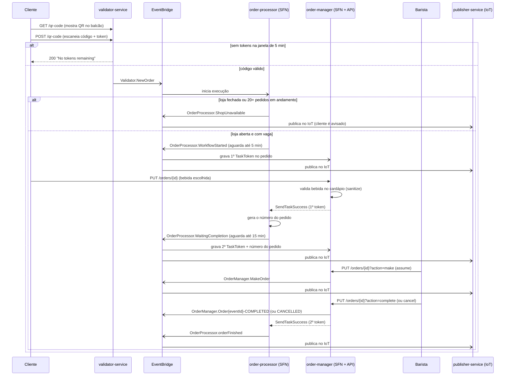
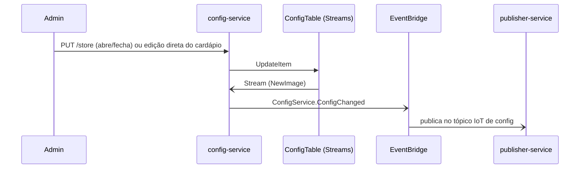

# Jornadas: Serverlesspresso

> **Em resumo:** duas jornadas. A principal é **Pedir um café**: do QR code escaneado no balcão até
> o recibo em HTML, orquestrada por duas máquinas de Step Functions que se revezam via *task
> token*. A segunda é **Configurar o evento**: como o admin abre/fecha a loja e muda o cardápio, e
> como isso se propaga sem nenhum orquestrador — por coreografia de eventos.

## Nesta página
| Jornada | Em uma linha | Quem orquestra |
|---|---|---|
| [Pedir um café](#pedir-um-café) | QR code → bebida → preparo → recibo | Duas Step Functions cooperando por *task token* |
| [Configurar o evento](#configurar-o-evento) | Admin abre a loja e define o cardápio | Coreografia por eventos, sem dono |

---

## Pedir um café

> **Em resumo:** o cliente escaneia um QR code liberado pelo balcão, escolhe a bebida, o barista
> prepara e conclui, e um recibo é gerado no fim. O pedido nunca fica "girando": ele existe como
> duas pausas de uma máquina de estados, acordadas por eventos quando alguém age.

### Em linguagem de negócio
| # | 🟨 Quem | 🟦 Faz | 🟧 Acontece | 🟪 Regra ou reação |
|---|---|---|---|---|
| 1 | Cliente | Pede o código no balcão e escaneia o QR | Pedido iniciado | Só se houver token livre na janela de 5 min (10 por padrão) |
| 2 | Sistema | Confere se a loja está aberta e há vaga | Loja indisponível *ou* pedido aceito | Aceita só com loja aberta e menos de 20 pedidos em andamento |
| 3 | Cliente | Escolhe a bebida e envia | Pedido registrado com número | Expira em 5 min se não enviar; bebida precisa existir no cardápio do evento |
| 4 | Barista | Assume o pedido | Pedido em preparo | Qualquer barista autenticado pode assumir ou devolver (unmake) |
| 5 | Barista | Conclui ou cancela | Pedido concluído *ou* cancelado | Expira em 15 min se o barista não agir; cliente é avisado na hora |
| 6 | Sistema | Fecha o pedido e monta o recibo | Pedido finalizado | Recibo em HTML publicado com a trilha completa de eventos |

🟥 **Dúvidas:** o evento de conclusão (`OrderManager.Order{eventId}-CANCELLED`) não tem um campo de
motivo estruturado — só o timeout tem (`OrderTimedOut`/`cause`); não dá para saber, só pelo evento,
*por que* o barista cancelou manualmente.

### Quem orquestra
Duas máquinas do Step Functions cooperam: **order-processor** é o dono do relógio (abre/fecha o
pedido, controla os dois tempos-limite), mas não fala com ninguém diretamente — ele publica um
evento com um `TaskToken` e **pausa**. Quem "acorda" ele é a segunda máquina, **order-manager**,
disparada via API Gateway sempre que o cliente ou o barista fazem uma ação; ela lê o token
salvo no DynamoDB e chama `SendTaskSuccess`. Não há coreografia aqui: sem uma ação humana passando
pelo order-manager, o order-processor fica parado até o timeout.

### Passo a passo técnico

Caminho de erro por timeout (fora do diagrama, para não poluir): se ninguém agir dentro dos 5 min
(cliente) ou 15 min (barista) de cada pausa, o `order-processor` emite `OrderProcessor.OrderTimeOut`
por conta própria e encerra o pedido como cancelado — sem passar pelo `order-manager`.

### Regras e dúvidas
| Regra | Valor atual | Onde |
|---|---|---|
| Pedidos simultâneos | máx. 20 (fixo no ASL, não vem da config) | `op.asl.json` → `Is capacity available?` |
| Tokens (QR) por janela | 10 a cada 5 min, por evento | `01-appCore/initDB/initMenuState.JSON` (`drinksPerBarcode`), `getCode.js` |
| Tempo para o cliente enviar a bebida | 5 min | `op.asl.json` → `HeartbeatSeconds: 300` |
| Tempo para o barista concluir | 15 min | `op.asl.json` → `HeartbeatSeconds: 900` |

🟥 O campo de config `maxOrdersInQueue` (10, visto em `initMenuState.JSON`) nunca é lido pelo
código — o limite de fato aplicado é o "20" fixo no ASL. Duas fontes de verdade para o mesmo
conceito; qual vale?

---

## Configurar o evento

> **Em resumo:** o admin abre/fecha a loja e ajusta o cardápio direto na tabela de configuração;
> qualquer mudança se propaga sozinha para quem precisar saber, sem ninguém "chamando" ninguém.

### Em linguagem de negócio
| # | 🟨 Quem | 🟦 Faz | 🟧 Acontece | 🟪 Regra ou reação |
|---|---|---|---|---|
| 1 | Admin | Abre ou fecha a loja / muda o cardápio | Configuração alterada | Toda mudança na tabela de config dispara aviso para os apps |

### Quem orquestra
Ninguém: é coreografia pura. A mudança acontece direto no DynamoDB (via API Gateway sem lambda no
meio), o DynamoDB Streams dispara `configChanged.js`, que publica `ConfigService.ConfigChanged` no
bus, e o `publisher-service` encaminha para o tópico IoT `serverlesspresso-config-{eventId}`. Não
há um serviço "dono" desse fluxo de ponta a ponta.

### Passo a passo técnico

### Regras e dúvidas
🟥 Não há endpoint para editar o cardápio (`menu`) — só `storeOpen` tem `PUT /store`. A edição do
cardápio parece ser feita direto no DynamoDB *(a confirmar)*: não achamos rota HTTP para isso.

**Fontes:** `backends/4-order-processing/statemachine/op.asl.json`,
`backends/5-order-manager/statemachine/om.asl.json`, `backends/9-validator/code/*.js`,
`backends/5-order-manager/functions/*/app.js`, `backends/2-config-service/code/configChanged.js`,
`backends/2-config-service/RestAPIs/api.yaml`, `01-appCore/template.yaml`,
`01-appCore/initDB/initMenuState.JSON`. Ver também [3-servicos.md](./3-servicos.md).
