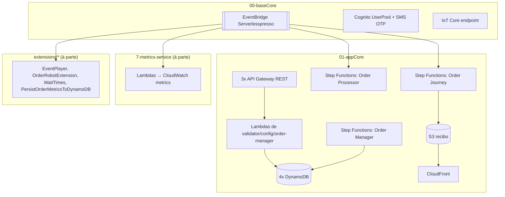

# Infraestrutura: Serverlesspresso

> **Em resumo:** tudo roda em `us-east-1` só como AWS SAM/CloudFormation, sem Kubernetes nem
> contêineres: Lambda (Node.js 14.x quase toda), duas máquinas de estado do Step Functions, um
> event bus próprio do EventBridge, quatro tabelas DynamoDB, uma API Gateway REST por serviço,
> Cognito com fluxo de login por SMS e AWS IoT Core para tempo real. Não há ambientes
> dev/homologação distintos: o próprio template é reimplantado em qualquer conta/região que o
> operador escolher.

## Nesta página
| Seção | Em uma linha |
|---|---|
| [Ambientes](#ambientes) | Um único conjunto de stacks, sem separação formal de ambientes |
| [Recursos](#recursos) | Tabela de toda a infraestrutura, por stack |
| [Implantação](#implantação) | Ordem de deploy e diagrama por stack |

## Ambientes

Não há pastas nem parâmetros de ambiente (`dev`/`staging`/`prod`). O README raiz instrui implantar
tudo manualmente com `sam deploy --guided` em `us-east-1`, escolhendo nomes de stack únicos por
conta. Cada "evento" (pop-up) é isolado por dado (`eventId`, ex. `ABC`), não por stack ou conta.
*(a confirmar: se times usam contas separadas por ambiente, não há evidência no repositório.)*

## Recursos

### Stack `00-baseCore` (`00-baseCore/template.yaml`)
| Recurso | Tipo | Tecnologia | Quem usa | Definido em |
|---|---|---|---|---|
| `ServerlesspressoEventBus` | EventBridge custom bus (`Serverlesspresso`) | EventBridge | Todos os serviços | `00-baseCore/template.yaml` |
| `LogsRule` + `LogGroupForEvents` | Regra + log group | CloudWatch Logs | Auditoria de todos os eventos do bus | `00-baseCore/template.yaml` |
| `UserPool` / `UserPoolClient` / `IdentityPool` | Cognito User Pool + Identity Pool | Cognito | Login do cliente e do barista por número de telefone | `00-baseCore/template.yaml` |
| `DefineAuthChallenge`, `CreateAuthChallenge`, `VerifyAuthChallengeResponse`, `PreSignUp` | Lambda (gatilhos do Cognito) | Node.js 14.x | Fluxo de login customizado por SMS/OTP | `00-baseCore/cognito-triggers/*.js` |
| `ServerlesspressoRealtime` + `IotEndpoint` | AWS IoT Thing + endpoint | IoT Core | Canal MQTT em tempo real para os apps | `00-baseCore/template.yaml` |
| `GetIoTEndpointFunction` | Lambda (custom resource) | Node.js 14.x | Descobre o endpoint IoT no deploy | `00-baseCore/GetIoTEndpoint.js` |

### Stack `01-appCore` (`01-appCore/template.yaml`) — a maior parte da aplicação
| Recurso | Tipo | Tecnologia | Quem usa | Definido em |
|---|---|---|---|---|
| `ConfigTable` | DynamoDB (Streams ligado) | DynamoDB | config-service, order-processor, order-manager | `01-appCore/template.yaml` |
| `CountingTable` (`serverlesspresso-counting-table`) | DynamoDB | DynamoDB | order-processor (gera número do pedido) | `01-appCore/template.yaml` |
| `ValidatorTable` (`serverlesspresso-validator`) | DynamoDB (Streams ligado, não consumido) | DynamoDB | validator-service | `01-appCore/template.yaml` |
| `OrderTable` (`serverlesspresso-order-table`, 1 LSI + 2 GSI) | DynamoDB (Streams ligado) | DynamoDB | order-manager, order-processor, order-journey | `01-appCore/template.yaml` |
| `OrderJourneyEventsTable` | DynamoDB (Streams ligado, não consumido) | DynamoDB | order-journey-service | `01-appCore/template.yaml` |
| `JourneyBucket` + `JourneyCloudFront` + `OriginAccessIdentity` | S3 + CloudFront | S3, CloudFront | Recibo HTML do pedido | `01-appCore/template.yaml` |
| `OrderProcessorStateMachine` | Step Functions (Standard) | ASL | Orquestra o ciclo de vida do pedido | `backends/4-order-processing/statemachine/op.asl.json` |
| `OrderManagerStateMachine` | Step Functions (Standard) | ASL | Ações do cliente e do barista sobre um pedido | `backends/5-order-manager/statemachine/om.asl.json` |
| `OrderJourneyService` | Step Functions (Standard) | ASL | Grava trilha de eventos e gera o recibo | `backends/8-order-journey/statemachine/StepFunction.asl.json` |
| `RESTApiValidatorService`, `RESTApiForOrderManager`, `RESTApiConfigService` | API Gateway REST (Cognito authorizer) | API Gateway | Frontends cliente/barista/admin | `01-appCore/template.yaml` |
| `GetQRcodeFunction`, `VerifyQRcodeFunction` | Lambda | Node.js 14.x | validator-service | `backends/9-validator/code/*.js` |
| `ConfigChangedFunction` | Lambda (gatilho: DynamoDB Streams da `ConfigTable`) | Node.js 14.x | config-service | `backends/2-config-service/code/configChanged.js` |
| `SanitizeOrderLambda`, `WorkFlowStarted`, `OrderTimedOut`, `WaitingCompletion` | Lambda | Node.js 14.x | order-manager | `backends/5-order-manager/functions/*/app.js` |
| `PublisherFunctionAdmin`, `PublisherFunctionUser`, `PublisherFunctionConfig` | Lambda (gatilho: EventBridge) | Node.js 14.x | publisher-service → IoT Core | `backends/6-publisher-service/code/*.js` |
| `GenerateHtml` | Lambda | Node.js 14.x | order-journey-service | `backends/8-order-journey/functions/GenerateHtml/app.js` |
| `FillDatabasesCustomResource` | Lambda (custom resource, roda 1x no deploy) | Node.js 14.x | Semeia `ConfigTable` e `CountingTable` | `01-appCore/initDB/app.js` |

### Stack `7-metrics-service` (`backends/7-metrics-service/template.yaml`) — implantada à parte
| Recurso | Tipo | Tecnologia | Quem usa | Definido em |
|---|---|---|---|---|
| `ValidatorNewOrderFunction`, `OrderManagerOrderCancelledFunction`, `OrderProcessorOrderTimeOutFunction`, `OrderManagerWaitingCompletionFunction` | Lambda (gatilho: EventBridge) | Node.js 14.x, CloudWatch PutMetric | metrics-service | `backends/7-metrics-service/code/*.js` |

### Extensões (stacks independentes, opcionais)
| Recurso | Tipo | Tecnologia | Quem usa | Definido em |
|---|---|---|---|---|
| `player.asl.json` | Step Functions | ASL | EventPlayer (simula 15 min de eventos reais) | `extensions/EventPlayer/statemachines/player.asl.json` |
| `orderBot.asl.json`, `baristaBot.asl.json` | Step Functions | ASL | OrderRobotExtension (simula clientes e baristas) | `extensions/OrderRobotExtension/statemachines/*.asl.json` |
| SQS + DynamoDB + Lambda (`publishMetric`) | SQS, DynamoDB, Lambda | Node.js | PersistOrderMetricsToDynamoDB (histórico de métricas) | `extensions/PersistOrderMetricsToDynamoDB/template.yaml` |
| Step Functions + DynamoDB + Lambda (`average`) | CDK stack | TypeScript, CDK | WaitTimes (tempo médio de espera por bebida) | `extensions/WaitTimes/lib/wait_times_stack.ts` |

### Fora do repositório
| Recurso | Observação |
|---|---|
| 3 aplicações frontend (cliente, barista, admin) | Citadas no README raiz como "not included"; consomem as APIs REST e o tópico IoT 🩷 |

### Código encontrado mas não implantado *(a confirmar)*
| Local | Observação |
|---|---|
| `backends/1-counting-service/code/*.js` | Sem `template.yaml` próprio e não referenciado por nenhum outro; o número do pedido é gerado hoje direto dentro do `OrderProcessorStateMachine` |
| `backends/4-order-processing/functions/capacity/isCapacityAvailable.js` e `functions/resumeWF/app.js` | Não aparecem em nenhum `template.yaml` implantado; a checagem de capacidade real está embutida no ASL (`ListExecutions`) |
| `backends/4-order-processing/api.yaml` (`POST /order` → EventBridge) | Não é incluído por nenhum template da stack principal; não achamos quem a chama |

## Implantação

Ordem de deploy descrita no README raiz: `00-baseCore` primeiro (bus, Cognito, IoT), depois
`01-appCore` (tudo mais). `7-metrics-service` e as `extensions/*` são stacks separadas e
opcionais, implantadas independentemente.

**Fontes:** `00-baseCore/template.yaml`, `01-appCore/template.yaml`, `backends/*/template.yaml`,
`backends/4-order-processing/statemachine/op.asl.json`, `backends/5-order-manager/statemachine/om.asl.json`,
`backends/8-order-journey/statemachine/StepFunction.asl.json`, `extensions/*/template.yaml`,
README raiz e de cada backend. Trechos marcados *(a confirmar)* são deduzidos por ausência de
referência cruzada no código, não por documentação explícita.
