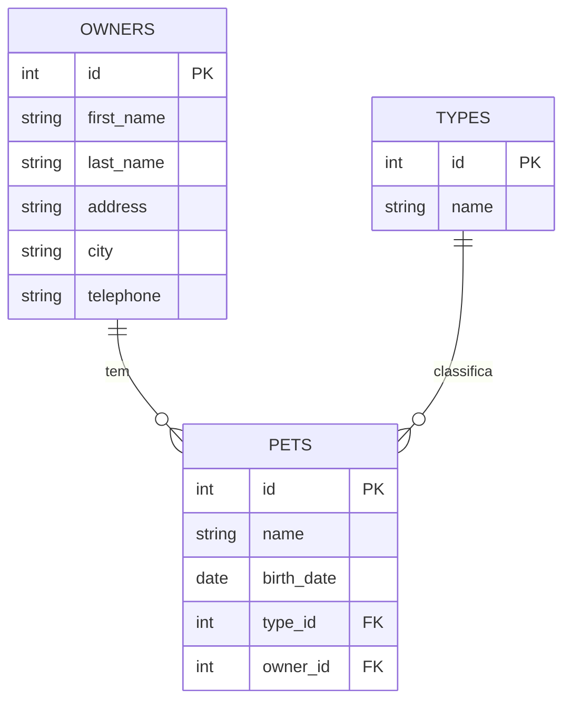
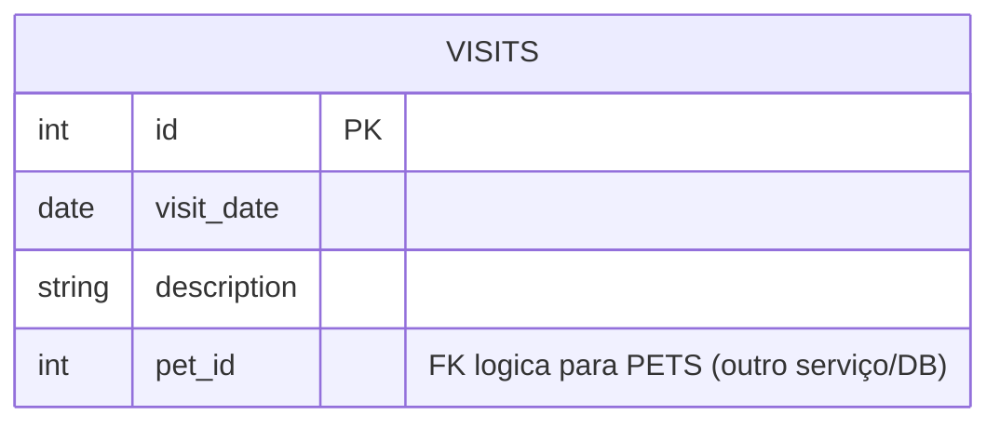
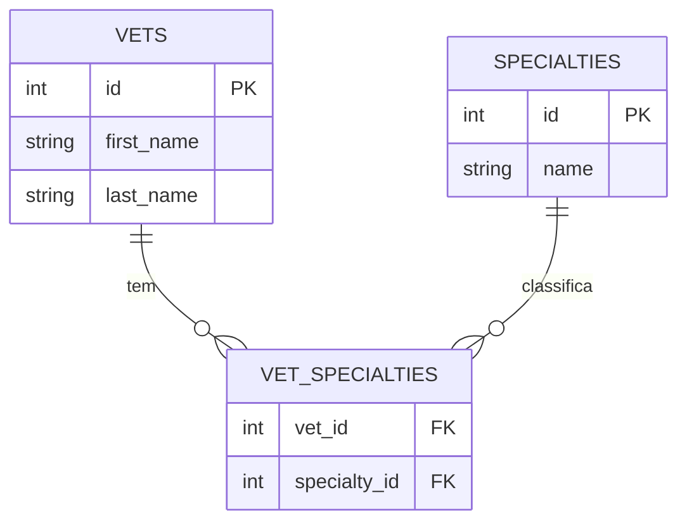

# Serviços: Clínica Veterinária

> **Em resumo:** 8 serviços Spring Boot. Quatro carregam o negócio (donos/pets, visitas,
> veterinários, chatbot de IA), um é a borda (api-gateway), três são plataforma (config,
> descoberta, admin). Comunicação só síncrona via REST/HTTP — sem fila nem eventos.

## Nesta página
| Serviço | Subdomínio | Em uma linha |
|---|---|---|
| [customers-service](#customers-service) | Cadastro | Dono do pet e seus pets: CRUD completo |
| [visits-service](#visits-service) | Atendimento | Registra e lista visitas de um pet |
| [vets-service](#vets-service) | Equipe clínica | Lista veterinários e suas especialidades (com cache) |
| [genai-service](#genai-service) | Assistente de IA | Chatbot que consulta e cria dados via tool calling |
| [api-gateway](#api-gateway) | Borda | Roteia o front-end e agrega dono + visitas |
| [config-server](#config-server) | Plataforma | Configuração centralizada vinda de um repo Git |
| [discovery-server](#discovery-server) | Plataforma | Registro de serviços (Eureka) |
| [admin-server](#admin-server) | Plataforma | Painel de saúde/observabilidade (Spring Boot Admin) |

---

## customers-service
> **Em resumo:** dono do sistema de registro de donos (`Owner`) e pets (`Pet`); é a fonte de
> verdade que os outros serviços (gateway e IA) consultam para saber quem é o dono e quais pets ele tem.

| Subdomínio | Dono | Stack | Repositório |
|---|---|---|---|
| Cadastro | *(a confirmar, sem CODEOWNERS no repo)* | Java 17, Spring Boot, Spring Data JPA, HSQLDB/MySQL | `spring-petclinic-customers-service/` |

### Expõe
| Contrato | Tipo | Para quê |
|---|---|---|
| `POST /owners` | API REST (JSON) | Cria um dono (`OwnerRequest` → `Owner`), retorna 201 |
| `GET /owners/{ownerId}` | API REST | Busca um dono por id (com seus pets) |
| `GET /owners` | API REST | Lista todos os donos |
| `PUT /owners/{ownerId}` | API REST | Atualiza dados de um dono, retorna 204; 404 se não existir |
| `GET /petTypes` | API REST | Lista os tipos de pet cadastrados (cat, dog, ...) |
| `POST /owners/{ownerId}/pets` | API REST | Cria um pet para o dono, retorna 201; 404 se dono não existir |
| `PUT /owners/*/pets/{petId}` | API REST | Atualiza um pet existente, retorna 204 |
| `GET /owners/*/pets/{petId}` | API REST | Busca detalhe de um pet (inclui tipo) |

### Consome
Não chama nenhum outro serviço do domínio; é consumido por `api-gateway` e por `genai-service`.

### Por dentro
| Componente | Gatilho | O que faz |
|---|---|---|
| `OwnerResource` | Requisições REST em `/owners` | CRUD de dono, validação `@Valid` (campos obrigatórios) |
| `PetResource` | Requisições REST em `/owners/*/pets`, `/petTypes` | CRUD de pet e listagem de tipos |
| `OwnerEntityMapper` | Chamado pelo `OwnerResource` | Copia campos de `OwnerRequest` para a entidade `Owner` |
| `ResourceNotFoundException` | Dono/pet não encontrado | Responde HTTP 404 (`@ResponseStatus`) |

### Dados

Sem máquina de estados: dono e pet são registros de cadastro (criado/atualizado), sem status de ciclo de vida.

### Quando falha
- Validação (`@NotBlank`, `@Digits(integer=12)` no telefone) rejeita a requisição antes de chegar ao banco (HTTP 400 do Spring, implícito).
- Dono ou pet inexistente → `ResourceNotFoundException` → HTTP 404.
- Sem timeout/retry configurado no próprio serviço; quem chama (api-gateway) é que aplica circuit breaker.
- Dependência `chaos-monkey-spring-boot` permite injetar falhas propositalmente com o perfil `chaos-monkey` (só em ambiente local de teste).

### Infra que usa
[Banco HSQLDB (padrão) / MySQL (opcional)](5-infraestrutura.md#recursos), [discovery-server](5-infraestrutura.md#recursos), [config-server](5-infraestrutura.md#recursos).

---

## visits-service
> **Em resumo:** registra o histórico de visitas de um pet (data + descrição). Não sabe quem é o
> dono nem o tipo do pet — só guarda o `petId`.

| Subdomínio | Dono | Stack | Repositório |
|---|---|---|---|
| Atendimento | *(a confirmar)* | Java 17, Spring Boot, Spring Data JPA, HSQLDB/MySQL | `spring-petclinic-visits-service/` |

### Expõe
| Contrato | Tipo | Para quê |
|---|---|---|
| `POST /owners/*/pets/{petId}/visits` | API REST | Cria uma visita para um pet, retorna 201 |
| `GET /owners/*/pets/{petId}/visits` | API REST | Lista visitas de um pet |
| `GET /pets/visits?petId=1&petId=2` | API REST | Lista visitas de vários pets de uma vez (usado pelo gateway) |

### Consome
Não chama nenhum outro serviço.

### Por dentro
| Componente | Gatilho | O que faz |
|---|---|---|
| `VisitResource` | Requisições REST | Cria/lista visitas; monta o `record Visits` para respostas em lote |

### Dados

`pet_id` não tem `FOREIGN KEY` para a tabela `pets` do customers-service (bancos separados) — é uma referência lógica entre serviços, não de banco. Sem estado (visita não tem status "confirmada/cancelada"), é só um registro histórico.

### Quando falha
- `@Size(max = 8192)` na descrição rejeita textos maiores.
- Sem validação de que `petId` realmente existe em customers-service — o serviço aceita qualquer inteiro.
- Sem timeout/retry próprio; o `api-gateway` isola falha desta chamada com circuit breaker ao montar a ficha do dono (ver [4-jornadas.md](4-jornadas.md)).

### Infra que usa
[Banco HSQLDB (padrão) / MySQL (opcional)](5-infraestrutura.md#recursos), [discovery-server](5-infraestrutura.md#recursos), [config-server](5-infraestrutura.md#recursos).

---

## vets-service
> **Em resumo:** cadastro de veterinários e suas especialidades; lista é cacheada em memória
> (`@Cacheable("vets")`) porque muda pouco e é lida com frequência.

| Subdomínio | Dono | Stack | Repositório |
|---|---|---|---|
| Equipe clínica | *(a confirmar)* | Java 17, Spring Boot, Spring Data JPA, HSQLDB/MySQL, Caffeine (cache) | `spring-petclinic-vets-service/` |

### Expõe
| Contrato | Tipo | Para quê |
|---|---|---|
| `GET /vets` | API REST | Lista todos os veterinários com suas especialidades (resposta cacheada) |

### Consome
Não chama nenhum outro serviço.

### Por dentro
| Componente | Gatilho | O que faz |
|---|---|---|
| `VetResource` | `GET /vets` | Retorna a lista, usando o cache Spring (`CacheConfig`) |
| `VetsProperties` | Config | Propriedades específicas do serviço *(conteúdo não detalhado)* |

### Dados

Sem estado de ciclo de vida (não há "vet ativo/inativo" no modelo).

### Quando falha
- Sem endpoints de escrita: risco de falha é só leitura indisponível.
- Cache (`@Cacheable("vets")`) implica que uma mudança no banco pode não aparecer imediatamente no `GET /vets` até o cache expirar/for limpo — TTL real de cache está no config-server externo *(a confirmar)*.
- `chaos-monkey-spring-boot` também presente aqui para testes de resiliência.

### Infra que usa
[Banco HSQLDB (padrão) / MySQL (opcional)](5-infraestrutura.md#recursos), cache em memória (Caffeine), [discovery-server](5-infraestrutura.md#recursos), [config-server](5-infraestrutura.md#recursos).

---

## genai-service
> **Em resumo:** expõe um chatbot (Spring AI) que responde perguntas sobre donos, pets e
> veterinários e pode criar donos/pets por conta própria, chamando `customers-service`
> diretamente e usando uma base vetorial pré-carregada dos veterinários para busca semântica.

| Subdomínio | Dono | Stack | Repositório |
|---|---|---|---|
| Assistente de IA | *(a confirmar)* | Java 17, Spring Boot, Spring AI (OpenAI/Azure OpenAI), Vector Store, HSQLDB | `spring-petclinic-genai-service/` |

### Expõe
| Contrato | Tipo | Para quê |
|---|---|---|
| `POST /chatclient` | API REST (corpo texto livre) | Envia uma pergunta/comando em linguagem natural ao assistente e recebe a resposta |

### Consome
| Serviço | Contrato | Tipo |
|---|---|---|
| customers-service | `GET /owners`, `POST /owners`, `POST /owners/{id}/pets` | API (via `DiscoveryClient` + `RestClient`, resolve o host pelo Eureka) |
| vets-service | `GET /vets` | API (chamada única na subida, para popular a base vetorial) |
| OpenAI / Azure OpenAI 🩷 | Chat completions + tool calling | API externa (modelo `gpt-4o-mini` por padrão, ou `gpt-4o`/Azure) |

### Por dentro
| Componente | Gatilho | O que faz |
|---|---|---|
| `PetclinicChatClient` | `POST /chatclient` | Monta o prompt do sistema, injeta memória de conversa (últimas 10 mensagens) e chama o LLM |
| `PetclinicTools` | Chamado pelo LLM (tool calling) | Expõe 4 ferramentas: `listOwners`, `addOwnerToPetclinic`, `listVets`, `addPetToOwner` |
| `AIDataProvider` | Chamado pelas tools | Faz as chamadas HTTP reais a customers-service e a busca por similaridade na base vetorial |
| `VectorStoreController` | Subida da aplicação (`ApplicationStartedEvent`) | Carrega `vectorstore.json` do classpath se existir; senão busca `GET /vets` e gera embeddings na hora |

### Dados
Não tem tabelas de negócio próprias além do suporte técnico do Spring AI (memória de chat, HSQLDB usado só como suporte de infraestrutura do framework, não para entidades do domínio). A base vetorial (`VectorStore`) guarda documentos derivados dos veterinários de `vets-service`, usada só para busca semântica em `listVets`.

Regras de negócio observadas no código do assistente (candidatas a regra de negócio real do domínio, marcadas para confirmação):
- Tipos de pet aceitos pela ferramenta `addPetToOwner`: 1=cat, 2=dog, 3=lizard, 4=snake, 5=bird, 6=hamster *(a confirmar se é regra fixa do negócio ou só documentação da tool)*.
- Busca de veterinários retorna até 20 resultados com filtro, ou até 50 sem filtro (`topK`).

### Quando falha
- Falha ao chamar o LLM é capturada em `PetclinicChatClient.exchange` e devolve a mensagem "Chat is currently unavailable. Please try again later." (sem propagar erro 500 ao usuário).
- `api-gateway` também protege a rota `/api/genai/**` com um circuit breaker próprio (`genaiCircuitBreaker`) que cai no mesmo `/fallback`.
- Erros ao processar JSON na tool `listVets` são logados e retornam lista vazia em vez de falhar.

### Infra que usa
[discovery-server](5-infraestrutura.md#recursos), [config-server](5-infraestrutura.md#recursos), [OpenAI/Azure OpenAI](5-infraestrutura.md#recursos), banco HSQLDB local (suporte, não domínio).

---

## api-gateway
> **Em resumo:** porta de entrada única: serve o front-end AngularJS estático, roteia
> `/api/**` para os serviços de negócio e é o único ponto que agrega dados de dois serviços
> (dono + visitas) numa mesma resposta.

| Subdomínio | Dono | Stack | Repositório |
|---|---|---|---|
| Borda | *(a confirmar)* | Java 17, Spring Cloud Gateway (WebFlux), Resilience4j, AngularJS (front-end embutido) | `spring-petclinic-api-gateway/` |

### Expõe
| Contrato | Tipo | Para quê |
|---|---|---|
| `GET /` e estáticos | Web | Serve o front-end AngularJS (`static/index.html` e assets) |
| `GET /api/gateway/owners/{ownerId}` | API REST | Agrega dono (customers-service) + visitas de cada pet (visits-service) numa resposta só |
| `/api/vet/**` → `vets-service` (strip 2) | Proxy REST | Repassa para `GET /vets` |
| `/api/visit/**` → `visits-service` (strip 2) | Proxy REST | Repassa para os endpoints de visita |
| `/api/customer/**` → `customers-service` (strip 2) | Proxy REST | Repassa para os endpoints de dono/pet |
| `/api/genai/**` → `genai-service` (strip 2, com circuit breaker próprio) | Proxy REST | Repassa para `/chatclient` |
| `POST /fallback` | API REST | Resposta padrão quando um circuit breaker abre |

### Consome
| Serviço | Contrato | Tipo |
|---|---|---|
| customers-service | `GET /owners/{ownerId}` | API (via `WebClient` balanceado por nome de serviço Eureka) |
| visits-service | `GET /pets/visits?petId=...` | API (mesma forma) |
| vets-service, genai-service | Proxy transparente via Spring Cloud Gateway | API |

### Por dentro
| Componente | Gatilho | O que faz |
|---|---|---|
| `ApiGatewayController` | `GET /api/gateway/owners/{id}` | Busca o dono, depois busca visitas de todos os pets dele em paralelo, protegido por circuit breaker `getOwnerDetails` |
| `CustomersServiceClient` / `VisitsServiceClient` | Chamado pelo controller acima | Encapsulam as chamadas HTTP reativas (`WebClient`) |
| `FallbackController` | Circuit breaker aberto (rota do gateway ou `getOwnerDetails`) | Retorna 503 com mensagem genérica |
| `defaultCustomizer` (`ApiGatewayApplication`) | Config do Resilience4j | Timeout padrão de 10s para os circuit breakers reativos |

### Dados
Não tem banco próprio; os DTOs (`OwnerDetails`, `PetDetails`, `VisitDetails`, `Visits`, `PetType`) são só formas de transporte que espelham os modelos de customers-service e visits-service.

### Quando falha
- Se `visits-service` falhar/estourar timeout ao montar a ficha do dono, o circuit breaker `getOwnerDetails` devolve lista de visitas vazia (`emptyVisitsForPets`) — o dono aparece, mas sem histórico de visitas, sem erro visível.
- Rotas `/api/**` têm filtro `CircuitBreaker` padrão com `fallbackUri: forward:/fallback` e uma retentativa (`Retry`, 1 tentativa) para respostas `SERVICE_UNAVAILABLE` em `POST`.
- Rota do genai-service tem circuit breaker dedicado (`genaiCircuitBreaker`).

### Infra que usa
[discovery-server](5-infraestrutura.md#recursos), [config-server](5-infraestrutura.md#recursos).

---

## config-server
> **Em resumo:** entrega configuração centralizada a todos os outros serviços na subida, lendo de
> um repositório Git externo (ou de um diretório local no perfil `native`).

| Subdomínio | Dono | Stack | Repositório |
|---|---|---|---|
| Plataforma | *(a confirmar)* | Java 17, Spring Cloud Config Server | `spring-petclinic-config-server/` |

### Expõe
| Contrato | Tipo | Para quê |
|---|---|---|
| Endpoints padrão do Spring Cloud Config (`/{application}/{profile}`, etc.) | API REST *(a confirmar caminhos exatos, vem do framework)* | Serve o `application.yml`/`.properties` de cada serviço por nome+perfil |

### Consome
| Serviço/Sistema | Contrato | Tipo |
|---|---|---|
| Repositório Git `spring-petclinic-microservices-config` 🩷 | Git clone/pull | Externo |

### Por dentro
Só a configuração declarada em `application.yml` (URI do Git, `default-label: main`, e um perfil `native` que lê de `${GIT_REPO}` local em vez de clonar).

### Dados
Sem banco.

### Quando falha
Os demais serviços importam a config como `optional:configserver:...` — ou seja, se o config-server estiver fora do ar, a subida não é bloqueada (mas os serviços podem faltar configurações esperadas) *(comportamento exato de fallback não testado, dedução da palavra `optional`)*.

### Infra que usa
Repositório Git externo (ver [5-infraestrutura.md](5-infraestrutura.md#recursos)).

---

## discovery-server
> **Em resumo:** registro de serviços via Eureka; todo serviço de aplicação se registra aqui e
> descobre os outros pelo nome lógico (`lb://customers-service`, etc.).

| Subdomínio | Dono | Stack | Repositório |
|---|---|---|---|
| Plataforma | *(a confirmar)* | Java 17, Spring Cloud Netflix Eureka Server | `spring-petclinic-discovery-server/` |

### Expõe
| Contrato | Tipo | Para quê |
|---|---|---|
| Dashboard/API Eureka (`/eureka/**`, painel em `:8761`) | API/Web *(framework, não customizado no código)* | Registro e descoberta de instâncias |

### Consome
Nenhum outro serviço do domínio; é consumido por todos.

### Por dentro
`DiscoveryServerApplication` com `@EnableEurekaServer` — sem customização adicional.

### Dados
Sem banco (registro fica em memória do próprio Eureka).

### Quando falha
Serviços não conseguem se descobrir; chamadas via `lb://` ou `DiscoveryClient` (gateway, genai-service) param de encontrar instâncias saudáveis. `docker-compose.yml` só sobe os demais serviços após `discovery-server` reportar `service_healthy`.

### Infra que usa
Nenhuma dependência externa além de si mesmo.

---

## admin-server
> **Em resumo:** painel de operação (Spring Boot Admin) para visualizar saúde e métricas dos
> outros serviços registrados no Eureka.

| Subdomínio | Dono | Stack | Repositório |
|---|---|---|---|
| Plataforma | *(a confirmar)* | Java 17, Spring Boot Admin Server, Jolokia | `spring-petclinic-admin-server/` |

### Expõe
| Contrato | Tipo | Para quê |
|---|---|---|
| Painel Spring Boot Admin (`:9090`) | Web | Visualização de saúde/métricas/logs dos serviços descobertos via Eureka |

### Consome
Descobre e monitora os demais serviços de aplicação via Eureka (não é uma chamada de contrato de negócio, é infraestrutura de observabilidade).

### Por dentro
`SpringBootAdminApplication` com `@EnableAdminServer` + `@EnableDiscoveryClient` — sem customização adicional.

### Dados
Sem banco.

### Quando falha
Perda do painel de observabilidade; não afeta o funcionamento dos demais serviços (é só leitura de status).

### Infra que usa
[discovery-server](5-infraestrutura.md#recursos), [config-server](5-infraestrutura.md#recursos).

**Fontes:** controllers e clientes lidos diretamente (`OwnerResource.java`, `PetResource.java`, `VisitResource.java`, `VetResource.java`, `ApiGatewayController.java`, `CustomersServiceClient.java`, `VisitsServiceClient.java`, `FallbackController.java`, `PetclinicChatClient.java`, `PetclinicTools.java`, `AIDataProvider.java`, `VectorStoreController.java`); entidades JPA (`Owner.java`, `Pet.java`, `PetType.java`, `Visit.java`, `Vet.java`, `Specialty.java`); `db/mysql/schema.sql` de cada serviço; `application.yml` de cada módulo (rotas do gateway, perfis, cache, IA); `*Application.java` (anotações `@Enable*`); `pom.xml` de cada módulo (stack e dependências). Sem OpenAPI/AsyncAPI no repositório — contratos documentados a partir do código dos controllers.
