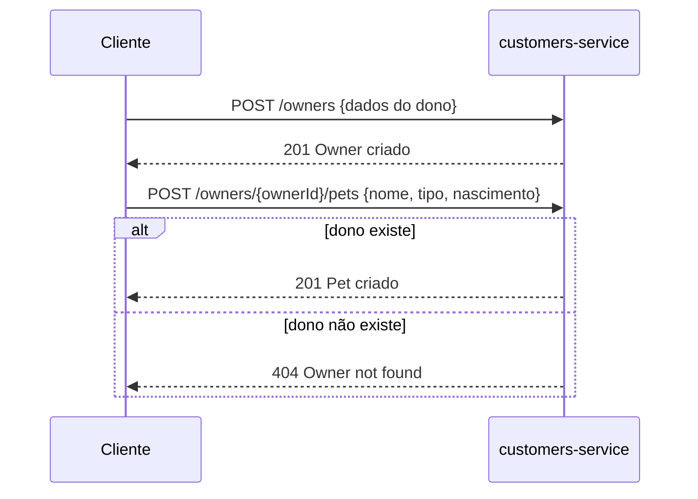
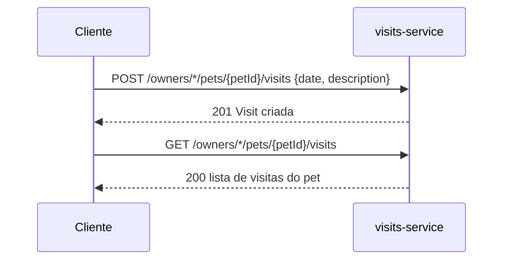
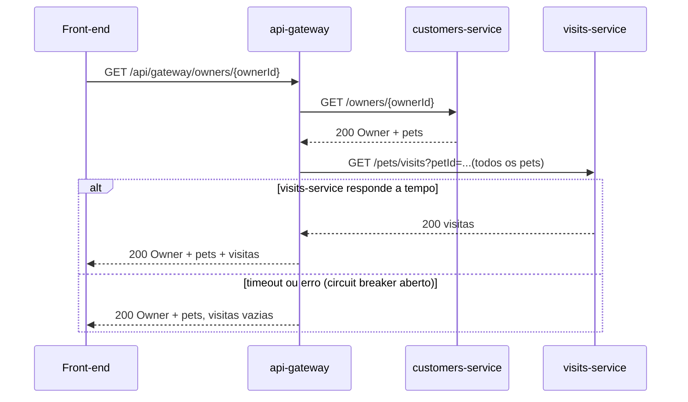
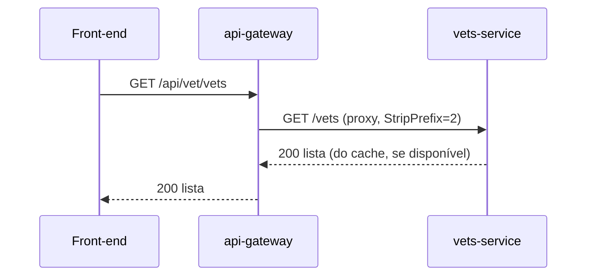
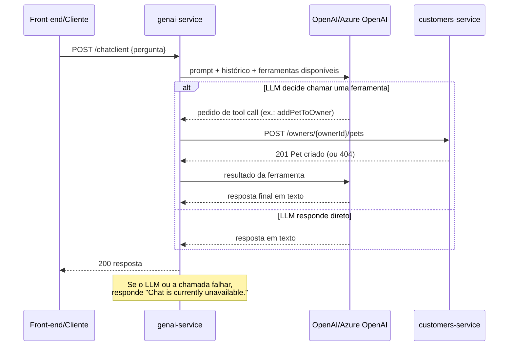

# Jornadas: Clínica Veterinária

> **Em resumo:** 5 jornadas, todas síncronas via REST. Sem orquestrador único: cada jornada é uma
> chamada direta a um serviço, ou uma agregação pontual do `api-gateway` (junta dois serviços,
> com circuit breaker).

## Nesta página
| Jornada | Em uma linha | Quem orquestra |
|---|---|---|
| [Cadastrar dono e pet](#cadastrar-dono-e-pet) | Recepção registra um novo dono e seus pets | Sem orquestrador — chamada direta ao customers-service |
| [Registrar uma visita](#registrar-uma-visita) | Clínica registra o atendimento de um pet | Sem orquestrador — chamada direta ao visits-service |
| [Consultar a ficha do dono](#consultar-a-ficha-do-dono) | Ver o dono com seus pets e o histórico de visitas de cada um | `api-gateway` agrega customers-service + visits-service |
| [Consultar veterinários](#consultar-veterinários) | Ver a equipe clínica e suas especialidades | Sem orquestrador — chamada direta ao vets-service (cacheada) |
| [Conversar com o assistente de IA](#conversar-com-o-assistente-de-ia) | Perguntar ou pedir ações em linguagem natural | `genai-service` decide (tool calling) quais chamadas fazer |

---

## Cadastrar dono e pet
> **Em resumo:** a recepção (ou o próprio front-end) cria o dono e, na sequência, adiciona um ou
> mais pets a ele. Cada pet pertence a exatamente um dono.

**Em linguagem de negócio:**
| # | 🟨 Quem | 🟦 Faz | 🟧 Acontece | 🟪 Regra ou reação |
|---|---|---|---|---|
| 1 | Recepção/dono | Preenche dados do dono (nome, endereço, cidade, telefone) | Dono cadastrado | Nome, endereço, cidade e telefone são obrigatórios; telefone só números, até 12 dígitos |
| 2 | Recepção/dono | Escolhe o tipo do pet e preenche nome e data de nascimento | Pet cadastrado, associado ao dono | Pet precisa de um dono já existente; nome do pet não pode ser vazio |

**Quem orquestra:** ninguém — são duas chamadas independentes e sequenciais ao `customers-service` (`POST /owners`, depois `POST /owners/{ownerId}/pets`), decididas pelo cliente (front-end ou o assistente de IA).

**Passo a passo técnico:**

**Regras e dúvidas:** não há transação única cobrindo dono+pet — se a segunda chamada falhar, o dono já existe sem pet (aceitável no modelo atual, mas sem compensação). 🟥 Não está claro se existe uma tela/fluxo que impeça cadastrar pet sem ownerId válido no front-end antes de chamar a API *(a confirmar)*.

---

## Registrar uma visita
> **Em resumo:** a clínica registra que um pet foi atendido, com data e descrição livre; não há
> conceito de agendamento prévio com confirmação — é um registro histórico do atendimento.

**Em linguagem de negócio:**
| # | 🟨 Quem | 🟦 Faz | 🟧 Acontece | 🟪 Regra ou reação |
|---|---|---|---|---|
| 1 | Clínica/veterinário | Registra a visita de um pet (data + descrição) | Visita registrada | Descrição até 8192 caracteres; `petId` é só um número, sem checagem de existência |

**Quem orquestra:** ninguém — chamada direta ao `visits-service`.

**Passo a passo técnico:**

**Regras e dúvidas:** 🟥 `visits-service` não valida que o `petId` existe em `customers-service` (bancos separados, sem chamada cruzada) — é possível registrar uma visita para um pet inexistente. Não há status da visita (agendada/realizada/cancelada), só a existência do registro.

---

## Consultar a ficha do dono
> **Em resumo:** a jornada mais "orquestrada" do domínio — o `api-gateway` busca o dono e, em
> paralelo, as visitas de todos os pets dele, juntando tudo numa única resposta para o front-end.
> Se as visitas falharem, a ficha aparece mesmo assim, só que sem histórico.

**Em linguagem de negócio:**
| # | 🟨 Quem | 🟦 Faz | 🟧 Acontece | 🟪 Regra ou reação |
|---|---|---|---|---|
| 1 | Dono/recepção | Abre a ficha de um dono | Ficha exibida com dono, pets e visitas de cada pet | Se o histórico de visitas não puder ser buscado a tempo, a ficha mostra os pets sem visitas em vez de falhar |

**Quem orquestra:** `api-gateway` (`ApiGatewayController.getOwnerDetails`) — busca síncrona em `customers-service`, depois busca em paralelo (reativo) em `visits-service`, protegida por um circuit breaker (`getOwnerDetails`).

**Passo a passo técnico:**

**Regras e dúvidas:** o timeout do circuit breaker reativo padrão é 10s (`ApiGatewayApplication.defaultCustomizer`). 🟥 Não há indicação visual ao usuário de que as visitas podem estar faltando por falha técnica — a resposta é indistinguível de "pet sem visitas".

---

## Consultar veterinários
> **Em resumo:** lista simples da equipe clínica e suas especialidades; a resposta é cacheada em
> memória no `vets-service`, então uma mudança recente pode não aparecer de imediato.

**Em linguagem de negócio:**
| # | 🟨 Quem | 🟦 Faz | 🟧 Acontece | 🟪 Regra ou reação |
|---|---|---|---|---|
| 1 | Dono/recepção | Consulta a lista de veterinários | Lista exibida com nome e especialidades | Resposta pode vir do cache (`@Cacheable("vets")`) |

**Quem orquestra:** ninguém — chamada direta (via `api-gateway` como proxy transparente `/api/vet/**`) ao `vets-service`.

**Passo a passo técnico:**

**Regras e dúvidas:** 🟥 TTL/política de invalidação do cache não está no código deste repositório (provável configuração externa no config-server) *(a confirmar)*.

---

## Conversar com o assistente de IA
> **Em resumo:** o usuário manda uma mensagem em linguagem natural; o `genai-service` decide, via
> tool calling do LLM, se precisa listar donos, listar veterinários (busca semântica), ou criar
> dono/pet — chamando `customers-service` diretamente, sem passar pelo `api-gateway`.

**Em linguagem de negócio:**
| # | 🟨 Quem | 🟦 Faz | 🟧 Acontece | 🟪 Regra ou reação |
|---|---|---|---|---|
| 1 | Usuário | Envia uma pergunta ou pedido em texto livre | Pergunta recebida | Mantém memória das últimas 10 mensagens da conversa |
| 2 | Assistente de IA | Decide se precisa de dados (lista de donos, veterinários) ou de uma ação (criar dono/pet) | Ferramenta certa é chamada | Só usa as 4 ferramentas expostas em `PetclinicTools` |
| 3 | Assistente de IA | Responde com base no resultado da ferramenta (ou direto, se não precisar de dados) | Resposta enviada ao usuário | Se não souber a resposta, deve dizer que não sabe e perguntar de volta (instrução do prompt de sistema) |

**Quem orquestra:** o próprio LLM decide a sequência de chamadas via tool calling (não há um fluxo fixo programado); `genai-service` é o único componente que fala com `customers-service` nessa jornada, resolvendo o endereço por `DiscoveryClient` (Eureka) em vez de passar pelo `api-gateway`.

**Passo a passo técnico:**

**Regras e dúvidas:** a lista de tipos de pet aceitos pela ferramenta (1=cat...6=hamster) está descrita só no texto da ferramenta para o LLM seguir — 🟥 não há validação server-side que barre um `typeId` fora dessa lista antes de chamar `customers-service`. A rota do gateway `/api/genai/**` tem seu próprio circuit breaker (`genaiCircuitBreaker`), mas o chat também pode ser acessado direto na porta do `genai-service` sem passar pelo gateway *(a confirmar qual caminho o front-end realmente usa)*.

**Fontes:** `ApiGatewayController.java`, `CustomersServiceClient.java`, `VisitsServiceClient.java`, `FallbackController.java`, `ApiGatewayApplication.java` (timeout do circuit breaker), `application.yml` do api-gateway (rotas, retry, circuit breaker do genai); `OwnerResource.java`, `PetResource.java`, `VisitResource.java`, `VetResource.java`; `PetclinicChatClient.java`, `PetclinicTools.java`, `AIDataProvider.java` (fluxo do chatbot e tool calling); `VetsServiceApplication`/`CacheConfig` (cache de vets, mencionado no serviço). Sequências reconstruídas a partir do código (não há diagramas de sequência nem OpenAPI no repositório).
