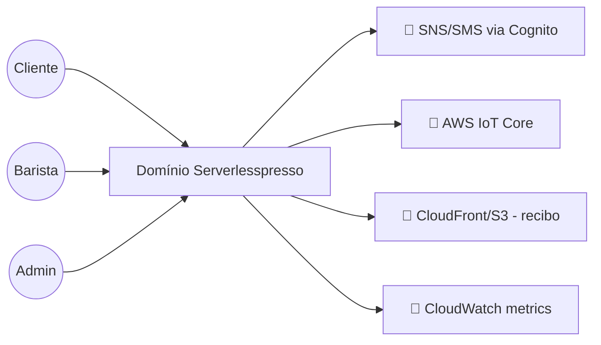

# Arquitetura: Serverlesspresso

> **Em resumo:** um único event bus do EventBridge (`Serverlesspresso`) conecta nove serviços
> serverless; dois deles são máquinas de Step Functions que se revezam para orquestrar o pedido, o
> resto é coreografia por eventos (nome do evento como contrato). Nada é síncrono entre serviços,
> exceto as chamadas REST que vêm de fora (dos 3 frontends) e o par de `SendTaskSuccess` que liga
> as duas máquinas de estado.

## Nesta página

| Seção |
|---|
| [Contexto](#contexto) |
| [Subdomínios](#subdomínios) |
| [Mapa dos serviços](#mapa-dos-serviços) |
| [Estilo de integração](#estilo-de-integração) |
| [Decisões que moldam](#decisões-que-moldam) |
| [Riscos técnicos](#riscos-técnicos) |

## Contexto

Os 3 frontends (app do cliente, app do barista, painel admin) **não estão neste repositório**
(README raiz); eles só aparecem aqui como consumidores das APIs REST e do tópico IoT.

## Subdomínios

| Subdomínio | Responsabilidade | Serviços |
|---|---|---|
| Plataforma | Event bus, login por SMS, endpoint de tempo real | `00-baseCore` |
| Validação do pedido | Portão de entrada: QR code com token limitado por janela | `validator-service` |
| Configuração do evento | Cardápio, limites e loja aberta/fechada | `config-service` |
| Processamento do pedido | Relógio do pedido: capacidade, timeouts, task tokens | `order-processor` |
| Gestão do pedido | Ações do cliente e do barista sobre um pedido | `order-manager` |
| Tempo real | Espelha eventos de negócio nos 3 frontends | `publisher-service` |
| Recibo do pedido | Trilha de eventos + HTML final | `order-journey-service` |
| Métricas | CloudWatch customizado | `metrics-service` |
| Extensões | Simulação e analytics opcionais, desacoplados | `EventPlayer`, `OrderRobotExtension`, `PersistOrderMetricsToDynamoDB`, `WaitTimes` |

## Mapa dos serviços

<!-- MAPA-PRINCIPAL -->

Relações de dependência declaradas em [Serviços](3-servicos.md); a seta parte do consumidor e aponta para seu fornecedor. O rótulo distingue chamada, evento, dado, callback e inicialização. Componentes opcionais e inativos conservam seu estado.

## Estilo de integração

| De → Para | Estilo | Observação |
|---|---|---|
| Frontends → validator/config/order-manager | Síncrono (REST via API Gateway, auth Cognito) | Único ponto síncrono externo |
| validator-service → order-processor | Assíncrono (evento `Validator.NewOrder` inicia a Step Function) | Coreografia |
| order-processor ⇄ order-manager | **Orquestração cruzada** via *task token* persistido no DynamoDB + `SendTaskSuccess` | Não é nem puro evento nem chamada direta — um workflow pausa e o outro o resume |
| order-processor/order-manager → publisher-service, order-journey-service, metrics-service | Assíncrono (EventBridge, roteado por `detail-type`) | Coreografia pura, várias regras de rota por prefixo |
| publisher-service → frontends | Assíncrono (MQTT via IoT Core) | Sem confirmação de entrega tratada pelo domínio |
| config-service (mudança na tabela) → resto do domínio | Assíncrono (DynamoDB Streams → EventBridge) | Não há API para mudar o cardápio, só a tabela `storeOpen` |

## Decisões que moldam

| Decisão | Onde está detalhada |
|---|---|
| Duas máquinas de Step Functions cooperando por *task token* em vez de uma só | [6-referencia.md → Decisões #1](./6-referencia.md#decisões) |
| AWS IoT Core (MQTT) para tempo real, em vez de WebSocket API ou polling | [6-referencia.md → Decisões #2](./6-referencia.md#decisões) |
| Uma tabela de config única por `eventId`, propagada por Streams | [6-referencia.md → Decisões #3](./6-referencia.md#decisões) |

## Riscos técnicos

- **Limite de 20 pedidos simultâneos fixo no ASL** (não vem da config `maxOrdersInQueue`): mudar a
  capacidade do evento exige editar e reimplantar a máquina de estados, não só a config.
- **Task token perdido = pedido preso até o timeout.** O elo entre as duas Step Functions é um
  campo (`TaskToken`) numa linha do DynamoDB; se essa linha for sobrescrita, apagada ou o
  `ConditionExpression` falhar, o `order-processor` só sai da pausa quando o timeout (5 ou 15 min)
  estourar — não há alarme nem retry visível para esse caso.
- **`publisher-service` engole erro de IoT silenciosamente** (`try/catch` só loga): um frontend
  pode parar de receber atualização em tempo real sem que nada no backend acuse falha.
- **`order-journey-service` escuta *todo* evento do bus** (sem filtro de `detail-type`): qualquer
  novo tipo de evento adicionado ao domínio passa a ser processado por ele também, ainda que não
  pertença a um pedido — o primeiro `Choice` descarta o que não tem `userId`, mas isso significa
  reprocessar tudo o tempo todo.
- **Código órfão convivendo com o código ativo** (`1-counting-service`, os dois lambdas de
  `4-order-processing/functions`, o `api.yaml` de `/order`): risco de alguém reativar ou editar o
  caminho errado achando que é o que está no ar.

**Fontes:** todos os `template.yaml`/`*.asl.json` e handlers citados em
[3-servicos.md](./3-servicos.md) e [5-infraestrutura.md](./5-infraestrutura.md); README raiz para
os frontends externos.
