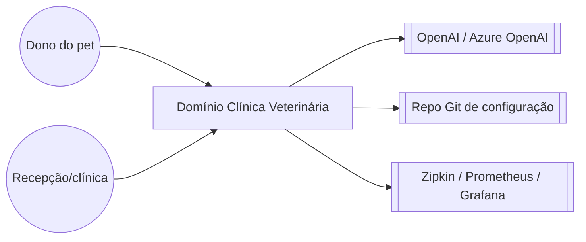

# Arquitetura: Clínica Veterinária

> **Em resumo:** microsserviços Spring Cloud — um serviço por subdomínio (donos/pets, visitas,
> veterinários, IA), um gateway de borda que agrega e roteia, três serviços de plataforma
> (config, descoberta, admin). Tudo síncrono via REST; sem fila, evento ou orquestrador.

## Nesta página

| Seção |
|---|
| [Contexto](#contexto) |
| [Subdomínios](#subdomínios) |
| [Mapa dos serviços](#mapa-dos-serviços) |
| [Estilo de integração](#estilo-de-integração) |
| [Decisões que moldam](#decisões-que-moldam) |
| [Riscos técnicos](#riscos-técnicos) |

## Contexto

O domínio não conversa hoje com outros domínios de negócio externos (não há integração com faturamento, laboratório, estoque, etc. neste repositório) — só com o front-end embutido, um provedor de LLM e a infraestrutura de plataforma/observabilidade.

## Subdomínios

| Subdomínio | Responsabilidade | Serviços |
|---|---|---|
| Cadastro | Dono do pet e seus pets (fonte de verdade) | `customers-service` |
| Atendimento | Histórico de visitas de cada pet | `visits-service` |
| Equipe clínica | Veterinários e especialidades | `vets-service` |
| Assistente de IA | Chat em linguagem natural sobre o domínio, com ações | `genai-service` |
| Borda | Front-end, roteamento e agregação para quem consome | `api-gateway` |
| Plataforma | Configuração, descoberta e observabilidade operacional | `config-server`, `discovery-server`, `admin-server` |

## Mapa dos serviços

<!-- MAPA-PRINCIPAL -->

Relações de dependência declaradas em [Serviços](3-servicos.md); a seta parte do consumidor e aponta para seu fornecedor. O rótulo distingue chamada, evento, dado, callback e inicialização. Componentes opcionais e inativos conservam seu estado.

`visits-service` e `vets-service` não chamam nenhum outro serviço de negócio — são "folhas" do grafo, só respondem.

## Estilo de integração

| Estilo | Onde | Observação |
|---|---|---|
| Síncrono REST | Todas as chamadas entre serviços | Via `WebClient`/`RestClient`/`RestTemplate` balanceados por nome (Eureka), ou proxy do Spring Cloud Gateway |
| Agregação pontual (fan-out) | `api-gateway.getOwnerDetails` | Busca `customers-service` e depois `visits-service` em sequência (dono antes das visitas), junta e devolve; não é uma saga (sem compensação, só fallback de dados vazios) |
| Tool calling (LLM decide a chamada) | `genai-service` | O LLM escolhe, em tempo de execução, qual função Java chamar (`PetclinicTools`) com base no pedido do usuário |
| Assíncrono/eventos | Nenhum | Não há Kafka, SQS/SNS, RabbitMQ nem qualquer publish/subscribe no repositório |
| Orquestração de processo (BPM/Step Functions/Temporal) | Nenhum | Não há `.bpmn`, `.asl.json`, nem dependência de Camunda/Temporal/Step Functions |

Não há coreografia por eventos nem orquestrador dedicado: cada jornada é uma cadeia curta de chamadas síncronas decidida pelo próprio código do serviço que inicia a chamada (`api-gateway` ou `genai-service`) — ver [4-jornadas.md](4-jornadas.md).

## Decisões que moldam

| Decisão | Efeito | Link |
|---|---|---|
| Um banco lógico por serviço (mesmo nome `petclinic`, tabelas diferentes) | Isolamento de dados por serviço, mas nomeação do banco pode confundir operação (ver risco abaixo) | [6-referencia.md](6-referencia.md#decisões) |
| Configuração centralizada num repositório Git externo | Serviços não têm segredo/porta hardcoded no código, mas a doc real de configuração vive fora deste repo | [6-referencia.md](6-referencia.md#decisões) |
| Chat de IA chama `customers-service` direto (não via gateway) | Menor latência e acoplamento simples, mas rota de escrita adicional fora do proxy central | [6-referencia.md](6-referencia.md#decisões) |
| Circuit breaker isola falha de `visits-service` na ficha do dono | Ficha do dono nunca falha por causa do histórico de visitas, mas pode esconder indisponibilidade | [6-referencia.md](6-referencia.md#decisões) |

## Riscos técnicos

- **Ficha do dono "mente" sobre visitas ausentes:** se `visits-service` estiver fora ou lento, `api-gateway` devolve a ficha com visitas vazias em vez de erro — visualmente igual a "pet sem histórico" (ver [4-jornadas.md](4-jornadas.md#consultar-a-ficha-do-dono)).
- **`genai-service` pode criar dados sem validação de negócio equivalente ao front-end:** a ferramenta `addPetToOwner` aceita qualquer `typeId` inteiro; a lista de tipos válidos só existe como texto de instrução para o LLM, não como validação no `customers-service`.
- **Sem transação entre visits-service e customers-service:** uma visita pode ser registrada para um `petId` que não existe (bancos separados, sem checagem cruzada).
- **Banco MySQL compartilhado com o mesmo nome (`petclinic`) por três serviços:** se apontados para a mesma instância MySQL, `customers-service`, `vets-service` e `visits-service` usam o mesmo banco lógico (tabelas diferentes, sem colisão hoje, mas rompe o isolamento típico de "um banco por serviço") *(a confirmar se em produção cada serviço aponta para uma instância própria)*.
- **Cache de veterinários pode atrasar a visão de mudanças:** `@Cacheable("vets")` sem TTL visível neste repositório.
- **Sem observabilidade de negócio, só técnica:** métricas existentes (`@Timed petclinic.owner/pet/visit`) medem volume/latência de chamadas, não indicadores de negócio (ver [1-negocio.md](1-negocio.md#indicadores)).

**Fontes:** `docker-compose.yml` e `*/src/main/resources/application.yml` (rotas do gateway, dependências entre serviços); `ApiGatewayController.java`, `CustomersServiceClient.java`, `VisitsServiceClient.java` (agregação e circuit breaker); `AIDataProvider.java`, `PetclinicTools.java` (chamada direta do genai-service ao customers-service); `db/mysql/schema.sql` dos três serviços (mesmo nome de banco); busca no repositório por `*.bpmn`, `*.asl.json`, filas/tópicos (nenhum encontrado).
