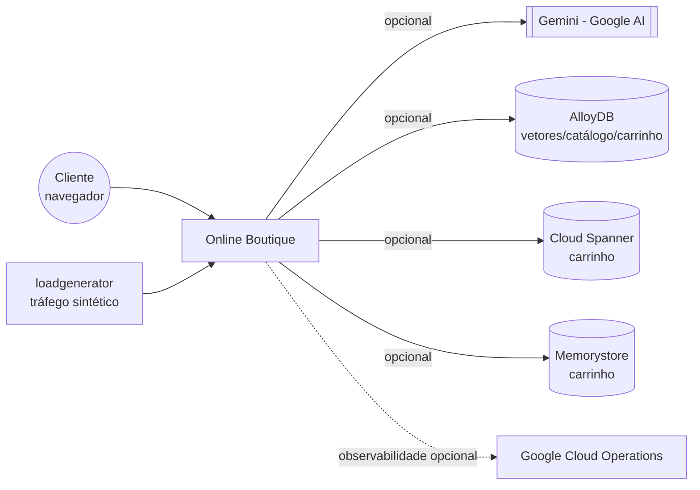

# Arquitetura: Online Boutique

> **Em resumo:** 11 microsserviços poliglotas (Go, Java, Node.js, Python, C#) que conversam quase
> exclusivamente por gRPC síncrono, definidos em um único contrato compartilhado
> (`protos/demo.proto`). Não há barramento de eventos nem fila — a única "orquestração" é o
> `checkoutservice`, que chama os demais em sequência dentro de uma requisição. O `frontend` é o
> único ponto de entrada externo; tudo mais é interno ao cluster.

## Nesta página

| Seção |
|---|
| [Contexto](#contexto) |
| [Subdomínios](#subdomínios) |
| [Mapa dos serviços](#mapa-dos-serviços) |
| [Estilo de integração](#estilo-de-integração) |
| [Decisões que moldam](#decisões-que-moldam) |
| [Riscos técnicos](#riscos-técnicos) |

## Contexto

Não há sistema de pagamento, transportadora ou provedor de email reais — `paymentservice`,
`shippingservice` e `emailservice` são mocks internos ao domínio (ver `3-servicos.md`).

## Subdomínios

| Subdomínio | Responsabilidade | Serviços |
|---|---|---|
| Experiência do cliente | Servir o site, agregar dados dos demais subdomínios | `frontend` |
| Carrinho | Guardar os itens escolhidos por sessão | `cartservice` |
| Catálogo | Listar, buscar e detalhar produtos | `productcatalogservice` |
| Precificação | Converter valores entre moedas | `currencyservice` |
| Frete | Cotar e "despachar" o pedido | `shippingservice` |
| Checkout | Orquestrar a compra ponta a ponta | `checkoutservice` |
| Pagamento | Validar e "cobrar" o cartão | `paymentservice` |
| Notificação | Confirmar o pedido por email | `emailservice` |
| Descoberta | Sugerir produtos/anúncios ao cliente | `recommendationservice`, `adservice`, `shoppingassistantservice` (opcional) |
| Suporte (fora do negócio) | Gerar tráfego de teste | `loadgenerator` |

## Mapa dos serviços

<!-- MAPA-PRINCIPAL -->

O mapa mostra as dependências declaradas em [Serviços](3-servicos.md): a seta vai do consumidor ao
fornecedor e o rótulo diz o tipo (chamada, dado, inicialização). **Não é cronologia** — a ordem do
checkout está na [sequência da compra](4-jornadas.md#comprar-um-produto). Também não é inventário
completo: recursos de infraestrutura (Redis, bancos opcionais, segredos) ficam em
[Infraestrutura](5-infraestrutura.md).

## Estilo de integração

Tudo é síncrono por gRPC, com contrato único em `protos/demo.proto`; a exceção é
`frontend` → `shoppingassistantservice`, que usa HTTP/JSON. Não há mensageria. A compra é
orquestrada em código por `checkoutservice.PlaceOrder`; as demais telas chamam os serviços
diretamente. Só `adservice` tem timeout explícito no chamador (100 ms); nos demais não foi
encontrado timeout nem retry *(a confirmar)*.

## Decisões que moldam

Nenhum ADR existe no repositório; as decisões abaixo foram **reconstruídas** do código e de
`docs/product-requirements.md`.

| Decisão | Consequência | Fonte |
|---|---|---|
| Um único `.proto` compartilhado | Reduz divergência de contrato, mas qualquer mudança exige regenerar código em todas as linguagens (`genproto.sh` de cada serviço) | `protos/demo.proto` |
| Pagamento, frete e email simulados | Domínio autocontido e seguro para rodar em qualquer lugar; não reflete uma loja real | `src/paymentservice/charge.js`, `src/shippingservice/` |
| Checkout orquestrado em código, sem persistir o pedido | Fácil de depurar; não há como consultar um pedido depois nem compensação automática | `src/checkoutservice/main.go` |
| Infra gerenciada (Spanner/AlloyDB/Memorystore/Istio) sempre opcional via Kustomize | Preserva a "golden user journey" para iniciantes; produção real exige montar essas peças | `docs/product-requirements.md`, `kustomize/components/*` |

## Riscos técnicos

- **Sem compensação após pagamento:** se `ShipOrder` falhar depois de `Charge` aprovado, o pedido
  termina com erro e nada é revertido. Na demo a cobrança é simulada; com pagamento real isso vira
  cobrança sem entrega ([Q06](6-referencia.md#pendências)).
- **Carrinho sem persistência por padrão:** `redis-cart` usa `emptyDir`; um restart do pod apaga
  todos os carrinhos em andamento (ver `5-infraestrutura.md`).
- **Sem estoque nem limite de quantidade:** nada no código impede adicionar mais itens do que
  "existe" — não há conceito de estoque no domínio *(a confirmar)*.
- **Taxas de câmbio desatualizadas:** `currencyservice` usa uma tabela fixa embutida na imagem, não
  busca cotações reais apesar do que o `README.md` do repositório sugere ([Q07](6-referencia.md#pendências)).
- **Acoplamento síncrono em cadeia:** como tudo é gRPC bloqueante, uma lentidão em qualquer serviço
  do checkout (ex.: `paymentservice`) atrasa a resposta inteira ao cliente; não há circuit breaker
  visível no código lido.

**Fontes:** `protos/demo.proto`, `src/checkoutservice/main.go`, `src/frontend/rpc.go` e
`handlers.go`, `docs/product-requirements.md`, `docs/purpose.md`, `README.md` do repositório,
`kustomize/components/*` (para as integrações opcionais). Donos por subdomínio e SLA/timeouts não
documentados explicitamente ficam *(a confirmar)*.
