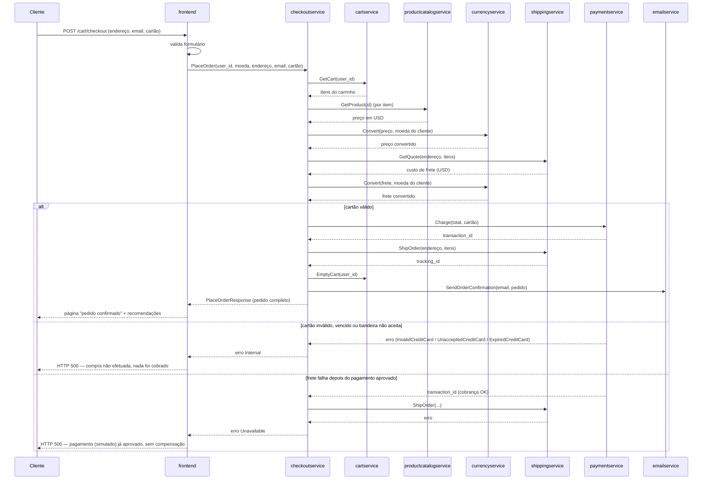
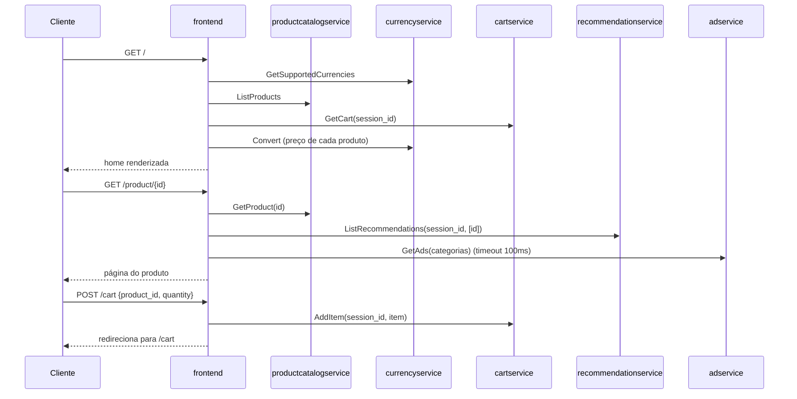
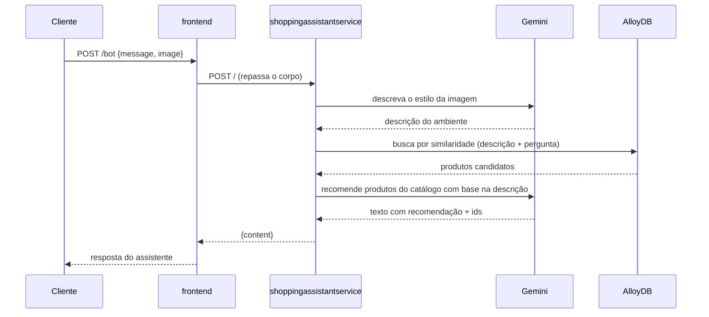

# Jornadas: Online Boutique

> **Em resumo:** a jornada central é a compra: o cliente navega sem login, monta um carrinho e
> fecha o pedido em uma única chamada síncrona orquestrada pelo `checkoutservice` (cobra, envia e
> notifica em sequência, sem fila). Há também a navegação/descoberta (home, catálogo, recomendação,
> anúncio) e, opcionalmente, um assistente de compras com IA. Nenhuma jornada usa um motor de
> processo — o checkout é orquestrado em código e as demais telas compõem chamadas HTTP/gRPC.
> Cada jornada lista só as regras que mudam o seu resultado; o conjunto completo está na
> [Referência](6-referencia.md#regras-de-negócio).

## Nesta página

| Seção |
|---|
| [Comprar um produto](#comprar-um-produto) |
| [Navegar e montar o carrinho](#navegar-e-montar-o-carrinho) |
| [Pedir ajuda ao assistente de compras (opcional)](#pedir-ajuda-ao-assistente-de-compras-opcional) |

## Comprar um produto

**Participantes:** `frontend`, `checkoutservice`, `cartservice`, `productcatalogservice`, `currencyservice`, `shippingservice`, `paymentservice`, `emailservice`, `recommendationservice`
> **Em resumo:** o cliente preenche endereço e cartão na tela de checkout; uma única chamada
> gRPC ao `checkoutservice` busca o carrinho, precifica em moeda local, cobra o cartão, despacha o
> frete, esvazia o carrinho e dispara o email — tudo antes de responder ao navegador.

### Em linguagem de negócio
| # | 🟨 Quem | 🟦 Faz | 🟧 Acontece | 🟪 Regra ou reação |
|---|---|---|---|---|
| 1 | Cliente | Preenche endereço, email e cartão e confirma a compra | Pedido solicitado | Formulário validado no frontend antes de seguir |
| 2 | Loja | Busca o carrinho do cliente e converte os preços para a moeda escolhida | Preço do pedido calculado | Inclui o frete já convertido |
| 3 | Loja | Cobra o valor total no cartão informado (simulado) | Pagamento aprovado *ou* recusado | Só aceita Visa/Mastercard com validade no mês atual ou posterior |
| 4 | Loja | Despacha o pedido para o endereço informado | Pedido enviado (rastreio gerado) | Só ocorre se o pagamento foi aprovado |
| 5 | Loja | Esvazia o carrinho e envia o email de confirmação | Pedido confirmado ao cliente | Falha aqui não desfaz a compra |

### Quem orquestra
`checkoutservice.PlaceOrder` chama, em sequência e de forma síncrona (dentro da mesma requisição
gRPC recebida do `frontend`): `cartservice`, `productcatalogservice`, `currencyservice`,
`shippingservice`, `paymentservice`, `cartservice` de novo (esvaziar) e `emailservice`. É uma sequência
orquestrada por código, sem compensação, não por um motor de processo nem por eventos.

### Passo a passo técnico

Após a resposta, o `frontend` ainda busca recomendações (`getRecommendations`) para mostrar na tela
de pedido confirmado — isso é best-effort e não bloqueia a exibição do pedido.

### Regras que mudam o resultado
Cartão: [R01/R02](6-referencia.md#regras-de-negócio). Frete: [R03](6-referencia.md#regras-de-negócio).
Pagamento antes do envio sem compensação: [R09](6-referencia.md#regras-de-negócio) e decisão
pendente [Q06](6-referencia.md#pendências). Email e limpeza do carrinho não bloqueiam: [R07](6-referencia.md#regras-de-negócio).

**Fontes:** `src/checkoutservice/main.go` (função `PlaceOrder` e auxiliares),
`src/frontend/handlers.go` (`placeOrderHandler`), `src/paymentservice/charge.js`,
`src/shippingservice/quote.go`, `protos/demo.proto`.

---

## Navegar e montar o carrinho

**Participantes:** `frontend`, `productcatalogservice`, `currencyservice`, `cartservice`, `recommendationservice`, `adservice`
> **Em resumo:** da home ao carrinho, cada tela busca só o que precisa conforme o handler da tela — sem
> orquestrador, sem estado de sessão no servidor além do cookie `shop_session-id`.

### Em linguagem de negócio
| # | 🟨 Quem | 🟦 Faz | 🟧 Acontece | 🟪 Regra ou reação |
|---|---|---|---|---|
| 1 | Cliente | Abre a loja | Sessão iniciada (cookie gerado) | Sem cadastro nem login |
| 2 | Cliente | Vê produtos ou entra no detalhe de um item | Produto visualizado | Anúncio e recomendações exibidos como complemento |
| 3 | Cliente | Adiciona item(s) ao carrinho | Item adicionado ao carrinho | Carrinho é por sessão (`user_id` = id da sessão) |
| 4 | Cliente | Troca a moeda de exibição | Preços recalculados | Não altera o carrinho, só a exibição |

### Quem orquestra
Ninguém — o `frontend` chama cada serviço dependente diretamente por handler HTTP, sem uma saga.

### Passo a passo técnico

### Regras que mudam o resultado
Anúncio tem timeout de 100 ms e some se falhar: [R04](6-referencia.md#regras-de-negócio).
Limites de recomendação e anúncio: [R05/R06](6-referencia.md#regras-de-negócio).

**Fontes:** `src/frontend/handlers.go` (`homeHandler`, `productHandler`, `addToCartHandler`),
`src/frontend/rpc.go`.

---

## Pedir ajuda ao assistente de compras (opcional)

**Participantes:** `frontend`, `shoppingassistantservice`
> **Em resumo:** só existe quando o componente Kustomize `shopping-assistant` está habilitado.
> Cliente envia uma foto do ambiente; o assistente descreve o estilo com Gemini, busca produtos
> parecidos por similaridade vetorial e devolve uma recomendação em texto.

### Em linguagem de negócio
| # | 🟨 Quem | 🟦 Faz | 🟧 Acontece | 🟪 Regra ou reação |
|---|---|---|---|---|
| 1 | Cliente | Envia foto do ambiente + pergunta | Pedido de sugestão recebido | Só disponível se `ENABLE_ASSISTANT=true` |
| 2 | Loja | Descreve o estilo da foto e busca produtos parecidos | Produtos candidatos encontrados | Busca por similaridade, não por regra fixa |
| 3 | Loja | Monta uma recomendação em texto com até 3 produtos | Sugestão entregue ao cliente | — |

### Quem orquestra
`shoppingassistantservice` — chama o Gemini duas vezes (descrever imagem, gerar recomendação) e o
AlloyDB uma vez (busca vetorial), com entrada pelo frontend e sem outro serviço de negócio durante a recomendação.

### Passo a passo técnico

### Regras que mudam o resultado
Só existe com o componente `shopping-assistant` ativo. A tabela de produtos com embeddings é
criada e populada pelos scripts `kustomize/components/shopping-assistant/scripts/1_*.sh` e `2_*.sh`
(passo a passo no README do componente). Os scripts geram embeddings com `textembedding-gecko@003`,
enquanto o serviço consulta com `models/embedding-001`: compatibilidade a confirmar ([Q08](6-referencia.md#pendências)).

**Fontes:** `src/shoppingassistantservice/shoppingassistantservice.py`,
`src/frontend/handlers.go` (`chatBotHandler`),
`kustomize/components/shopping-assistant/README.md`.
