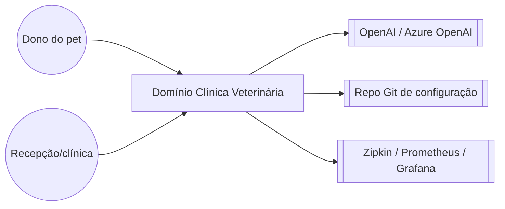

# Arquitetura: Clínica Veterinária

> **Em resumo:** microsserviços Spring Cloud — um serviço por subdomínio (donos/pets, visitas,
> veterinários, IA), um gateway de borda que agrega e roteia, três serviços de plataforma
> (config, descoberta, admin). Tudo síncrono via REST; sem fila, evento ou orquestrador.

## Nesta página

| Seção |
|---|
| [Contexto](#contexto) |
| [Subdomínios](#subdomínios) |
| [Mapa dos serviços](#mapa-dos-serviços) |
| [Estilo de integração](#estilo-de-integração) |
| [Decisões que moldam](#decisões-que-moldam) |
| [Riscos técnicos](#riscos-técnicos) |

## Contexto

O domínio não conversa hoje com outros domínios de negócio externos (não há integração com faturamento, laboratório, estoque, etc. neste repositório) — só com o front-end embutido, um provedor de LLM e a infraestrutura de plataforma/observabilidade.

## Subdomínios

| Subdomínio | Responsabilidade | Serviços |
|---|---|---|
| Cadastro | Dono do pet e seus pets (fonte de verdade) | `customers-service` |
| Atendimento | Histórico de visitas de cada pet | `visits-service` |
| Equipe clínica | Veterinários e especialidades | `vets-service` |
| Assistente de IA | Chat em linguagem natural sobre o domínio, com ações | `genai-service` |
| Borda | Front-end, roteamento e agregação para quem consome | `api-gateway` |
| Plataforma | Configuração, descoberta e observabilidade operacional | `config-server`, `discovery-server`, `admin-server` |

## Mapa dos serviços

<!-- MAPA-PRINCIPAL -->

O mapa mostra as dependências declaradas em [Serviços](3-servicos.md): a seta vai do consumidor ao
fornecedor. **Não é cronologia** — a ordem da ficha do dono (dono antes das visitas) está na
[jornada](4-jornadas.md#consultar-a-ficha-do-dono). Também omite dependências de plataforma: todos os
serviços de aplicação leem configuração do `config-server` e se registram no `discovery-server` ao
subir, mas essas relações só aparecem onde foram declaradas; não conclua ausência de acoplamento
pela ausência de seta. `visits-service` e `vets-service` não chamam outros serviços de negócio.

## Estilo de integração

Tudo é REST síncrono, com descoberta por nome no Eureka; não há mensageria nem motor de processo.
Dois pontos merecem atenção: o `api-gateway` **agrega** a ficha do dono (busca o dono, depois as
visitas dos pets, com circuit breaker e fallback vazio — sem compensação), e o `genai-service` usa
*tool calling*: o modelo escolhe, a cada mensagem, qual função Java de `PetclinicTools` chamar. A
entrada do chat passa pelo gateway (`/api/genai/chatclient`); as ações do chat chamam o
`customers-service` **direto**, sem gateway.

## Decisões que moldam

Nenhum ADR existe no repositório; as decisões abaixo foram **reconstruídas do código**. A motivação
é inferida; a consequência é observável.

| Decisão | Consequência | Fonte |
|---|---|---|
| Um serviço Spring Boot por subdomínio, descobertos via Eureka | Chamadas viram rede (latência, falha parcial); daí o circuit breaker no gateway | `docker-compose.yml`, `pom.xml` |
| `api-gateway` agrega dono + visitas no servidor | A ficha nunca falha por causa das visitas, mas esconde a indisponibilidade (histórico vazio) | `ApiGatewayController.java` |
| `genai-service` chama `customers-service` direto | Caminho de escrita fora do proxy central; o chat depende do contrato de `customers-service` | `AIDataProvider.java`, `PetclinicTools.java` |
| Configuração num repositório Git externo (Config Server) | Nada hardcoded, mas a configuração real de produção não está neste repositório | `config-server/.../application.yml` |
| Três serviços com banco de mesmo nome (`petclinic`), tabelas diferentes | Sem colisão hoje; se apontarem para a mesma instância MySQL, o isolamento por serviço some | `db/mysql/schema.sql` |
| Cache em memória da lista de veterinários (`@Cacheable("vets")`) | Leitura rápida; mudanças no banco podem demorar a aparecer | `VetResource.java` |

## Riscos técnicos

- **Ficha do dono "mente" sobre visitas ausentes:** se `visits-service` estiver fora ou lento, `api-gateway` devolve a ficha com visitas vazias em vez de erro — visualmente igual a "pet sem histórico" (ver [4-jornadas.md](4-jornadas.md#consultar-a-ficha-do-dono)).
- **`genai-service` pode criar dados sem validação de negócio equivalente ao front-end:** a ferramenta `addPetToOwner` aceita qualquer `typeId` inteiro; a lista de tipos válidos só existe como texto de instrução para o LLM, não como validação no `customers-service`.
- **Sem transação entre visits-service e customers-service:** uma visita pode ser registrada para um `petId` que não existe (bancos separados, sem checagem cruzada).
- **Banco MySQL compartilhado com o mesmo nome (`petclinic`) por três serviços:** se apontados para a mesma instância MySQL, `customers-service`, `vets-service` e `visits-service` usam o mesmo banco lógico (tabelas diferentes, sem colisão hoje, mas rompe o isolamento típico de "um banco por serviço") *(a confirmar se em produção cada serviço aponta para uma instância própria)*.
- **Cache de veterinários pode atrasar a visão de mudanças:** `@Cacheable("vets")` sem TTL visível neste repositório ([Q04](6-referencia.md#pendências)).
- **Sem observabilidade de negócio, só técnica:** métricas existentes (`@Timed petclinic.owner/pet/visit`) medem volume/latência de chamadas, não indicadores de negócio (ver [1-negocio.md](1-negocio.md#indicadores)).

**Fontes:** `docker-compose.yml` e `*/src/main/resources/application.yml` (rotas do gateway, dependências entre serviços); `ApiGatewayController.java`, `CustomersServiceClient.java`, `VisitsServiceClient.java` (agregação e circuit breaker); `AIDataProvider.java`, `PetclinicTools.java` (chamada direta do genai-service ao customers-service); `db/mysql/schema.sql` dos três serviços (mesmo nome de banco); busca no repositório por `*.bpmn`, `*.asl.json`, filas/tópicos (nenhum encontrado).
