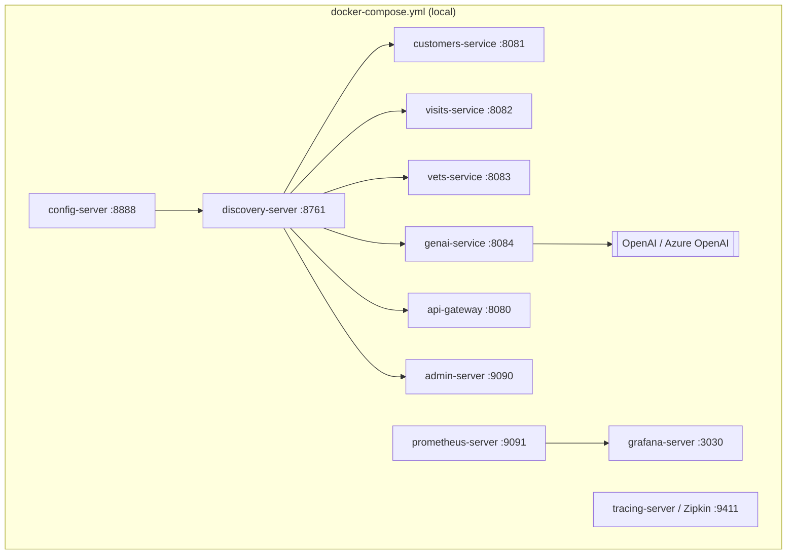

# Infraestrutura: Clínica Veterinária

> **Em resumo:** aplicações Spring Boot independentes, registradas num Eureka (`discovery-server`)
> e configuradas por um Config Server que busca valores num repositório Git externo. Sobe local
> via `docker-compose.yml` ou `mvnw`/`run_all.sh`; sem Terraform, Kubernetes ou CloudFormation.

## Nesta página

| Seção |
|---|
| [Ambientes](#ambientes) |
| [Recursos](#recursos) |
| [Implantação](#implantação) |

## Ambientes

| Ambiente | Como sobe | Diferenças |
|---|---|---|
| Local (IDE/Maven) | `../mvnw spring-boot:run` em cada módulo, ou `./scripts/run_all.sh` | Banco HSQLDB em memória (perfil padrão); Config e Discovery Server precisam subir primeiro |
| Local com chaos | `./scripts/run_all.sh --chaos-monkey` | Ativa o perfil `chaos-monkey` (Chaos Monkey for Spring Boot) em customers/vets/visits-service |
| Docker Compose | `docker compose up` (imagens construídas com `./mvnw clean install -P buildDocker` ou baixadas de `springcommunity/*` no Docker Hub) | Perfil Spring `docker`; serviços se aguardam por `depends_on`/`healthcheck` |
| MySQL opcional | Perfil Spring `mysql` em customers/vets/visits-service + `docker run mysql:8.4.5 ...` | Troca HSQLDB por MySQL persistente; schema/dados vêm de `db/mysql/{schema,data}.sql` |
| Produção real | *(a confirmar)* | Não há manifesto de nuvem (Terraform/K8s/CloudFormation) neste repositório; só existem imagens Docker publicadas em `springcommunity/*` no Docker Hub |

Topologia e configuração de produção não estão no repositório: [Q02](6-referencia.md#pendências).

## Recursos

| Recurso | Tipo | Tecnologia | Quem usa | Definido em |
|---|---|---|---|---|
| `discovery-server` | Registro de serviços | Eureka Server (Spring Cloud Netflix) | Todos os serviços de aplicação se registram/consultam | `spring-petclinic-discovery-server/` |
| `config-server` | Configuração centralizada | Spring Cloud Config Server | Todos os serviços importam config na subida (`optional:configserver:...`) | `spring-petclinic-config-server/`, aponta para o repositório Git externo `spring-petclinic-microservices-config` |
| Banco HSQLDB (padrão) | Banco em memória, um por serviço | HSQLDB | customers-service, vets-service, visits-service, genai-service | `*/src/main/resources/db/hsqldb/{schema,data}.sql` |
| Banco MySQL (opcional) | Banco relacional persistente | MySQL 8.4.x, driver `mysql-connector-j` | customers-service, vets-service, visits-service (perfil `mysql`) | `*/src/main/resources/db/mysql/{schema,data}.sql` |
| `admin-server` | Observabilidade operacional | Spring Boot Admin | Painel de saúde/métricas dos outros serviços via Eureka | `spring-petclinic-admin-server/` |
| `tracing-server` | Rastreamento distribuído | Zipkin (`openzipkin/zipkin`) | Todos os serviços (dependência `spring-boot-starter-zipkin`) publicam traces | `docker-compose.yml` |
| `prometheus-server` | Métricas | Prometheus | Coleta métricas Micrometer dos serviços | `docker/prometheus/prometheus.yml` |
| `grafana-server` | Dashboards | Grafana | Visualiza métricas do Prometheus (dashboard `Spring Petclinic Metrics`) | `docker/grafana/` |
| OpenAI / Azure OpenAI | LLM externo 🩷 | API de chat da OpenAI ou Azure OpenAI | genai-service (chat + tool calling) | `spring-petclinic-genai-service/src/main/resources/application.yml` (chaves via env `OPENAI_API_KEY`/`AZURE_OPENAI_*`, **não copiadas aqui**) |
| Repositório Git de configuração | Fonte de config externa 🩷 | GitHub `spring-petclinic/spring-petclinic-microservices-config` | config-server | `spring-petclinic-config-server/src/main/resources/application.yml` |

**Segredo encontrado (só localização, valor não copiado):** `spring-petclinic-genai-service/src/main/resources/application.yml` referencia as variáveis de ambiente `OPENAI_API_KEY`, `AZURE_OPENAI_KEY`, `AZURE_OPENAI_ENDPOINT` (linhas 9, 17-18, 25); `docker-compose.yml` as repassa como variáveis de ambiente do container `genai-service`.

## Implantação

Ordem de subida (via `depends_on` + `healthcheck` no `docker-compose.yml`): `config-server` saudável → `discovery-server` saudável → todos os demais serviços de aplicação. `tracing-server`, `prometheus-server` e `grafana-server` não têm dependência declarada.

**Fontes:** `docker-compose.yml` (serviços, portas, healthchecks, memória); `docker/Dockerfile`, `docker/grafana/`, `docker/prometheus/prometheus.yml`; `*/src/main/resources/application.yml` de cada serviço (import do config server, perfil `docker`); `spring-petclinic-config-server/src/main/resources/application.yml` (URI do repo Git); `README.md` (instruções de start local, MySQL, Grafana/Prometheus, Chaos Monkey); `*/pom.xml` (dependência `chaos-monkey-spring-boot` em customers/vets/visits-service). Ausência de Terraform/K8s/CloudFormation verificada por busca no repositório.
