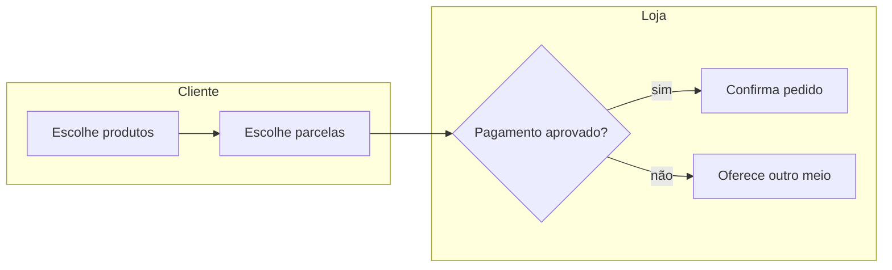
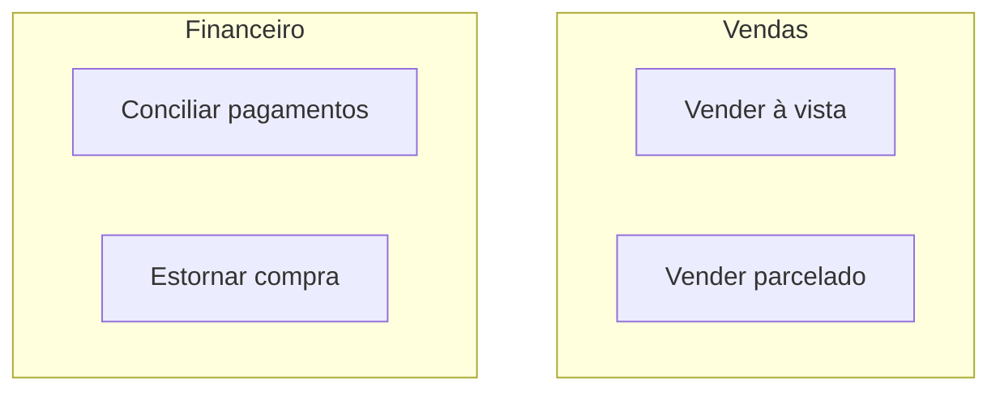
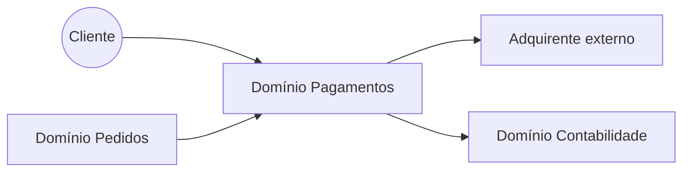
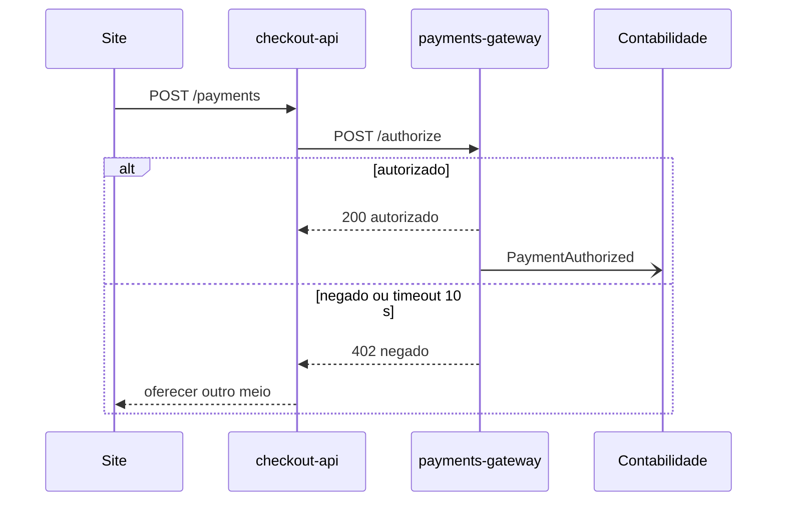
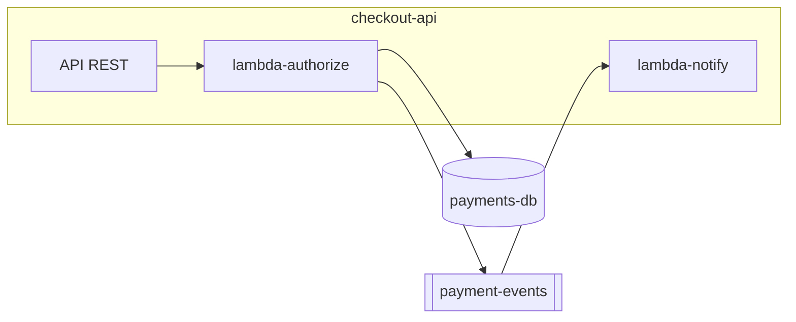
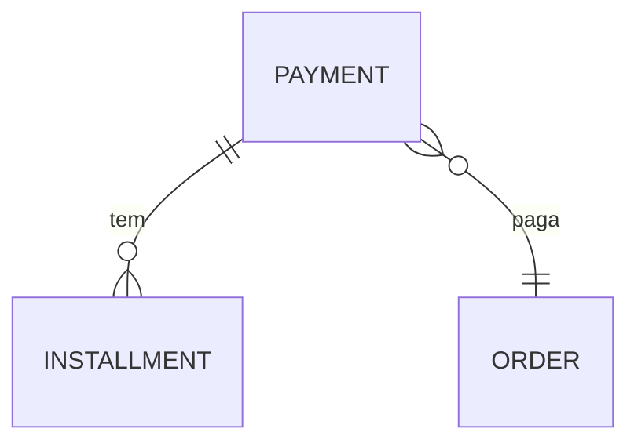
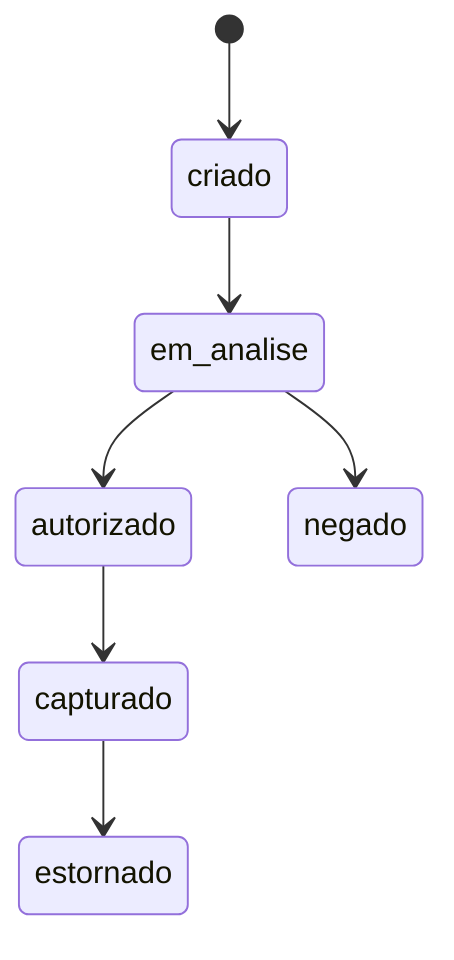
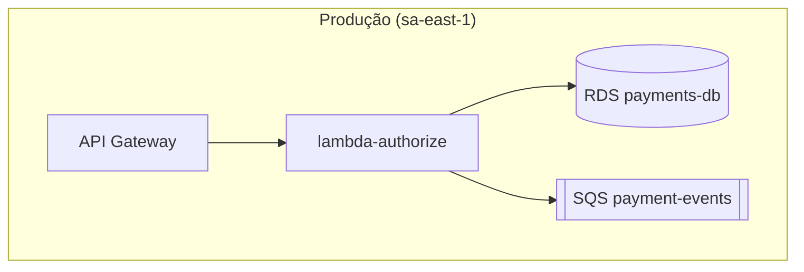

# Padrões de diagrama (Mermaid)

Um diagrama por pergunta. Poucos elementos (até ~12), rótulos curtos, nomes iguais aos do código.

## Fluxo macro com raias (camada 1)

Sem nomes de sistemas: só atores e etapas de negócio.

## Mapa de capacidades (camada 1)

## Contexto do domínio (camada 2)

## Sequência entre sistemas (camada 3)

Mostre respostas, eventos assíncronos (`-)`) e ao menos um caminho de erro relevante (`alt`).

## Contêiner do sistema (camada 4)

## Dados (camada 4)

## Estados (camada 4)

## Implantação (camada 6)

