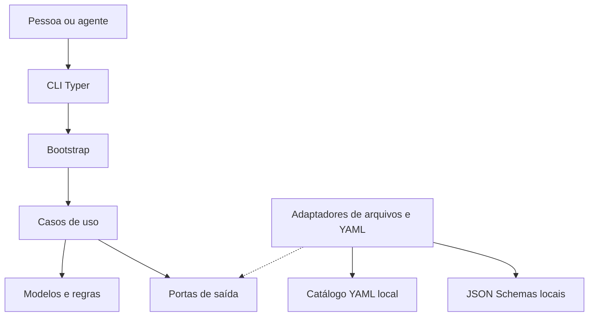
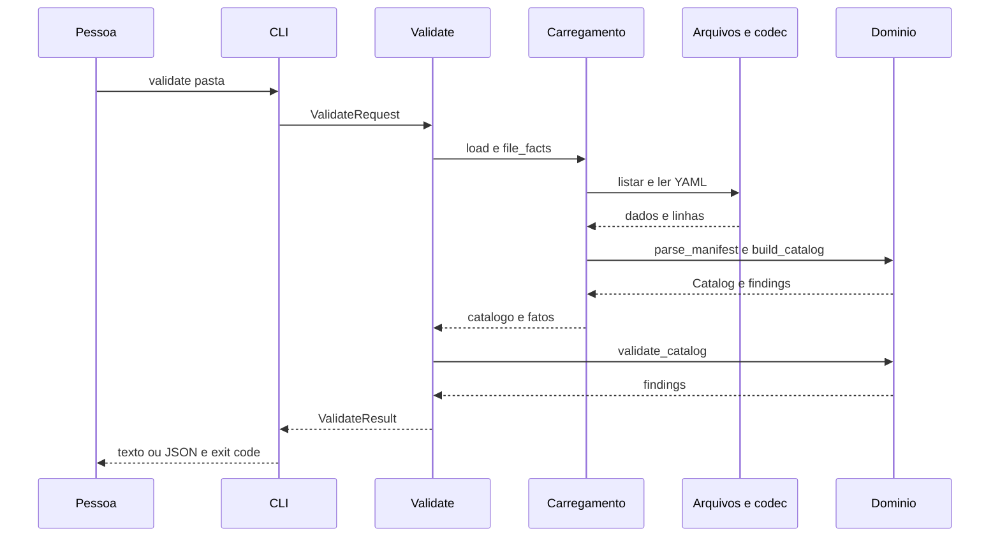

# Arquitetura observada do Sinter

## Architecture Analysis

### Visão do sistema e estilo

Aplicação de linha de comando, em um processo, com arquitetura hexagonal. A entrada Typer adapta argumentos e apresentação; `bootstrap.build` é a composição; casos de uso dependem de protocolos; domínio contém modelos, visões e regras. Persistência é o sistema de arquivos local: manifestos YAML de entrada e JSON Schemas de saída.

### Relações entre componentes

<!-- Text fallback: Pessoa ou agente chama a CLI; bootstrap compõe casos de uso, que usam domínio e portas. Adaptadores implementam portas para ler YAML e escrever schemas. -->

### Fluxo de dados e fronteiras

`load` enumera arquivos, separa documentos pelo codec, valida cada kind com Pydantic e monta `Catalog` com entradas por ID. Dados inválidos mantêm representação bruta para diagnósticos. A validação cruza o catálogo com `FileFacts` calculados pela aplicação; regras não fazem I/O. `Get` reutiliza o carregamento, monta visões em `levels` e agrega herança em `inheritance`. A saída é texto ou JSON camelCase.

### Decisões reconhecíveis no código

| Escolha observada | Benefício | Consequência |
|---|---|---|
| Protocolos e composição centralizada | Substituição de disco por memória em testes | Mais tipos e adaptadores |
| Arquivos YAML como fonte | Leitura humana e versionamento externo por Git | Catálogo inteiro é recarregado por consulta |
| Pydantic como contrato | Modelos e schemas derivados da mesma definição | Domínio depende de Pydantic |
| Regras puras registradas por código | Expansão por módulo e diagnóstico uniforme | Registro global e imports dinâmicos precisam permanecer determinísticos |

Não foram criadas novas decisões arquiteturais nesta análise. Alternativas como banco/servidor ou chamada direta a disco nos casos de uso não são implementadas; a tabela descreve efeitos observados, sem atribuir uma decisão humana que não foi lida.

### Segurança e melhorias a investigar

Nenhuma autenticação é necessária para um serviço porque não há serviço remoto observado; permissões são as do processo local. Os adaptadores concatenam raiz/base e caminhos sem conferir contenção após resolução: se catálogo ou destino vier de fonte não confiável, avaliar travessia de caminhos/symlinks. Há potencial de leitura de existência fora da raiz em docs. Não houve exploração nem execução.

## Interaction Diagrams

### Conferir catálogo

<!-- Text fallback: validate resolve a raiz, carrega YAML com linhas, cria catálogo, aplica regras puras e devolve relatório e código de saída. -->

### Consultar contexto e exportar contratos

`CLI → Get → load → Catalog.find/manifest → levels → inheritance → GetResult → render`.
`CLI → SchemaExport → contract_schemas → KINDS/published_results → LocalFiles → JSON Schema`.
São fluxos locais síncronos, sem broker, scheduler, API externa ou banco.

## Fontes

`sinter/src/sinter/bootstrap.py`; `application/{load,validate,get,schema_export}.py`; `domain/validation/engine.py`; `ports/`; `adapters/`; contratos import-linter em `sinter/pyproject.toml`. Diagramas conferidos estaticamente: participantes/nós declarados, nomes simples e delimitadores balanceados.

